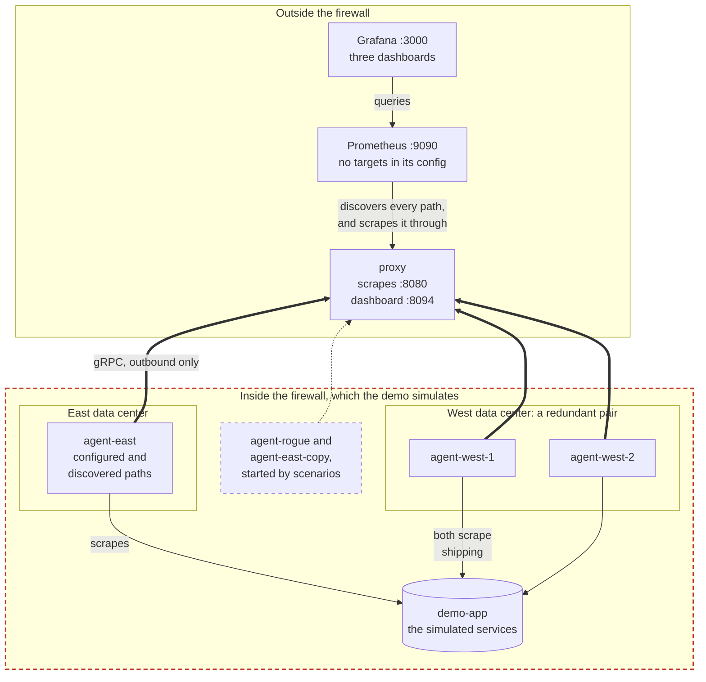

# Basics demo

A self-contained demo of Prometheus Proxy. It runs the proxy with its web dashboard, three agents behind a simulated
firewall, a set of simulated services, and Prometheus and Grafana, all on one laptop, and shows live traffic,
failures and recovery, redundancy, dynamic discovery, stale-agent eviction, per-team identities, and a misconfigured
duplicate agent.

The website's [Basics Demo](https://prometheus-proxy.com/basics-demo/) page walks through the same
scenarios with screenshots of the dashboard and Grafana.

Proxy failover, filtering at the agent, and tracing through the firewall are in the [network demo](../network), which
follows this one and puts a simulated WAN between the agents and the proxies.



## What you need

The proxy and agent are the latest release's images, from Docker Hub, so there's nothing to build. On macOS or Linux,
the demo needs only:

- [Docker](https://docs.docker.com/get-started/get-docker/) with Compose v2: Docker Desktop, or Docker Engine with the
  Compose plugin.
- `git`, to clone the repository, and GNU `make`. On macOS, the Xcode command-line tools (`xcode-select --install`)
  have both. Where GNU make is installed as `gmake`, type `gmake` wherever these instructions say `make`.
- `curl`, which the demo uses to wait for each service to answer.
- A web browser.

## Quick start

Clone the repository at the latest release, then run the demo's commands from its own directory, where `make help` lists
its targets:

```bash
git clone -c advice.detachedHead=false --depth 1 --branch 4.6.1 https://github.com/pambrose/prometheus-proxy.git
cd prometheus-proxy/demos/basics
make up      # pulls the images, starts everything, and prints the URLs
make tour    # walks through the guided tour below, pausing before each step
make down    # stops it and removes its containers, network, and volume
```

The first `make up` pulls the proxy, agent, Prometheus, Grafana, and Python images, which takes a few minutes. After
that it starts in under a minute, even without a network connection.

| What | URL |
|---|---|
| Proxy dashboard | <http://localhost:8094/dashboard> |
| Grafana (no sign-in needed; admin / admin to edit) | <http://localhost:3000> |
| Prometheus | <http://localhost:9090> (alerts at `/alerts`) |
| The proxy's service discovery | <http://localhost:8080/discovery> |

`make open` opens the proxy dashboard, Grafana, and Prometheus's alerts in your browser.

If a port is already taken, move it, for example with `DEMO_GRAFANA_PORT=3001 make up`. The variables are
`DEMO_DASHBOARD_PORT`, `DEMO_GRAFANA_PORT`, `DEMO_PROMETHEUS_PORT`, and `DEMO_PROXY_PORT`; the dashboard's links into
Prometheus and Grafana keep the default ports (`config/proxy.conf`). Every port binds to `127.0.0.1` only. The
dashboard runs without a login, but for part 10 of the tour, and Grafana uses its default admin password, so this
setup is for a laptop, not for anything shared.

## What's running

| Service | Role |
|---|---|
| `proxy` | The proxy, outside the firewall. Its dashboard is on; service discovery tells Prometheus about every path the agents register. |
| `agent-east` | The agent in the "east" data center. It scrapes the orders, payments, inventory, and catalog services, the proxy's own metrics, its own, and whatever its discovery file lists. |
| `agent-west-1`, `agent-west-2` | A redundant pair in the "west" data center. Both run consolidated and serve `shipping_metrics`, and the proxy merges their two replicas. |
| `agent-rogue` | Not started by default. `demo.sh rogue-agent` starts a contractor's agent whose identity may register only `contractor_*` paths, and which tries to register `payments_metrics` too. |
| `agent-east-copy` | Not started by default. `demo.sh duplicate-agent` starts a second copy of agent-east's config, without consolidated mode. |
| `demo-app` | The simulated services (`app/demo_app.py`). Traffic follows a 5-minute "day", so the graphs move. It also writes agent-east's discovery file. |
| `prometheus` | Scrapes every path through the proxy every 5s, with no target in its config. It loads the project's alerting rules (`grafana/alerts.yml`) and the demo's fast ones (`prometheus/demo-alerts.yml`). |
| `grafana` | Opens on the **Prometheus Proxy Demo** dashboard. The project's own **Prometheus Proxy** and **Prometheus Agents** dashboards (`grafana/*.json`) are linked from its top bar. |

## Guided tour

`make tour` walks through these parts one step at a time. To follow them here instead, run the scenario commands
from `demos/basics`; each one prints what to watch. Leave about a minute between parts so the graphs catch up.

### 1. How Prometheus scrapes services behind a firewall

The diagram above shows the setup. Prometheus pulls metrics, but the services live behind a firewall that allows no
inbound connections. The agents sit inside the firewall and connect *out* to the proxy over gRPC. Prometheus scrapes the proxy
as if it were each service. The demo simulates the firewall: its containers share one network, but Prometheus has no
targets of its own, so it reaches each service only through the proxy.

### 2. Agents, paths, and live scrapes on the proxy dashboard

Open the dashboard on the **Agents** view.

- Three agents are connected, each with its address and number of paths.
- Click **agent-east**. It shows its host, uptime, and idle time, the paths it registered with their labels, and the
  scrapes flowing through it live: status, time, and size. The catalog payload is about 480,000 characters, large
  enough that the agent sends it to the proxy in chunks.
- `/proxy_metrics` is the proxy's own metrics. They leave the proxy, go through an agent, and come back through the
  proxy to Prometheus, so the proxy monitors itself with the same path as everything else.
- Switch to **Paths**: every path, the agent serving it, its target, its last scrape, and its status.
  `/shipping_metrics` shows `agent-west-1 +1`: two agents serve it.
- Each row ends with links to its job in Prometheus and in Grafana, shown as their brand icons and filled from the
  label the agent registered the path with; the Grafana one is a way into the next part.

### 3. Target health and business metrics in Grafana

Open Grafana. It lands on the **Prometheus Proxy Demo** dashboard.

- **Through the firewall** shows the health of every target, scrape outcomes, latency, and payload size per path.
- **Business metrics from behind the firewall** shows orders, payments, inventory, and shipping. These are ordinary
  application metrics that Prometheus collected through the proxy.
- The **Prometheus Proxy** and **Prometheus Agents** links open the dashboards the project ships for operating the
  proxy itself.
- Prometheus's config lists no targets. It asks the proxy (`/discovery`) what exists, and each agent's labels set the
  `job`. Its answer is at <http://localhost:8080/discovery>.

### 4. One service fails, another hangs, and the rest keep working

```bash
./demo.sh outage          # payments now answers 500
```

- The dashboard: `/payments_metrics` turns red with a 500 in the Paths view, and in agent-east's recent scrapes.
- Grafana: payments turns red on **Target health**. After 15 seconds, **DemoTargetDown** fires (the **Alerts** stat and
  the **Firing alerts** table; also Prometheus's `/alerts` page).
- The other services keep working: one failing target never affects the rest.

```bash
./demo.sh slow            # inventory now hangs
```

- The agent gives up after its 3-second scrape timeout and reports 408 (`upstream_timed_out`), so Prometheus gets a
  clear answer instead of waiting. **Scrape latency** spikes for inventory only.

```bash
./demo.sh recover         # everything back to normal
```

### 5. A second agent keeps a path up when one stops

```bash
./demo.sh agent-stop      # stops agent-west-2
```

- agent-west-2 leaves the dashboard at once, and `/shipping_metrics` drops from `+1` to just agent-west-1.
- Grafana: **Shipping by replica** keeps west-1 flowing, and shipping stays green on **Target health**.

```bash
./demo.sh agent-start     # it reconnects and rejoins in seconds
```

### 6. New services appear without a restart

```bash
./demo.sh discover
```

- Within about 5 seconds, `/search_metrics`, `/recommendations_metrics`, and `/notifications_metrics` appear in the
  Paths view with source `disc` (discovered), alongside the `cfg` (configured) ones.
- Prometheus finds them through the proxy's service discovery, and Grafana's **Discovered services** panel fills. No
  restart, and no change to Prometheus's config.

```bash
./demo.sh undiscover      # they go away just as quietly
```

In the Paths view, a removed path that had been scraped stays listed as `gone`, so it's clear what left.

### 7. The proxy evicts an agent that goes silent

```bash
./demo.sh agent-freeze    # freezes agent-west-2: connected, but silent
```

- In the dashboard, click agent-west-2. Its **idle** time climbs and the **evicted in** countdown runs.
- A consolidated path waits for all of its agents, so `/shipping_metrics` stalls while agent-west-2 is frozen.
- After 30 seconds the proxy evicts it. **DemoAgentEvicted** fires, its own `/agent_west_2_metrics` path shows as
  `gone` (the status bar counts it as departed), the **Prometheus Proxy** dashboard's **Agent Events** panel records
  the eviction, and agent-west-1 carries shipping alone.

```bash
./demo.sh agent-thaw      # it reconnects and registers again
```

### 8. Per-team tokens restrict which paths an agent can register

The proxy has per-agent identities: each data center's agents connect with their own token, and an identity may
register only the paths its patterns allow.

```bash
./demo.sh rogue-agent     # a contractor's agent tries to register payments_metrics
```

- agent-rogue appears in the dashboard with the one path its identity allows, `/contractor_metrics`.
- Its `/payments_metrics` is refused, and the command prints the proxy's log line: *Agent identity 'contractor' denied
  registration of path /payments_metrics*. Payments keeps coming from agent-east, untouched: with a shared token, the
  newer agent would have taken the path over.

```bash
./demo.sh rogue-agent-stop
```

### 9. A duplicate agent takes over the paths, and the proxy logs the fix

```bash
./demo.sh duplicate-agent    # a second copy of agent-east, without consolidated mode
```

- Someone deployed agent-east's config twice. The copy registers the same paths, with the same identity, and the
  newer registration takes each one: the dashboard shows agent-east-copy with 6 paths and agent-east with 0.
- They settle. agent-east stays connected without paths rather than reconnecting and taking them back, which used to
  make two such agents swap the paths every few seconds. The command prints the proxy's log line, which names both
  agents and says the fix: `agent.consolidated = true` on each, if both should serve the paths.

```bash
./demo.sh duplicate-agent-stop   # removes the copy, and restarts agent-east to register again
```

### 10. A login for the dashboard

```bash
./demo.sh login       # restarts the proxy with a dashboard password in its environment
```

- Reload the dashboard: it shows its login page. Sign in as `admin`, with the password `admin`, and it opens the page
  you asked for; **Log out**, at the right end of the top bar, signs you out. A wrong password shows "Invalid username
  or password", and the proxy logs it at WARN.
- The password comes from the proxy's environment, `DEMO_DASHBOARD_PASSWORD` in `docker/compose.yml`, not from
  `config/proxy.conf`, so it never sits in a file. A script sends the login as HTTP Basic Auth instead:
  `curl -u admin:admin http://localhost:8094/dashboard/paths`.
- A restart clears what the proxy holds in memory, so this part comes last: the agents reconnect within a few seconds
  and register their paths again, and the dashboard's histories start over.

```bash
./demo.sh login-off   # restarts the proxy without the password
```

That's the tour. For proxy failover, filtering at the agent, and tracing through the firewall, go on to the
[network demo](../network). The same proxy and agent, deployed on Kubernetes with their Helm charts, are in the
[Kubernetes demo](../kubernetes), which needs kind, `kubectl`, and Helm as well as Docker. The demos use different
ports, so they can run side by side, but each takes memory and CPU: `make down` stops this one and frees its
resources.

## Scenario reference

| Command | Effect | How it works |
|---|---|---|
| `demo.sh outage [service]` | The service answers 500 (default `payments`) | demo-app's control API: `POST /control/<service>/error` |
| `demo.sh slow [service]` | The service hangs past the agent's scrape timeout (default `inventory`) | `POST /control/<service>/slow`: demo-app holds each request 10 seconds, past the agent's 3-second `scrapeTimeoutSecs` |
| `demo.sh recover` | Every service returns to normal | `POST /control/all/ok` |
| `demo.sh discover` / `undiscover` | Adds or removes the search, recommendations, and notifications services through agent-east's discovery file | demo-app rewrites `/discovery/targets.json`, which agent-east re-reads every 5 seconds |
| `demo.sh agent-stop` / `agent-start [agent]` | Stops or starts an agent (default `agent-west-2`) | `docker compose stop` / `start`: the agent's connection closes as it exits |
| `demo.sh agent-freeze` / `agent-thaw [agent]` | Pauses or resumes an agent's container (default `agent-west-2`) | `docker compose pause` / `unpause`: the connection stays open but silent, so the proxy evicts the agent after 30 seconds |
| `demo.sh rogue-agent` / `rogue-agent-stop` | Starts or removes the contractor's agent | Starts or removes `agent-rogue` (compose profile `rogue`), which presents the contractor identity's token, allowed only `contractor_*` paths |
| `demo.sh login` / `login-off` | Turns the dashboard's login on (`admin`, password `admin`) or off | Restarts the proxy with or without `DASHBOARD_PASSWORD`, from `DEMO_DASHBOARD_PASSWORD` in `docker/compose.yml` |
| `demo.sh duplicate-agent` / `duplicate-agent-stop` | Starts a second copy of agent-east, or removes it and restarts agent-east | Starts or removes `agent-east-copy` (profile `duplicate`): agent-east's config under another name, not consolidated |
| `make tour [PART=n]` | Walks through the guided tour above, from part 1 or the one given, pausing before each step |  |
| `make status` | The containers, the services' modes, and the URLs |  |
| `make logs [SERVICE=name]` | Follows the logs, of every service or the one given |  |

The services are `orders`, `payments`, `inventory`, `catalog`, and `shipping`, plus `search`, `recommendations`, and
`notifications` once discovered. Freezing `agent-east` also stops the proxy's own metrics, which travel through it.

## How it's put together

| File | What it sets up |
|---|---|
| `docker/compose.yml` | The services, their ports, and their images, and the proxy's dashboard password for part 10 |
| `config/proxy.conf` | The dashboard, service discovery, the per-agent identities, and a 30-second eviction limit, so part 7 fits a demo |
| `config/agent-duplicate.conf` | agent-east's config under another name, for part 9 |
| `config/agent-*.conf` | Each agent's proxy endpoint, identity token, paths, and their labels (the `job` Prometheus uses), discovery for agent-east, consolidated mode for the west pair, and a 3-second scrape timeout |
| `prometheus/prometheus.yml` | One HTTP service discovery job against the proxy |
| `prometheus/demo-alerts.yml` | The fast demo alerts |
| `grafana/` | The provisioned datasource, dashboard folder, and demo dashboard |
| `app/demo_app.py` | The simulated services and their control API |
| `Makefile` | The demo's targets: `make up`, `make up-local` (which runs the proxy and agent built from this checkout, for trying a change to them), `down`, `status`, `open`, `tour`, and `logs`, which `make help` lists, and `screenshots`, which it leaves out, since it's for maintaining the site |
| `demo.sh` | Starting, stopping, and the scenarios. Its `NEEDS_RELEASE_AFTER` is the latest release that predates what the demo shows: until a later one is out, `make up` builds the proxy and agent from this checkout, as `make up-local` does, so set it to the latest release when the demo comes to use something unreleased |
| `bin/screenshots.sh` | The Basics Demo page's screenshots, and the Dashboard page's of the login page, in the dark and light themes. `make screenshots` builds and starts the demo, waits a minute so the agents' uptimes read in minutes, plays the scenarios, and writes them to `website/prometheus-proxy/docs/images/demo/` (needs Chrome, ImageMagick 7, and `cwebp`). While checking a change, `SKIP_UPTIME_WAIT=1` skips the minute, so the shots show uptimes in seconds and aren't for the site, and `WAIT_SECS` sets how long each wait for a scene may take before the script fails (default 150): `make screenshots SKIP_UPTIME_WAIT=1 WAIT_SECS=60` |

From the repository root, `make check-rules` validates the Prometheus config and both rule files with promtool, and
`ConfigFileKeysTest` checks every key in `config/*.conf` against `config/config.conf`, and that each file loads as the
proxy or agent loads it.

To change the demo dashboard, edit `grafana/dashboards/demo-overview.json` and run
`docker compose -f docker/compose.yml restart grafana`. Grafana doesn't reliably notice a change to a mounted file,
and Prometheus doesn't notice one at all, so `make up` reloads Prometheus's config and restarts Grafana each time.

## Troubleshooting

- **`port is already allocated`**: another service holds the port. Move it with the variables above.
- **The dashboard is empty, or shows only some agents**: the agents connect a few seconds after the proxy starts.
  Give it ten seconds, or check `make logs SERVICE=agent-east`.
- **A scenario left things in an odd state**: `./demo.sh recover`, `undiscover`, `agent-thaw`, `agent-start`,
  `rogue-agent-stop`, and `duplicate-agent-stop` undo every scenario. For a clean slate, `make down && make up`.
- The proxy logs a warning at startup that the dashboard has no authentication. That's expected here, and is why
  every port binds to `127.0.0.1`.
