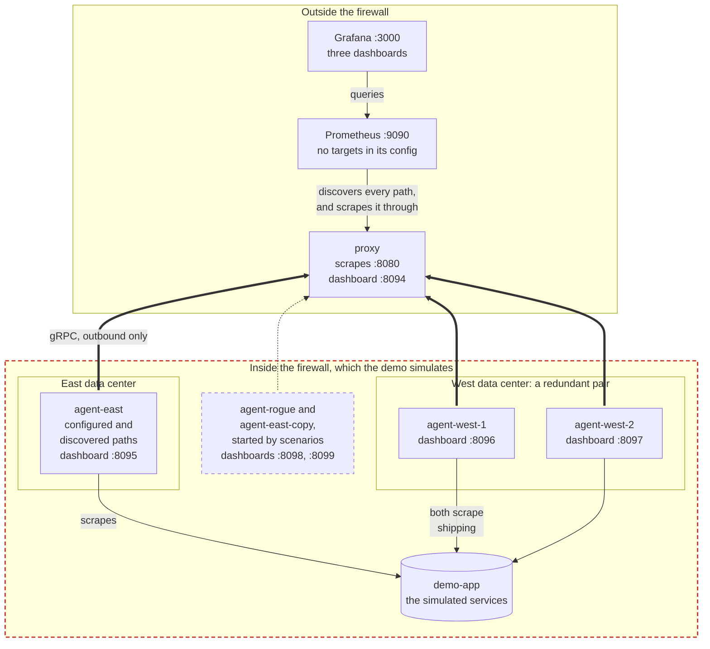

# Basics Demo

A self-contained demo of Prometheus Proxy. It runs the proxy with its web dashboard, three agents with theirs behind a
simulated firewall, a set of simulated services, and Prometheus and Grafana, all on one laptop, and shows live
traffic, failures and recovery, redundancy, dynamic discovery, stale-agent eviction, per-team identities, an agent's
view of a refused path and a lost proxy, and a misconfigured duplicate agent.

The website's [Basics Demo](https://prometheus-proxy.com/basics-demo/) page walks through the same
scenarios with screenshots of the dashboard and Grafana.

Proxy failover, filtering at the agent, and tracing through the firewall are in the [network demo](../network), which
follows this one and puts a simulated WAN between the agents and the proxies.



## Quick Start

On macOS or Linux, the demo needs [Docker](https://docs.docker.com/get-started/get-docker/) with Compose v2, `git`, GNU
`make`, and `curl`. Where GNU make is installed as `gmake`, type `gmake` wherever these instructions say `make`.

Clone the repository at the latest release, then run the demo's commands from its own directory, where `make help` lists
its targets:

```bash
git clone -c advice.detachedHead=false --depth 1 --branch 4.7.1 https://github.com/pambrose/prometheus-proxy.git
cd prometheus-proxy/demos/basics
make up      # pulls the images, starts everything, and prints the screens page's URL
make tour    # walks through the guided tour below, pausing before each step
make down    # stops it and removes its containers, network, and volume
```

The first `make up` pulls the proxy, agent, Prometheus, Grafana, and Python images, which takes a few minutes. After
that it starts in under a minute, even without a network connection.

Then open the proxy's screens page, one browser tab that holds every screen in the demo, each in a tab of its own: the
proxy's dashboard, each agent's, Prometheus, and Grafana. `make open` opens it, and the guided tour's links open in it:
<http://localhost:8094/>

Each screen also has an address of its own, which the table gives with the variable that moves its port:

| What | URL | Port variable |
|---|---|---|
| The screens page, every screen in one tab | <http://localhost:8094/> | `DEMO_DASHBOARD_PORT` |
| Proxy dashboard | <http://localhost:8094/dashboard> | `DEMO_DASHBOARD_PORT` |
| agent-east's dashboard | <http://localhost:8095/dashboard> | `DEMO_AGENT_EAST_DASHBOARD_PORT` |
| agent-west-1's dashboard | <http://localhost:8096/dashboard> | `DEMO_AGENT_WEST_1_DASHBOARD_PORT` |
| agent-west-2's dashboard | <http://localhost:8097/dashboard> | `DEMO_AGENT_WEST_2_DASHBOARD_PORT` |
| agent-rogue's dashboard, while its scenario runs | <http://localhost:8098/dashboard> | `DEMO_AGENT_ROGUE_DASHBOARD_PORT` |
| agent-east-copy's dashboard, while its scenario runs | <http://localhost:8099/dashboard> | `DEMO_AGENT_EAST_COPY_DASHBOARD_PORT` |
| Grafana (no sign-in needed; admin / admin to edit) | <http://localhost:3000> | `DEMO_GRAFANA_PORT` |
| Prometheus | <http://localhost:9090> (alerts at `/alerts`) | `DEMO_PROMETHEUS_PORT` |
| The proxy's service discovery | <http://localhost:8080/discovery> | `DEMO_PROXY_PORT` |

`make open` opens the screens page in your browser.

If a port is already taken, set its variable from the table for `make up`, for example `DEMO_GRAFANA_PORT=3001 make up`.
`make up` saves it in `docker/.env`, which every later command and docker compose read, so you set it once; delete its
line there to go back to the default. The screens page follows a moved port, while the proxy dashboard's links into
Prometheus and Grafana keep the default ports (`config/proxy.conf`).

Every port binds to `127.0.0.1` only. The dashboards run without a login, but for the proxy's in part 11 of the tour,
and Grafana uses its default admin password, so this setup is for a laptop, not for anything shared.

## What's Running

| Service | Role |
|---|---|
| `proxy` | The proxy, outside the firewall. Its dashboard is on; service discovery tells Prometheus about every path the agents register. |
| `agent-east` | The agent in the "east" data center. It scrapes the orders, payments, inventory, and catalog services, the proxy's own metrics, its own, and whatever its discovery file lists. Its own dashboard is on port 8095. |
| `agent-west-1`, `agent-west-2` | A redundant pair in the "west" data center. Both run consolidated and serve `shipping_metrics`, and the proxy merges their two replicas. Their dashboards are on ports 8096 and 8097. |
| `agent-rogue` | Not started by default. `demo.sh rogue-agent` starts a contractor's agent whose identity may register only `contractor_*` paths, and which tries to register `payments_metrics` too. Its dashboard is on port 8098. |
| `agent-east-copy` | Not started by default. `demo.sh duplicate-agent` starts a second copy of agent-east's config, without consolidated mode. Its dashboard is on port 8099. |
| `demo-app` | The simulated services (`app/demo_app.py`). Traffic follows a 5-minute "day", so the graphs move. It also writes agent-east's discovery file. |
| `prometheus` | Scrapes every path through the proxy every 5s, with no target in its config. It loads the project's alerting rules (`grafana/alerts.yml`) and the demo's fast ones (`prometheus/demo-alerts.yml`). |
| `grafana` | Opens on the **Prometheus Proxy Demo** dashboard. The project's own **Prometheus Proxy** and **Prometheus Agents** dashboards (`grafana/*.json`) are linked from its top bar. |

## What This Demo Shows

Each part of the guided tour, `make tour`, makes one point. A part's name links to its section under [Guided
Tour](#guided-tour).

| Part | What it shows | Why it matters |
|---|---|---|
| 1. [How Prometheus scrapes services behind a firewall](#1-how-prometheus-scrapes-services-behind-a-firewall) | Agents dial out to the proxy over gRPC, and Prometheus scrapes the proxy as if it were each service | A firewall that allows no inbound connections stays closed |
| 2. [Agents, paths, and live scrapes on the proxy dashboard](#2-agents-paths-and-live-scrapes-on-the-proxy-dashboard) | Every agent, the paths it registered, and each scrape as it happens, the proxy's own metrics included | One place to see who's connected and what's flowing, without reading logs |
| 3. [Target health and business metrics in Grafana](#3-target-health-and-business-metrics-in-grafana) | Target health, scrape outcomes, and the services' own metrics, which Prometheus finds through the proxy's discovery | Metrics arrive unchanged, and adding a service never touches Prometheus's config |
| 4. [An outage and a timeout](#4-an-outage-and-a-timeout) | A service that answers 500 and one that hangs, each reported on its own path while the rest keep answering | A failing target is named, and a hung one gets a timeout rather than stalling Prometheus |
| 5. [Two agents, one path](#5-two-agents-one-path) | One agent of a consolidated pair stops, and the other keeps their path up | Consolidated mode gives a path redundancy |
| 6. [New services, no restart](#6-new-services-no-restart) | Services added to an agent's discovery file are scraped within seconds, and leave as cleanly | Services come and go with no restart and no change to Prometheus |
| 7. [A silent agent is evicted](#7-a-silent-agent-is-evicted) | A frozen agent keeps its connection but goes quiet; the proxy evicts it after 30 seconds | A hung agent is found, and doesn't hold its paths |
| 8. [Per-team tokens](#8-per-team-tokens) | A contractor's agent is refused a path its identity doesn't allow, with the proxy's reason | One team's agent can't take over another team's metrics |
| 9. [A refused path, a lost proxy](#9-a-refused-path-a-lost-proxy) | The agent's own dashboard shows a refused path and a lost proxy, and Scrape now checks a target directly | When something's wrong, the agent's side says what, even while the proxy is down |
| 10. [A duplicate agent](#10-a-duplicate-agent) | A copy of an agent without consolidated mode takes its paths, the two settle, and the proxy logs the fix | A misdeployment is reported with its fix, not left to flap |
| 11. [A login for the dashboard](#11-a-login-for-the-dashboard) | A dashboard password from the proxy's environment, with signing in and out | The dashboard can be locked without a password in a file |

## Guided Tour

`make tour` walks through these parts one step at a time. To follow them here instead, run the scenario commands
from `demos/basics`; each one prints what to watch. Leave about a minute between parts so the graphs catch up.

### 1. How Prometheus Scrapes Services behind a Firewall

The diagram above shows the setup. Prometheus pulls metrics, but the services live behind a firewall that allows no
inbound connections. The agents sit inside the firewall and connect *out* to the proxy over gRPC. Prometheus scrapes
the proxy as if it were each service. The demo simulates the firewall: its containers share one network, but
Prometheus has no targets of its own, so it reaches each service only through the proxy.

Each tab along the top of the screens page is one of the boxes in the diagram: the proxy's dashboard, each agent's own,
Prometheus, and Grafana. A tab's dot is green while its screen answers; agent-rogue's and agent-east-copy's stay red
until the parts that start them. The links below open in it, so keep it open: <http://localhost:8094/screens>

### 2. Agents, Paths, and Live Scrapes on the Proxy Dashboard

Open the proxy's dashboard on the **Agents** view: <http://localhost:8094/screens#proxy>

- Three agents are connected, each with its address and number of paths.
- Click **agent-east**. It shows its host, uptime, and idle time, the paths it registered with their labels, and the
  scrapes flowing through it live: status, time, and size. The catalog payload is about 480,000 characters, large
  enough that the agent sends it to the proxy in chunks.
- `/proxy_metrics` is the proxy's own metrics. They leave the proxy, go through an agent, and come back through the
  proxy to Prometheus, so the proxy monitors itself with the same path as everything else.
- Switch to **Paths**: every path, the agent serving it, its target, its last scrape, and its status.
  `/shipping_metrics` shows one of the west agents, followed by `+1`: two agents serve it.
- Each row ends with links to its job in Prometheus and in Grafana, shown as their brand icons and filled from the
  label the agent registered the path with; the Grafana one is a way into the next part.

### 3. Target Health and Business Metrics in Grafana

Open Grafana, which lands on the **Prometheus Proxy Demo** dashboard: <http://localhost:8094/screens#grafana>

- **Through the firewall** shows the health of every target, scrape outcomes, latency, and payload size per path.
- **Business metrics from behind the firewall** shows orders, payments, inventory, and shipping. These are ordinary
  application metrics that Prometheus collected through the proxy.
- The **Prometheus Proxy** and **Prometheus Agents** links open the dashboards the project ships for operating the
  proxy itself.
- Prometheus's config lists no targets. It asks the proxy (`/discovery`) what exists, and each path's labels set the
  `job`. Its answer is at <http://localhost:8080/discovery>

### 4. An Outage and a Timeout

Watch the proxy's failing paths beside Grafana. The screens page's Split layout shows two screens side by side, each at
its own narrow layout, too narrow for the **Paths** table's status column, so the link filters the table to problems:
it lists only failing paths, none yet. <http://localhost:8094/screens#proxy/paths?problems=1+grafana>

```bash
./demo.sh outage          # payments now answers 500
```

- The dashboard: `/payments_metrics` appears in the filtered Paths view, and the status bar counts it as failing.
  Unfiltered, its row shows the 500, as do agent-east's recent scrapes.
- Grafana: payments turns red on **Target health**. After 15 seconds, **DemoTargetDown** fires (the **Alerts** stat and
  the **Firing alerts** table; also Prometheus's `/alerts` page).
- The other services keep working: one failing target never affects the rest.

```bash
./demo.sh slow            # inventory now hangs
```

- The agent gives up after its 3-second scrape timeout and reports 408 (`upstream_timed_out`), so Prometheus gets a
  clear answer instead of waiting. `/inventory_metrics` joins `/payments_metrics` in the filtered Paths view, and
  **Scrape latency** spikes for inventory only.

```bash
./demo.sh recover         # everything back to normal
```

Within a scrape or two the filtered Paths view is empty again, and Grafana's rows turn green.

### 5. Two Agents, One Path

```bash
./demo.sh agent-stop      # stops agent-west-2
```

- agent-west-2 leaves the dashboard at once, and `/shipping_metrics` drops from `+1` to just agent-west-1.
- Grafana: **Shipping by replica** keeps west-1 flowing, and shipping stays green on **Target health**.

```bash
./demo.sh agent-start     # it reconnects and rejoins in seconds
```

### 6. New Services, No Restart

```bash
./demo.sh discover
```

- Within about 5 seconds, `/search_metrics`, `/recommendations_metrics`, and `/notifications_metrics` appear in the
  Paths view with source `disc` (discovered), alongside the `cfg` (configured) ones.
- Prometheus finds them through the proxy's service discovery, and Grafana's **Discovered services** panel fills. No
  restart, and no change to Prometheus's config.

```bash
./demo.sh undiscover      # they go away just as quietly
```

In the Paths view, a removed path that had been scraped stays listed as `gone`, so it's clear what left.

### 7. A Silent Agent Is Evicted

```bash
./demo.sh agent-freeze    # freezes agent-west-2: connected, but silent
```

- In the dashboard, click agent-west-2. Its **idle** time climbs and the **evicted in** countdown runs.
- A consolidated path waits for all of its agents, so `/shipping_metrics` stalls while agent-west-2 is frozen.
- After 30 seconds the proxy evicts it. **DemoAgentEvicted** fires, its own `/agent_west_2_metrics` path shows as
  `gone` (the status bar counts it as departed), Grafana's **Agent disconnects at the proxy, by reason** shows it as
  an `eviction`, and agent-west-1 carries shipping alone.

```bash
./demo.sh agent-thaw      # it reconnects and registers again
```

### 8. Per-Team Tokens

The proxy has per-agent identities: each data center's agents connect with their own token, and an identity may
register only the paths its patterns allow.

```bash
./demo.sh rogue-agent     # a contractor's agent tries to register payments_metrics
```

- agent-rogue appears in the dashboard with the one path its identity allows, `/contractor_metrics`.
- Its `/payments_metrics` is refused, and the command prints the proxy's log line: *Agent identity 'contractor' denied
  registration of path /payments_metrics*. Payments keeps coming from agent-east, untouched: with a shared token, the
  newer agent would have taken the path over.
- The Agents and Paths views can't show a refusal, since the proxy added nothing. The **Activity** view lists it as
  `rejected`, with the proxy's reason, searched here for the contractor's agent:
  <http://localhost:8094/screens#proxy/activity?q=agent-rogue>
- Grafana's **Path rejections at the proxy, by cause** counts it as `not_authorized`, the cause the proxy gave the
  agent. The proxy counts every refusal in `proxy_path_rejections_total`, so an alert can catch a path that keeps
  being refused.

### 9. A Refused Path, a Lost Proxy

The proxy's dashboard shows only what reaches the proxy. A path the proxy refused, or a proxy an agent can't reach,
shows on the agent's side, so each agent here serves a dashboard of its own, on a port of its own (`agent.dashboard`
in `config/agent-*.conf`). This part starts with agent-rogue, which part 8 left running.

- agent-rogue's **Paths** view gives each path a light, green while the proxy routes the path's scrapes to this agent.
  `/contractor_metrics` is green, and `/payments_metrics` is red, tagged `refused`:
  <http://localhost:8094/screens#agent-rogue>
- Click `/payments_metrics`. Under **Refused by the proxy** is the proxy's reason, *Agent identity 'contractor' is not
  authorized to register path /payments_metrics*. Asking again wouldn't change the answer, so the agent doesn't try
  the path again until it reconnects.
- Its **Activity** view lists what has happened to the agent, newest first. Its entries show the agent connecting to
  the proxy, registering `/contractor_metrics`, and being refused `/payments_metrics`. **Problems only** leaves just
  the refusal.

```bash
./demo.sh rogue-agent-stop
```

- agent-east's **Connection** view shows it connected to `proxy:50051`, its one proxy endpoint, with its discovery file
  below: <http://localhost:8094/screens#agent-east/connection>
- Its **Settings** view shows the settings it resolved: <http://localhost:8094/screens#agent-east/settings>

```bash
./demo.sh proxy-down      # stops the proxy
```

- The proxy's dashboard goes with it, but agent-east's keeps answering, since it runs on the agent. Its Connection
  view turns `failing`, and `proxy:50051` shows the error from the agent's last try. The agent tries again every 3
  seconds.
- The screens page stays open, since your browser already has it: its proxy tab turns red, and agent-east's keeps
  working. Don't reload it until the proxy is back.
- Its **Activity** view lists `disconnected`, then `connect failed`, once rather than for each retry. On its **Paths**
  view every path turns red, tagged `pending`.
- Select `/orders_metrics` there and click its **Scrape now** button, the circular arrow after its name. The agent
  fetches the orders service at once and shows a 200, with the metrics Prometheus would get: the target is fine, and
  what's lost is the way to the proxy. Scrape now works whether or not the proxy has the path.
- Prometheus can't reach the proxy either, so every target turns DOWN on Grafana's **Target health**.

```bash
./demo.sh proxy-up        # starts it again
```

- Within a few seconds agent-east connects and registers its paths again: its Connection view turns `connected`, its
  paths turn green, and **Activity** lists `connected` and `registered`. A new proxy holds nothing from the old one,
  so the proxy's dashboard starts its histories over.

### 10. A Duplicate Agent

```bash
./demo.sh duplicate-agent    # a second copy of agent-east, without consolidated mode
```

- Someone deployed agent-east's config twice. The copy registers the same paths, with the same identity, and the
  newer registration takes each one: the dashboard shows agent-east-copy with 6 paths and agent-east with 0.
- They settle. agent-east stays connected without paths and waits, rather than the two taking the paths from each
  other every few seconds. The command prints the proxy's log line, which names both agents by agentId and says the
  fix: `agent.consolidated = true` on each, if both should serve the paths.
- The proxy told agent-east. Its own dashboard lists its six paths as `retrying`, each taken over by agent-east-copy,
  and its **Activity** view has the takeover: <http://localhost:8094/screens#agent-east>
- The copy's own dashboard lists the six paths, each green, since the proxy accepted every one:
  <http://localhost:8094/screens#agent-east-copy>

```bash
./demo.sh duplicate-agent-stop   # removes the copy; agent-east takes its paths back
```

The proxy tells agent-east, which was waiting, that no agent serves its paths any more, and it takes them back within
seconds, on the connection it kept, with no restart.

### 11. A Login for the Dashboard

```bash
./demo.sh login       # restarts the proxy with a dashboard password in its environment
```

- The screens page's proxy tab shows the login page in its frame, since the restarted proxy asks for one. Sign in
  there as `admin`, with the password `admin`, and the dashboard comes back: a login inside a frame works when the
  screen is on the same site as the page. **Log out**, the exit icon at the right end of the dashboard's top bar,
  signs you out. A wrong password shows "Invalid username or password", and the proxy logs it at WARN.
- The password comes from the proxy's environment, `DEMO_DASHBOARD_PASSWORD` in `docker/compose.yml`, not from
  `config/proxy.conf`, so it never sits in a file. A script sends the login as HTTP Basic Auth instead:
  `curl -u admin:admin http://localhost:8094/dashboard/paths`
- A restart clears what the proxy holds in memory, so this part comes last: the agents reconnect within a few seconds
  and register their paths again, and the dashboard's histories start over.

```bash
./demo.sh login-off   # restarts the proxy without the password
```

That's the tour. The other demos, in the order the docs site's [Demos](https://prometheus-proxy.com/demos/) page gives
them:

- [Network demo](../network): a simulated WAN between the agents and the proxies, and what a far, thin, dead, flaky, or
  missing link does
- [nginx demo](../nginx): nginx between the agents and the proxy, its stream timeouts, its reloads, and TLS ended on one
  port
- [Kubernetes demo](../kubernetes): the Helm charts on two kind clusters, with Kubernetes doing the operating and the
  target cluster exposing nothing
- [Ktor demo](../ktor): a coffee shop, a Ktor app that runs the agent in its own JVM through the Ktor plugin
- [Spring Boot demo](../spring-boot): a roastery, a Spring Boot app in Java whose agent the starter starts from
  properties
- [Plain Kotlin demo](../plain-kotlin): a bakery's ovens, workers with no framework or HTTP server, each reading its own
  metrics in-process

The demos use different ports, so they can run side by side, but each takes memory and CPU: `make down` stops this one
and frees its resources.

## Scenario Reference

| Command | Effect | How it works |
|---|---|---|
| `demo.sh outage [service]` | The service answers 500 (default `payments`) | demo-app's control API: `POST /control/<service>/error` |
| `demo.sh slow [service]` | The service hangs past the agent's scrape timeout (default `inventory`) | `POST /control/<service>/slow`: demo-app holds each request 10 seconds, past the agent's 3-second `scrapeTimeoutSecs` |
| `demo.sh recover` | Every service returns to normal | `POST /control/all/ok` |
| `demo.sh discover` / `undiscover` | Adds or removes the search, recommendations, and notifications services through agent-east's discovery file | demo-app rewrites `/discovery/targets.json`, which agent-east re-reads every 5 seconds |
| `demo.sh agent-stop` / `agent-start [agent]` | Stops or starts an agent (default `agent-west-2`) | `docker compose stop` / `start`: the agent's connection closes as it exits |
| `demo.sh agent-freeze` / `agent-thaw [agent]` | Pauses or resumes an agent's container (default `agent-west-2`) | `docker compose pause` / `unpause`: the connection stays open but silent, so the proxy evicts the agent after 30 seconds |
| `demo.sh rogue-agent` / `rogue-agent-stop` | Starts or removes the contractor's agent | Starts or removes `agent-rogue` (compose profile `rogue`), which presents the contractor identity's token, allowed only `contractor_*` paths |
| `demo.sh proxy-down` / `proxy-up` | Stops or starts the proxy | `docker compose stop` / `start proxy`: each agent's connection closes, and the agent tries again every 3 seconds (`agent.internal.reconnectPauseSecs`) until the proxy is back |
| `demo.sh login` / `login-off` | Turns the dashboard's login on (`admin`, password `admin`) or off | Restarts the proxy with or without `DASHBOARD_PASSWORD`, from `DEMO_DASHBOARD_PASSWORD` in `docker/compose.yml` |
| `demo.sh duplicate-agent` / `duplicate-agent-stop` | Starts a second copy of agent-east, or removes it, and agent-east takes its paths back | Starts or removes `agent-east-copy` (profile `duplicate`): agent-east's config under another name, not consolidated |
| `make tour [PART=n]` | Walks through the guided tour above, from part 1 or the one given, pausing before each step |  |
| `make status` | The containers, the services' modes, and the URLs |  |
| `make logs [SERVICE=name]` | Follows the logs, of every service or the one given |  |
| `make open` | Opens the proxy's screens page, which holds every screen, in the browser |  |

The services are `orders`, `payments`, `inventory`, `catalog`, and `shipping`, plus `search`, `recommendations`, and
`notifications` once discovered. Freezing `agent-east` also stops the proxy's own metrics, which travel through it.

## How It's Put Together

| File | What it sets up |
|---|---|
| `docker/compose.yml` | The services, their ports, and their images, and the proxy's dashboard password for part 11 |
| `config/proxy.conf` | The dashboard, service discovery, the per-agent identities, and a 30-second eviction limit, so part 7 fits a demo |
| `config/agent-duplicate.conf` | agent-east's config under another name, with a dashboard port of its own, for part 10 |
| `config/agent-*.conf` | Each agent's proxy endpoint, identity token, dashboard port, paths, and their labels (the `job` Prometheus uses), discovery for agent-east, consolidated mode for the west pair, and a 3-second scrape timeout for agent-east and the west pair |
| `prometheus/prometheus.yml` | One HTTP service discovery job against the proxy |
| `prometheus/demo-alerts.yml` | The fast demo alerts |
| `grafana/` | The provisioned datasource, dashboard folder, and demo dashboard |
| `app/demo_app.py` | The simulated services and their control API |
| `Makefile` | The demo's targets: `make up`, `make up-local` (which runs the proxy and agent built from this checkout, for trying a change to them), `down`, `status`, `open`, `tour`, and `logs`, which `make help` lists, and `screenshots`, which it leaves out, since it's for maintaining the site |
| `demo.sh` | Starting, stopping, and the scenarios. Its `NEEDS_RELEASE_AFTER` is the newest release that lacks something the demo shows: until the release the docs give is later and its images are on Docker Hub, `make up` builds the proxy and agent from this checkout, as `make up-local` does, so set it to the latest release on Docker Hub when the demo comes to use something no release has yet |
| `bin/screenshots.sh` | The Basics Demo page's screenshots, agent-rogue's dashboard and the screens page among them, and the Dashboard page's of the login page and the screens page, in the dark and light themes. `make screenshots` builds and starts the demo, recreates the proxy so no path an earlier scenario left shows as gone, waits a minute so the agents' uptimes read in minutes, plays the scenarios, and writes them to `website/prometheus-proxy/docs/images/demo/` (needs Chrome, ImageMagick 7, and `cwebp`). While checking a change, `SKIP_UPTIME_WAIT=1` skips the minute, so the shots show uptimes in seconds and aren't for the site, and `WAIT_SECS` sets how long each wait for a scene may take before the script fails (default 150): `make screenshots SKIP_UPTIME_WAIT=1 WAIT_SECS=60` |

From the repository root, `make check-rules` validates the Prometheus config and both rule files with promtool, and
`ConfigFileKeysTest` checks every key in `config/*.conf` against `config/config.conf`, and that each file loads as the
proxy or agent loads it.

To change the demo dashboard, edit `grafana/dashboards/demo-overview.json` and run
`docker compose -f docker/compose.yml restart grafana`. Grafana doesn't reliably notice a change to a mounted file,
and Prometheus doesn't notice one at all, so `make up` reloads Prometheus's config and restarts Grafana each time.

## Troubleshooting

- **`port is already allocated`**, or **`ports are not available: … bind: address already in use`**: something
  already holds the port, another container for the first message, or another program on the machine for the second.
  Move it with the variables above.
- **The dashboard is empty, or shows only some agents**: the agents connect a few seconds after the proxy starts.
  Give it ten seconds, or check `make logs SERVICE=agent-east`.
- **A scenario left things in an odd state**: `./demo.sh recover`, `undiscover`, `agent-thaw`, `agent-start`,
  `rogue-agent-stop`, `proxy-up`, `duplicate-agent-stop`, and `login-off` undo every scenario. For a clean slate,
  `make down && make up`.
- The proxy logs warnings at startup that the dashboard has no authentication, and that agent tokens are sent without
  TLS; each agent logs the same for its own dashboard, which listens on every interface in its container, and that its
  token crosses without TLS. All are expected here, and are why every port binds to `127.0.0.1`.
