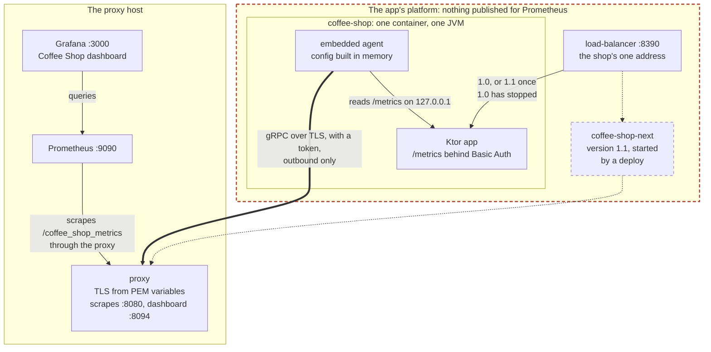

# Embedded demo

A self-contained demo of Prometheus Proxy's agent embedded in an app. A coffee shop, a small Ktor app with built-in
customers, runs the agent inside its own JVM. The agent connects to a proxy, and Prometheus and Grafana sit beside
the proxy, as they would on a proxy host in the cloud. The demo runs on one laptop and shows the app's metrics
reaching Grafana with no port opened for them. It also shows a rush, a failure that fires an alert, a deploy that
hands the agent's paths to the new version, the proxy going away while the app keeps serving, and secrets that come
from the environment.

It's the setup the website's [Cloud Platforms](https://prometheus-proxy.com/cloud-platforms/) page
describes, on one machine, and the website's
[Embedded Demo](https://prometheus-proxy.com/embedded-demo/) page walks through it with screenshots.
Standalone agents behind a firewall, with the proxy's dashboard, are in the [basics demo](../basics).



## What you need

On macOS or Linux, the demo needs:

- [Docker](https://docs.docker.com/get-started/get-docker/) with Compose v2: Docker Desktop, or Docker Engine with the
  Compose plugin.
- `git`, to clone the repository, and GNU `make`. On macOS, the Xcode command-line tools (`xcode-select --install`)
  have both. Where GNU make is installed as `gmake`, type `gmake` wherever these instructions say `make`.
- `curl`, which the demo uses to wait for each service to answer, and to turn the coffee shop's knobs.
- A web browser.

`make up` runs the latest release's proxy image, from Docker Hub, and builds the coffee shop inside Docker against the
latest release's library, from Maven Central, so it needs no JDK. Until a release has everything the demo shows, it
builds from the checkout instead, which needs a JDK 17 or later, as `make up-local` always does.

## Quick start

Clone the repository at the latest release, then run the demo's commands from its own directory, where `make help` lists
its targets:

```bash
git clone -c advice.detachedHead=false --depth 1 --branch 4.6.0 https://github.com/pambrose/prometheus-proxy.git
cd prometheus-proxy/demos/embedded
make up      # builds the coffee shop, starts everything, and prints the URLs
make tour    # walks through the guided tour below, pausing before each step
make down    # stops it and removes its containers and network
```

The first `make up` pulls the images and builds the coffee shop, which takes a few minutes. After that it starts in
under a minute.

| What | URL |
|---|---|
| The coffee shop, through its load balancer | <http://localhost:8390> |
| Proxy dashboard | <http://localhost:8394/dashboard> |
| Grafana (no sign-in needed; admin / admin to edit) | <http://localhost:3300> |
| Prometheus | <http://localhost:9390> (alerts at `/alerts`) |
| The coffee shop's metrics, through the proxy | <http://localhost:8380/coffee_shop_metrics> |
| The agent's `/debug` page, on its admin port | <http://localhost:8393/debug> |

`make open` opens the coffee shop, the proxy dashboard, Grafana, and Prometheus's alerts in your browser.

The ports are the basics demo's plus 300, so the demos can run side by side. If a port is already taken, move it, for
example with `EMBEDDED_DEMO_GRAFANA_PORT=3301 make up`. The variables are `EMBEDDED_DEMO_APP_PORT`,
`EMBEDDED_DEMO_DASHBOARD_PORT`, `EMBEDDED_DEMO_GRAFANA_PORT`, `EMBEDDED_DEMO_PROMETHEUS_PORT`,
`EMBEDDED_DEMO_PROXY_PORT`, and `EMBEDDED_DEMO_AGENT_ADMIN_PORT`. Every port binds to `127.0.0.1` only. The dashboard
and the agent's admin endpoints have no authentication, the coffee shop's knobs need none, and Grafana uses its default
admin password, so this setup is for a laptop, not for anything shared.

## What's running

| Service | Role |
|---|---|
| `coffee-shop` | The app, version 1.0 (`app/`): a Ktor server whose built-in customers order over HTTP, and whose baristas brew from a queue. It serves its metrics, with Ktor's HTTP and the JVM's, at `/metrics` behind Basic Auth. The prometheus-proxy agent runs inside it, started from the app's code with a config built in memory from its environment, and reads `/metrics` on `127.0.0.1`. Its admin endpoints, `/debug` among them, are on port 8393, for debugging it. |
| `coffee-shop-next` | Not started by default. `demo.sh deploy` starts version 1.1 of the same image beside 1.0, as a rolling deploy does. |
| `load-balancer` | Caddy (`config/Caddyfile`), the coffee shop's one address, on port 8390, as a platform's load balancer is. It sends every request to 1.0, or to 1.1 once a deploy has stopped 1.0, so the status page, the order counter, and the knobs keep answering at the same URL through a deploy. |
| `proxy` | The stock proxy image, which takes its TLS certificate and key, and the agents' token, from environment variables, with no file mounted. Its agent port is reachable only on the compose network; its dashboard is on. |
| `prometheus` | Scrapes the coffee shop's paths through the proxy every 5s, and the proxy's own metrics. It loads the project's alerting rules (`grafana/alerts.yml`) and the coffee shop's (`prometheus/embedded-alerts.yml`). |
| `grafana` | Opens on the **Coffee Shop** dashboard. The project's own **Prometheus Proxy** and **Prometheus Agents** dashboards (`grafana/*.json`) are linked from its top bar. |

The secrets, the proxy's certificate and key, the certificate its agents trust, the token, and the password for
`/metrics`, are in `docker/.env`, which `make up` writes the first time it runs and docker compose reads. The
certificates are the repository's test ones (`testing/certs`), which are public, so this suits a laptop and nothing
else; the Cloud Platforms page shows how to make your own.

## Guided tour

`make tour` walks through these parts one step at a time. To follow them here instead, run the scenario commands
from `demos/embedded`; each one prints what to watch. Leave about a minute between parts so the graphs catch up.

### 1. An app with the agent embedded, and no port open for Prometheus

An app on a platform such as ECS, Cloud Run, or Azure Container Apps can't be scraped by a Prometheus outside the
platform without opening
its metrics to the internet. Here the agent runs inside the app instead, and connects out to the proxy.

- Open the coffee shop. Its status page shows the queue, the baristas on shift, and the drinks served so far.
- Try its metrics without the password, then through the proxy:

  ```bash
  ./demo.sh peek
  ```

  `/metrics` answers 401. The agent reads it on `127.0.0.1` with the credentials, which it holds in its config, so
  Prometheus scrapes the proxy at `/coffee_shop_metrics` and never needs the password or a way into the app.
- Open the proxy dashboard. One agent is connected, `coffee-shop-1.0`, named after the app's version, with two paths:
  the coffee shop's metrics, and the agent's own. It connected to the proxy over TLS.

### 2. The coffee shop's metrics in Grafana

Open Grafana. It lands on the **Coffee Shop** dashboard.

- **The coffee shop, scraped through its embedded agent**: the shop right now, drinks served a minute, the queue, the
  baristas, the rush, the espresso machine, and whether the last scrape through the proxy succeeded, then drinks by
  type, orders by outcome, the queue against the baristas, brew time, and the order counter's HTTP statuses.
- **The app and its runtime**: Ktor's HTTP latency and the JVM's heap, from Micrometer, as any Ktor app has, and how
  long each scrape through the proxy took.
- The **Prometheus Agents** link opens the project's agents dashboard, which shows the embedded agent like any other.

### 3. A rush fills the queue, and more baristas drain it

The customers order about one and a half drinks a second, which three baristas keep up with.

```bash
./demo.sh rush          # customers order three times as often
./demo.sh baristas 8    # once the queue has passed 30 and CoffeeQueueBacklog has fired
./demo.sh calm          # ends the rush, and sends the extra baristas home
```

The queue climbs on the status page and in **Queue and baristas**. Once it holds 40, the counter turns customers away
with a 429, and **Orders / sec, by outcome** shows them rejected. Eight baristas drain it.

### 4. The espresso machine breaks, and an alert fires

```bash
./demo.sh break-machine
./demo.sh fix-machine   # once CoffeeShopErrors has fired
```

Every espresso drink fails with a 503, about three orders in four. **Espresso** turns red, the failed orders
show by outcome and by HTTP status, and after 10 seconds `CoffeeShopErrors` fires on Prometheus's alerts page. The
proxy and the agent are untouched: the metrics report the failure, they don't fail.

### 5. A deploy hands the path to the new version

```bash
./demo.sh deploy        # starts version 1.1 beside 1.0, then stops 1.0
./demo.sh rollback      # puts 1.0 back, so the tour can be run again
```

Version 1.1's agent registers the same paths with the same token, and the proxy gives each path to the newer
registration; the command prints the proxy's log line. 1.0's agent stays connected without paths until its app stops.
The coffee shop's page, at the same address, now reads Version 1.1: its load balancer sends requests to 1.0 while it
runs and to 1.1 once it has stopped. On the dashboard, `coffee-shop-1.1` has the paths, and in Grafana the graphs go
on without a gap.

### 6. The agent's admin endpoints, for debugging it

When an embedded agent doesn't connect, or a path doesn't scrape, its admin endpoints show what it's doing. The coffee
shop's environment turns them on with `ADMIN_ENABLED`, and its `/debug` page with `DEBUG_ENABLED`, with nothing in its
code. The agent reads them itself, from the `x-coffee-shop-env` block of `docker/compose.yml`, beside
`METRICS_ENABLED`, which turns on the agent's own metrics:

```yaml
METRICS_ENABLED: "true"   # the agent's own metrics, on port 8083
ADMIN_ENABLED: "true"     # its admin endpoints, on port 8093, published on 127.0.0.1:8393
DEBUG_ENABLED: "true"     # adds /debug
```

```bash
./demo.sh debug
```

It calls each endpoint and shows what it answered:

| Endpoint | What it answers |
|---|---|
| `/ping` | `pong`, while the agent is running, for a liveness probe |
| `/version` | The agent's version, release date, and build time, as JSON |
| `/healthcheck` | The agent's health checks, as JSON: its own health, not its connection, so it stays healthy while the proxy is down |
| `/threaddump` | Every thread in the coffee shop's JVM, the app's as well as the agent's |
| `/debug` | Only with `DEBUG_ENABLED`: the agent's name, the ID the proxy gave it when it connected, which is empty while it isn't connected, the proxy it's connected to or trying, and each path with the URL it scrapes, the password masked |

When a path doesn't scrape, its URL on `/debug` is the first thing to check. Keep <http://localhost:8393/debug> open
for the next part, where the proxy goes away.

Turn them off once the agent works, since the admin port has no authentication and `/threaddump` shows the app's
threads: take `ADMIN_ENABLED` and `DEBUG_ENABLED` out of the app's environment and restart it, with no new build, and
set them again when you need to look. `ADMIN_PORT` moves the port. In code, `setting("admin.enabled", true)` and
`setting("admin.debugEnabled", true)` do the same, though the environment overrides them.

### 7. The proxy goes away, and the shop keeps serving

```bash
./demo.sh proxy-stop
./demo.sh order         # an order still goes through
./demo.sh debug         # the agent's AgentId is empty, and its /healthcheck still healthy
./demo.sh proxy-start   # once CoffeeShopDown has fired
```

The agent retries in the background, and the app's requests never wait on it. Grafana's **Scrape** turns
Down, its graphs stop, and `CoffeeShopDown` fires. The agent's `/debug` page shows an empty AgentId, since the agent
has lost its connection, and the proxy it keeps trying, while its `/healthcheck` still reads healthy. Once the proxy is
back, the agent reconnects within a few seconds and registers its paths again, `/debug` shows the AgentId the proxy gave
it, and the graphs resume, with a gap for the time the proxy was down.

### 8. The secrets come from the environment

```bash
./demo.sh secrets
```

It lists the coffee shop's and the proxy's secrets by name, and shows that the app's container holds no config file.
The app builds its agent's settings in code, `embeddedAgent { }`, so the token, the certificate it trusts,
and the password for its `/metrics` never sit in a file (`app/src/main/kotlin/coffeeshop/PrometheusAgent.kt`). The
proxy is the stock image, which has no shell to write a variable to a file, and takes its certificate and key as PEM,
base64-encoded, in `CERT_CHAIN_PEM` and `PRIVATE_KEY_PEM`. It logs only whether each is set.

That's the tour. The website's [Cloud Platforms](https://prometheus-proxy.com/cloud-platforms/) page
sets up the same thing for real, with the app on ECS, Cloud Run, or Azure Container Apps and the proxy on AWS, GCP,
Azure, DigitalOcean, or Railway.
Standalone agents behind a firewall are in the [basics demo](../basics), proxy failover and tracing in the
[network demo](../network), the Helm charts in the [Kubernetes demo](../kubernetes), and the agent in a Spring Boot app,
written in Java, in the [Spring Boot demo](../spring-boot). The demos use different
ports, so they can run side by side, but each takes memory and CPU: `make down` stops this one and frees its
resources.

## Scenario reference

| Command | Effect | How it works |
|---|---|---|
| `demo.sh peek` | Tries `/metrics` without the password, then reads it through the proxy | `curl` of the app's `/metrics`, then of the proxy's `/coffee_shop_metrics` |
| `demo.sh order [drink]` | Orders a drink at the counter (default `latte`) | `POST /orders?drink=<drink>` |
| `demo.sh rush` | Customers order three times as often | `POST /admin/rush?on=true` |
| `demo.sh baristas <count>` | Puts this many baristas on shift (1 to 12) | `POST /admin/baristas?count=<count>`: one sent home finishes the drink in hand |
| `demo.sh calm` | Ends the rush, and keeps three baristas | `POST /admin/rush?on=false` and `/admin/baristas?count=3` |
| `demo.sh break-machine` / `fix-machine` | Every espresso drink fails, or is served again | `POST /admin/machine?broken=true` / `false` |
| `demo.sh deploy` / `rollback` | Deploys version 1.1 beside 1.0 and stops 1.0, or puts 1.0 back | Starts `coffee-shop-next` (compose profile `deploy`), whose agent takes the paths, then stops `coffee-shop`, and the load balancer sends the shop's requests to 1.1; `rollback` the other way round |
| `demo.sh proxy-stop` / `proxy-start` | Stops or starts the proxy | `docker compose stop` / `start proxy`: the agent retries every 3 seconds until it's back |
| `demo.sh debug` | Calls each of the agent's admin endpoints, and shows its `/debug` page | `curl` of `/ping`, `/version`, `/healthcheck`, `/threaddump`, and `/debug` on the agent's admin port, which the coffee shop's environment turns on |
| `demo.sh secrets` | Shows where the secrets come from | The names of the app's and the proxy's variables, and the app's container's files |
| `make tour [PART=n]` | Walks through the guided tour above, from part 1 or the one given, pausing before each step |  |
| `make status` | The containers, the coffee shop's state, and the URLs |  |
| `make logs [SERVICE=name]` | Follows the logs, of every service or the one given |  |

The drinks are `espresso`, `latte`, `cappuccino`, `mocha`, `tea`, and `cold-brew`; the first four need the espresso
machine.

## How it's put together

| File | What it sets up |
|---|---|
| `app/` | The coffee shop: a Gradle project of its own, outside the repository's build, which reads the repository's version catalog (`settings.gradle.kts`). `Main.kt` is the Ktor module and its routes, `CoffeeShop.kt` the queue and baristas, `Customers.kt` the customers, who order over HTTP, `ShopMetrics.kt` its Micrometer meters, and `PrometheusAgent.kt` the embedded agent, started from a config built in memory. With `-PlocalProxy` it builds against this checkout's library (a composite build), as `make up-local` and CI do. |
| `app/Dockerfile` | Builds the coffee shop's image: compiled inside Docker against the latest release (`make up`), or from the build on the host (`make up-local`) |
| `docker/compose.yml` | The services, their ports, their images, and the secrets they read from `docker/.env`; the coffee shop's environment also turns on its agent's own metrics, admin endpoints, and `/debug` |
| `config/proxy.conf` | The proxy's dashboard and metrics; its TLS and token come from the environment |
| `config/Caddyfile` | The load balancer: 1.0 first, then 1.1, retrying a request whose version has gone |
| `prometheus/prometheus.yml` | The coffee shop's two paths through the proxy, and the proxy's own metrics |
| `prometheus/embedded-alerts.yml` | `CoffeeShopDown`, `CoffeeShopErrors`, and `CoffeeQueueBacklog` |
| `grafana/` | The provisioned datasource, dashboard folder, and Coffee Shop dashboard |
| `Makefile` | The demo's targets: `make up`, `make up-local`, `down`, `status`, `open`, `tour`, and `logs`, which `make help` lists, and `screenshots`, which it leaves out, since it's for maintaining the site |
| `demo.sh` | Starting, stopping, and the scenarios. It writes `docker/.env` the first time the demo starts. Its `NEEDS_RELEASE_AFTER` is the latest release that predates what the demo shows: until a later one is out, `make up` builds from this checkout, as `make up-local` does |
| `bin/screenshots.sh` | The Embedded Demo page's screenshots, in the dark and light themes. `make screenshots` builds and starts the demo, waits three minutes so Grafana's graphs have some history, plays the scenarios, and writes them to `website/prometheus-proxy/docs/images/embedded-demo/` (needs Chrome, ImageMagick 7, and `cwebp`). While checking a change, `SKIP_HISTORY_WAIT=1` skips the wait, and `WAIT_SECS` sets how long each wait for a scene may take before the script fails (default 150) |

From the repository root, `make check-rules` validates the Prometheus config and both rule files with promtool,
`ConfigFileKeysTest` checks every key in `config/proxy.conf` against `config/config.conf`, and CI builds the coffee
shop against the checkout (`./gradlew -p demos/embedded/app -PlocalProxy build`), so a change to the library's API
that breaks it fails the build.

## Troubleshooting

- **`port is already allocated`**: another service holds the port. Move it with the variables above.
- **The first `make up` is slow**: it downloads Gradle's dependencies to build the coffee shop; Docker keeps them, so
  the next build takes seconds.
- **The dashboard shows no agent**: the coffee shop's agent connects a few seconds after the proxy starts. Give it ten
  seconds, or check `make logs SERVICE=coffee-shop`, and `./demo.sh debug` for the proxy it's trying.
- **A scenario left things in an odd state**: `./demo.sh calm`, `fix-machine`, `rollback`, and `proxy-start` undo every
  scenario. For a clean slate, `make down && make up`.
- **New secrets**: delete `docker/.env`, and the next `make up` writes a new one, with a new token and password.
- The proxy logs a warning at startup that the dashboard has no authentication. That's expected here, and is why
  every port binds to `127.0.0.1`.
