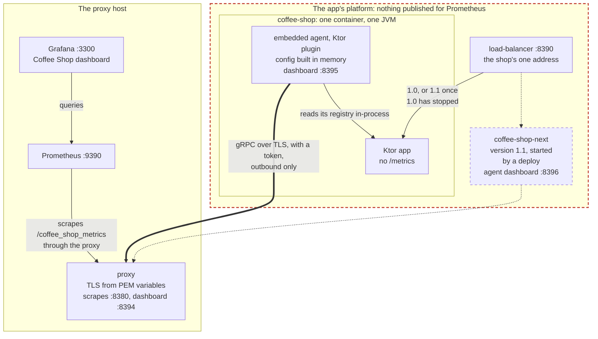

# Ktor Demo

A self-contained demo of Prometheus Proxy's agent embedded in an app. A coffee shop, a small Ktor app with built-in
customers, runs the agent inside its own JVM. The agent connects to a proxy, and Prometheus and Grafana sit beside
the proxy, as they would on a proxy host in the cloud. The demo runs on one laptop and shows the app's metrics
reaching Grafana with no port opened for them. It also shows the agent's own dashboard, served from inside the app, a
rush, a failure that fires an alert, a deploy that hands the agent's paths to the new version, the proxy going away
while the app keeps serving, and secrets that come from the environment.

It's the setup the website's [Cloud Platforms](https://prometheus-proxy.com/cloud-platforms/) page
describes, on one machine, and the website's
[Ktor Demo](https://prometheus-proxy.com/ktor-demo/) page walks through it with screenshots.
Standalone agents behind a firewall, with the proxy's dashboard, are in the [basics demo](../basics).



## Quick Start

On macOS or Linux, the demo needs [Docker](https://docs.docker.com/get-started/get-docker/) with Compose v2, `git`, GNU
`make`, and `curl`. Where GNU make is installed as `gmake`, type `gmake` wherever these instructions say `make`.

`make up` runs the latest release's proxy image, from Docker Hub, and builds the coffee shop inside Docker against the
latest release's library, from Maven Central, so it needs no JDK. Until a release with everything the demo shows is
on Docker Hub, it builds from the checkout instead, which needs a JDK 17 or later, as `make up-local` always does.

Clone the repository at the latest release, then run the demo's commands from its own directory, where `make help` lists
its targets:

```bash
git clone -c advice.detachedHead=false --depth 1 --branch 4.7.1 https://github.com/pambrose/prometheus-proxy.git
cd prometheus-proxy/demos/ktor
make up      # builds the coffee shop, starts everything, and prints the URLs
make tour    # walks through the guided tour below, pausing before each step
make down    # stops it and removes its containers and network
```

The first `make up` pulls the images and builds the coffee shop, which takes a few minutes. After that it starts in
under a minute.

Then open the proxy's [screens page](https://prometheus-proxy.com/web-dashboard/#screens), one browser tab that holds
every screen in the demo, each in a tab of its own: the proxy's dashboard, the coffee shop, its agent's dashboard, 1.1's
after a deploy, the agent's `/debug` page, Prometheus, and Grafana. `make open` opens it, and the guided tour's links
open in it: <http://localhost:8394/>

Each screen also has an address of its own, which the table gives with the variable that moves its port:

| What | URL | Port variable |
|---|---|---|
| The screens page, every screen in one tab | <http://localhost:8394/> | `KTOR_DEMO_DASHBOARD_PORT` |
| The coffee shop, through its load balancer | <http://localhost:8390> | `KTOR_DEMO_APP_PORT` |
| Proxy dashboard | <http://localhost:8394/dashboard> | `KTOR_DEMO_DASHBOARD_PORT` |
| Grafana (no sign-in needed; admin / admin to edit) | <http://localhost:3300> | `KTOR_DEMO_GRAFANA_PORT` |
| Prometheus | <http://localhost:9390> (alerts at `/alerts`) | `KTOR_DEMO_PROMETHEUS_PORT` |
| The coffee shop's metrics, through the proxy | <http://localhost:8380/coffee_shop_metrics> | `KTOR_DEMO_PROXY_PORT` |
| The coffee shop agent's dashboard | <http://localhost:8395/dashboard> | `KTOR_DEMO_AGENT_DASHBOARD_PORT` |
| Version 1.1's agent's dashboard, after `./demo.sh deploy` | <http://localhost:8396/dashboard> | `KTOR_DEMO_NEXT_AGENT_DASHBOARD_PORT` |
| The agent's `/debug` page, on its admin port | <http://localhost:8393/debug> | `KTOR_DEMO_AGENT_ADMIN_PORT` |

Each port is the basics demo's plus 300, so the demos can run side by side. If a port is already taken, set its variable
from the table for `make up`, for example `KTOR_DEMO_GRAFANA_PORT=3301 make up`. `make up` saves it in `docker/.env`,
which every later command and docker compose read, so you set it once; delete its line there to go back to the default.

Every port binds to `127.0.0.1` only. The dashboards and the agent's admin endpoints have no authentication, the coffee
shop's knobs need none, and Grafana uses its default admin password, so this setup is for a laptop, not for anything
shared.

## What's Running

| Service | Role |
|---|---|
| `coffee-shop` | The app, version 1.0 (`app/`): a Ktor server whose built-in customers order over HTTP, and whose baristas brew from a queue. Its metrics, with Ktor's HTTP and the JVM's, are in a Micrometer registry, and it serves no `/metrics`. The prometheus-proxy agent runs inside it, installed with the [Ktor plugin](https://prometheus-proxy.com/ktor-plugin/) from settings the app builds in memory from its environment, and reads the registry in-process. Its admin endpoints, `/debug` among them, are on port 8393, for debugging it, and its [dashboard](https://prometheus-proxy.com/agent-dashboard/) on port 8395. |
| `coffee-shop-next` | Not started by default. `demo.sh deploy` starts version 1.1 of the same image beside 1.0, as a rolling deploy does. Its agent's dashboard is on port 8396. |
| `load-balancer` | Caddy (`config/Caddyfile`), the coffee shop's one address, on port 8390, as a platform's load balancer is. It sends every request to 1.0, or to 1.1 once a deploy has stopped 1.0, so the status page, the order counter, and the knobs keep answering at the same URL through a deploy. |
| `proxy` | The stock proxy image, which takes its TLS certificate and key, and the agents' token, from environment variables, with none of them in a file. Its agent port is reachable only on the compose network; its dashboard is on. |
| `prometheus` | Scrapes the coffee shop's paths through the proxy every 5s, and the proxy's own metrics. It loads the project's alerting rules (`grafana/alerts.yml`) and the coffee shop's (`prometheus/ktor-alerts.yml`). |
| `grafana` | Opens on the **Coffee Shop** dashboard. The project's own **Prometheus Proxy** and **Prometheus Agents** dashboards (`grafana/*.json`) are linked from its top bar. |

The secrets, the proxy's certificate and key, the certificate its agents trust, and the token, are in `docker/.env`,
which `make up` writes the first time it runs, beside any port you moved, and docker compose reads. The certificates
are the repository's test ones (`testing/certs`), which are public, so this suits a laptop and nothing else; the Cloud
Platforms page shows how to make your own.

## What This Demo Shows

Each part of the guided tour, `make tour`, makes one point. A part's name links to its section under [Guided
Tour](#guided-tour).

| Part | What it shows | Why it matters |
|---|---|---|
| 1. [An app with the agent embedded, and no port open for Prometheus](#1-an-app-with-the-agent-embedded-and-no-port-open-for-prometheus) | The app serves no `/metrics`; the agent inside it reads its registry and sends the metrics out to the proxy | An app on ECS, Cloud Run, or Azure Container Apps is scraped with no port open |
| 2. [The agent's own dashboard, served from inside the app](#2-the-agents-own-dashboard-served-from-inside-the-app) | The agent's own dashboard, served from inside the app, and Scrape now reading the registry on demand | The agent's side of its connection, turned on from the environment with no rebuild |
| 3. [The coffee shop's metrics in Grafana](#3-the-coffee-shops-metrics-in-grafana) | The app's business metrics, Ktor's and the JVM's, and the embedded agent on the dashboard the project ships | Framework and runtime metrics come for free, and the agent needs no tooling of its own |
| 4. [A rush fills the queue, and more baristas drain it](#4-a-rush-fills-the-queue-and-more-baristas-drain-it) | A rush fills the queue and fires an alert, and more baristas drain it | The app's own metrics drive real alerts through the proxy |
| 5. [The espresso machine breaks, and an alert fires](#5-the-espresso-machine-breaks-and-an-alert-fires) | Espresso orders fail, and an error-rate alert fires | The metrics report a failure, rather than failing with it |
| 6. [A deploy hands the path to the new version](#6-a-deploy-hands-the-path-to-the-new-version) | Version 1.1's agent takes the path from 1.0's, with no gap in the graphs | Rolling deploys keep metrics continuous, and a failed one gives the path back |
| 7. [The agent's admin endpoints, for debugging it](#7-the-agents-admin-endpoints-for-debugging-it) | `/ping`, `/version`, `/healthcheck`, `/threaddump`, and `/debug`, turned on from the environment | Tools for an agent that won't connect or scrape, with no rebuild |
| 8. [The proxy goes away, and the shop keeps serving](#8-the-proxy-goes-away-and-the-shop-keeps-serving) | The shop keeps serving and its `/healthcheck` stays healthy while the proxy is down, and the agent reconnects | A proxy outage never becomes an app outage |
| 9. [The secrets come from the environment](#9-the-secrets-come-from-the-environment) | The app's token and certificate, and the proxy's, come from environment variables rather than files | It fits platforms that pass secrets as environment variables |

## Guided Tour

`make tour` walks through these nine parts one step at a time, about 23 minutes in all. To follow them here instead,
run the scenario commands from `demos/ktor`; most print what to watch. Leave about a minute between parts so the graphs
catch up.

### 1. An App with the Agent Embedded, and No Port Open for Prometheus

An app on a platform such as ECS, Cloud Run, or Azure Container Apps can't be scraped by a Prometheus outside the
platform without opening its metrics to the internet. Here the agent runs inside the app instead, and connects out to
the proxy.

- Open the coffee shop, <http://localhost:8394/screens#coffee-shop>. Its status page shows the queue, the baristas on
  shift, and the drinks served so far.
- Look for its metrics, then read them through the proxy:

  ```bash
  ./demo.sh peek
  ```

  The coffee shop has no `/metrics`, so it answers 404. The agent reads the app's registry in-process, so Prometheus
  scrapes the proxy at `/coffee_shop_metrics` and needs no password, port, or way into the app.
- Open the proxy dashboard, <http://localhost:8394/screens#proxy>. One agent is connected, `coffee-shop-1.0`, named
  after the app's version, with two paths: the coffee shop's metrics, and the agent's own. It connected to the proxy
  over TLS.

### 2. The Agent's Own Dashboard, Served from inside the App

The proxy's dashboard shows only what reaches the proxy. The agent serves a
[dashboard of its own](https://prometheus-proxy.com/agent-dashboard/), from inside the app, that shows its side: its
connection, each path's registration, its scrapes as it saw them, and what it did, in order.

- Open it: <http://localhost:8394/screens#agent>

  Its **Paths** view lists the agent's two paths, each with a green light; select one and its header reads
  `registered`: the proxy routes its scrapes to this agent. Beside each are the status of its last scrape and a strip
  of its recent scrapes, which fills as Prometheus scrapes every five seconds.
- Select `coffee_shop_metrics`. Its target is `in-process`, the app's registry, which the agent reads itself, and
  **Recent scrapes** lists the scrapes Prometheus asked for, newest first. **Scrape now** reads the registry at once,
  from inside the app, and shows the status, the size, the metric families and samples, and the start of the body. It
  works whether or not the proxy has the path, so when a path doesn't scrape, it tells you whether the agent can read
  the app's metrics.
- The **Connection** view reads `connected`, to `proxy:50051`, over TLS, with its token set, and in part 8 it says
  why the agent can't connect: <http://localhost:8394/screens#agent/connection>
- The **Settings** view lists the settings the agent resolved, its token shown only as set:
  <http://localhost:8394/screens#agent/settings>
- The **Activity** view lists what the agent did, newest first: the two paths `registered`, above `connected`. If the
  agent tried before the proxy was listening, a `connect failed` sits below them. Open it at
  <http://localhost:8394/screens#agent/activity>

The coffee shop's environment turns it on, with nothing in its code: `DASHBOARD_ENABLED: "true"` in the
`x-coffee-shop-env` block of `docker/compose.yml`, for both versions, and a `DASHBOARD_PORT` for each, 8395 for 1.0 and
8396 for 1.1, which the agent reads itself. Turning it off, or on again, takes a restart and no new build. In code,
`dashboard(port = 8395)` in the plugin's `agent { }` does the same, though the environment overrides it. It has no login
unless `DASHBOARD_PASSWORD` sets one, so the demo publishes it on `127.0.0.1`; on a platform, its port would stay on the
internal network.

### 3. The Coffee Shop's Metrics in Grafana

Open Grafana, <http://localhost:8394/screens#grafana>. It lands on the **Coffee Shop** dashboard.

- **The coffee shop, scraped through its embedded agent**: the shop right now, drinks served a minute, the queue, the
  baristas, the rush, the espresso machine, whether the last scrape through the proxy succeeded, and whether the agent
  is connected to the proxy, then drinks by type, orders by outcome, the queue against the baristas, brew time, and the
  order counter's HTTP statuses.
- **The app and its runtime**: Ktor's HTTP latency and the JVM's heap, from Micrometer, as any Ktor app has, and how
  long each scrape through the proxy took.
- The **Prometheus Agents** link opens the project's agents dashboard, which shows the embedded agent like any other.

### 4. A Rush Fills the Queue, and More Baristas Drain It

The customers order about one and a half drinks a second, which three baristas keep up with.

```bash
./demo.sh rush          # customers order three times as often
./demo.sh baristas 8    # once the queue has passed 30 and CoffeeQueueBacklog has fired
./demo.sh calm          # ends the rush, and sends the extra baristas home
```

Put the status page beside Grafana, <http://localhost:8394/screens#coffee-shop+grafana>. The queue climbs on the
status page and in **Queue and baristas**. Once it holds 40, the counter turns customers away
with a 429, and **Orders / sec, by outcome** shows them rejected. Eight baristas drain it.

### 5. The Espresso Machine Breaks, and an Alert Fires

```bash
./demo.sh break-machine
./demo.sh fix-machine   # once CoffeeShopErrors has fired
```

Every espresso drink fails with a 503, about three orders in four. **Espresso** turns red, the failed orders
show by outcome and by HTTP status, and within about half a minute `CoffeeShopErrors` fires on Prometheus's alerts
page: its rule reads the failed orders' share over a 30-second window, and has to stay above one in ten for 10 seconds.
The proxy and the agent are untouched: the metrics report the failure, they don't fail.

### 6. A Deploy Hands the Path to the New Version

```bash
./demo.sh deploy        # starts version 1.1 beside 1.0, then stops 1.0
./demo.sh rollback      # puts 1.0 back, so the tour can be run again
```

Version 1.1's agent registers the same paths with the same token, and the proxy gives each path to the newer
registration; the command prints the proxy's log line. 1.0's agent, told so, stays connected without paths until its
app stops, ready to take them back should 1.1 go away first, as a failed deploy's new version does.
The coffee shop's page, at the same address, now reads Version 1.1: its load balancer sends requests to 1.0 while it
runs and to 1.1 once it has stopped. On the proxy dashboard, `coffee-shop-1.1` has the paths, and in Grafana the graphs
go on without a gap.

Each version's agent has its own dashboard, inside its own app. 1.1's lists the two paths registered. Until 1.0
stopped, its dashboard showed them as `retrying`, taken over by `coffee-shop-1.1`. 1.0's dashboard stops with its app,
and answers again, starting over, after the rollback. 1.1's is at <http://localhost:8394/screens#agent-1-1>

### 7. The Agent's Admin Endpoints, for Debugging It

When an embedded agent doesn't connect, or a path doesn't scrape, its admin endpoints show what it's doing. The coffee
shop's environment turns them on with `ADMIN_ENABLED`, and its `/debug` page with `DEBUG_ENABLED`, with nothing in its
code. The agent reads them itself, from the `x-coffee-shop-env` block of `docker/compose.yml`:

```yaml
ADMIN_ENABLED: "true"     # its admin endpoints, on port 8093, published on 127.0.0.1:8393
DEBUG_ENABLED: "true"     # adds /debug
```

The agent's own metrics, which the **Prometheus Agents** dashboard reads, need no port: the app's code serves them, in
`PrometheusAgent.kt`, at the proxy's `/coffee_shop_agent_metrics`, with `agentMetricsAt`.

```bash
./demo.sh debug
```

It calls each endpoint and shows what it answered:

| Endpoint | What it answers |
|---|---|
| `/ping` | `pong`, while the agent is running, for a liveness probe |
| `/version` | The agent's version, release date, and build time, as JSON |
| `/healthcheck` | The agent's health checks, as JSON: its own health, not its connection, so it stays healthy while the proxy is down |
| `/threaddump` | Every thread in the coffee shop's JVM, the app's as well as the agent's |
| `/debug` | Only with `DEBUG_ENABLED`: the agent's name, the ID the proxy gave it when it connected, which is empty while it isn't connected, the proxy it's connected to or trying, and each path with the URL it scrapes, or `in-process` for the app's registry |

When a path doesn't scrape, its URL on `/debug` is the first thing to check: <http://localhost:8394/screens#debug>. The
next part comes back to it, with the proxy down, at its own address.

Turn them off once the agent works, since the admin port has no authentication and `/threaddump` shows the app's
threads: take `ADMIN_ENABLED` and `DEBUG_ENABLED` out of the app's environment and restart it, with no new build, and
set them again when you need to look. `ADMIN_PORT` moves the port. In code, `setting("admin.enabled", true)` and
`setting("admin.debugEnabled", true)` do the same, though the environment overrides them.

### 8. The Proxy Goes Away, and the Shop Keeps Serving

A health check that restarted the app whenever the proxy was down would turn a proxy outage into an app outage. The
agent's `/healthcheck` reports the agent itself, not its connection, and the app never waits on its agent, so the shop
keeps serving and stays healthy while its metrics stop.

```bash
./demo.sh proxy-stop
./demo.sh order         # an order still goes through
./demo.sh debug         # the agent's AgentId is empty, and its /healthcheck still healthy
./demo.sh proxy-start   # once CoffeeShopDown has fired
```

The agent retries in the background, and the app's requests never wait on it. Grafana's **Scrape** turns Down,
**Agent** reads Disconnected, its graphs stop, and `CoffeeShopDown` fires. The screens page is the proxy's, so until
the proxy is back, a link into it can't load, and this part gives each screen's own address. The agent's `/debug` page
shows an empty AgentId, since the agent has lost its connection, and the proxy it keeps trying, while its
`/healthcheck` still reads healthy: <http://localhost:8393/debug>

Once the proxy is back, the agent reconnects within a few seconds and registers its paths again, `/debug` shows the
AgentId the proxy gave it, and the graphs resume, with a gap for the time the proxy was down.

The agent's dashboard shows the outage more directly. Its **Connection** view reads `failing`,
with the error the agent's last try to reach `proxy:50051` got, and its paths read `pending`. A proxy that's down, a
wrong port, a refused token, and a TLS mismatch each show there, which makes it the first place to look when an agent
won't connect: <http://localhost:8395/dashboard/connection>

Once the proxy is back, the newest lines of the dashboard's **Activity** view, read from the bottom up, tell the outage
in order: `disconnected`, `connect failed`, then `connected` and the paths `registered`. **Problems only** keeps just
the `connect failed` lines. Open it at <http://localhost:8394/screens#agent/activity>

### 9. The Secrets Come from the Environment

```bash
./demo.sh secrets
```

It lists the coffee shop's and the proxy's secrets by name, and shows that the app's container holds no config file.
The app builds its agent's settings in code, in the Ktor plugin's `agent { }` block, where `fromEnvironment()` reads
them from its `PROMETHEUS_` variables, so the token and the certificate it trusts never sit in a file
(`app/src/main/kotlin/coffeeshop/PrometheusAgent.kt`). The proxy is the stock image, which has no shell to write a
variable to a file, and takes its certificate and key as PEM, base64-encoded, in `CERT_CHAIN_PEM` and
`PRIVATE_KEY_PEM`. It logs only whether each is set.

That's the tour. The website's [Cloud Platforms](https://prometheus-proxy.com/cloud-platforms/) page sets up the same
thing for real, with the app on ECS, Cloud Run, or Azure Container Apps and the proxy on AWS, GCP, Azure,
DigitalOcean, or Railway. The other demos, in the order the website's [Demos](https://prometheus-proxy.com/demos/) page
gives them:

- [Basics demo](../basics): the whole system on one machine, the proxy and its dashboard, three agents behind a
  simulated firewall, Prometheus, and Grafana
- [Network demo](../network): a simulated WAN between the agents and the proxies, and what a far, thin, dead, flaky, or
  missing link does
- [nginx demo](../nginx): nginx between the agents and the proxy, its stream timeouts, its reloads, and TLS ended on one
  port
- [Kubernetes demo](../kubernetes): the Helm charts on two kind clusters, with Kubernetes doing the operating and the
  target cluster exposing nothing
- [Spring Boot demo](../spring-boot): a roastery, a Spring Boot app in Java whose agent the starter starts from
  properties
- [Plain Kotlin demo](../plain-kotlin): a bakery's ovens, workers with no framework or HTTP server, each reading its own
  metrics in-process

The demos use different ports, so they can run side by side, but each takes memory and CPU: `make down` stops this one
and frees its resources.

## Scenario Reference

| Command | Effect | How it works |
|---|---|---|
| `demo.sh peek` | Looks for the coffee shop's `/metrics`, which it doesn't have, then reads its metrics through the proxy | `curl` of the app's `/metrics`, then of the proxy's `/coffee_shop_metrics` |
| `demo.sh order [drink]` | Orders a drink at the counter (default `latte`) | `POST /orders?drink=<drink>` |
| `demo.sh rush` | Customers order three times as often | `POST /admin/rush?on=true` |
| `demo.sh baristas <count>` | Puts this many baristas on shift (1 to 12) | `POST /admin/baristas?count=<count>`: one sent home finishes the drink in hand |
| `demo.sh calm` | Ends the rush, and keeps three baristas | `POST /admin/rush?on=false` and `/admin/baristas?count=3` |
| `demo.sh break-machine` / `fix-machine` | Every espresso drink fails, or is served again | `POST /admin/machine?broken=true` / `false` |
| `demo.sh deploy` / `rollback` | Deploys version 1.1 beside 1.0 and stops 1.0, or puts 1.0 back | Starts `coffee-shop-next` (compose profile `deploy`), whose agent takes the paths, then stops `coffee-shop`, and the load balancer sends the shop's requests to 1.1; `rollback` the other way round |
| `demo.sh proxy-stop` / `proxy-start` | Stops or starts the proxy | `docker compose stop` / `start proxy`: the agent retries every 3 seconds until it's back |
| `demo.sh debug` | Calls each of the agent's admin endpoints, and shows its `/debug` page | `curl` of `/ping`, `/version`, `/healthcheck`, `/threaddump`, and `/debug` on the agent's admin port, which the coffee shop's environment turns on |
| `demo.sh secrets` | Shows where the secrets come from | The names of the app's and the proxy's variables, and the app's container's files |
| `make tour [PART=n]` | Walks through the guided tour above, from part 1 or the one given, pausing before each step |  |
| `make status` | The containers, the coffee shop's state, and the URLs |  |
| `make logs [SERVICE=name]` | Follows the logs, of every service or the one given |  |
| `make open` | Opens the proxy's screens page, which holds the coffee shop, every dashboard, Prometheus, and Grafana, in the browser |  |

The drinks are `espresso`, `latte`, `cappuccino`, `mocha`, `tea`, and `cold-brew`; the first four need the espresso
machine.

## How It's Put Together

| File | What it sets up |
|---|---|
| `app/` | The coffee shop: a Gradle project of its own, outside the repository's build, which reads the repository's version catalog (`settings.gradle.kts`). `Main.kt` is the Ktor module and its routes, `CoffeeShop.kt` the queue and baristas, `Customers.kt` the customers, who order over HTTP, `ShopMetrics.kt` its Micrometer meters, and `PrometheusAgent.kt` the embedded agent, started from a config built in memory. With `-PlocalProxy` it builds against this checkout's library (a composite build), as `make up-local` and CI do. |
| `app/Dockerfile` | Builds the coffee shop's image: compiled inside Docker against the latest release (`make up`), or from the build on the host (`make up-local`) |
| `docker/compose.yml` | The services, their ports, their images, and the secrets they read from `docker/.env`; the coffee shop's environment also turns on its agent's admin endpoints, `/debug`, and dashboard |
| `config/proxy.conf` | The proxy's dashboard and metrics; its TLS and token come from the environment |
| `config/Caddyfile` | The load balancer: 1.0 first, then 1.1, retrying a request whose version has gone |
| `prometheus/prometheus.yml` | The coffee shop's two paths through the proxy, and the proxy's own metrics |
| `prometheus/ktor-alerts.yml` | `CoffeeShopDown`, `CoffeeShopErrors`, and `CoffeeQueueBacklog` |
| `grafana/` | The provisioned datasource, dashboard folder, and Coffee Shop dashboard |
| `Makefile` | The demo's targets: `make up`, `make up-local`, `down`, `status`, `open`, `tour`, and `logs`, which `make help` lists, and `screenshots`, which it leaves out, since it's for maintaining the site |
| `demo.sh` | Starting, stopping, and the scenarios. It writes the secrets to `docker/.env` the first time the demo starts, and saves there any port moved for `make up`. Its `NEEDS_RELEASE_AFTER` is the newest release that lacks something the demo shows: until the release the docs give is later and its images are on Docker Hub, `make up` builds from this checkout, as `make up-local` does, so set it to the latest release on Docker Hub when the demo comes to use something no release has yet |
| `bin/screenshots.sh` | The Ktor Demo page's screenshots, the proxy's screens page among them, in the dark and light themes. `make screenshots` builds and starts the demo, waits three minutes so Grafana's graphs have some history, plays the scenarios, and writes them to `website/prometheus-proxy/docs/images/ktor-demo/` (needs Chrome, ImageMagick 7, and `cwebp`). While checking a change, `SKIP_HISTORY_WAIT=1` skips the wait, and `WAIT_SECS` sets how long each wait for a scene may take before the script fails (default 150) |

From the repository root, `make check-rules` validates the Prometheus config and both rule files with promtool,
`ConfigFileKeysTest` checks every key in `config/proxy.conf` against `config/config.conf`, and CI builds the coffee
shop against the checkout (`./gradlew -p demos/ktor/app -PlocalProxy build`), so a change to the library's API
that breaks it fails the build.

## Troubleshooting

- **`port is already allocated`**: another service holds the port. Move it with the variables above, once: `make up`
  saves it.
- **The first `make up` is slow**: it downloads Gradle's dependencies to build the coffee shop; Docker keeps them, so
  the next build takes seconds.
- **The proxy dashboard shows no agent**: the coffee shop's agent connects a few seconds after the proxy starts. Give
  it ten seconds, or run `make logs SERVICE=coffee-shop`, or check the Connection view of the agent's dashboard for the
  proxy it's trying and why it can't connect: <http://localhost:8394/screens#agent/connection>
- **A scenario left things in an odd state**: `./demo.sh calm`, `fix-machine`, `rollback`, and `proxy-start` undo every
  scenario. For a clean slate, `make down && make up`.
- **New secrets**: delete `docker/.env`, and the next `make up` writes a new one, with a new token. Set any port you had
  moved again for that `make up`.
- The proxy logs a warning at startup that its dashboard has no authentication. That's expected here, and is why
  every port binds to `127.0.0.1`.
- The coffee shop logs a warning at startup that its agent's dashboard has no authentication and listens on all
  interfaces. Inside the container it has to, for Docker to publish its port, which binds to `127.0.0.1` on the host.
