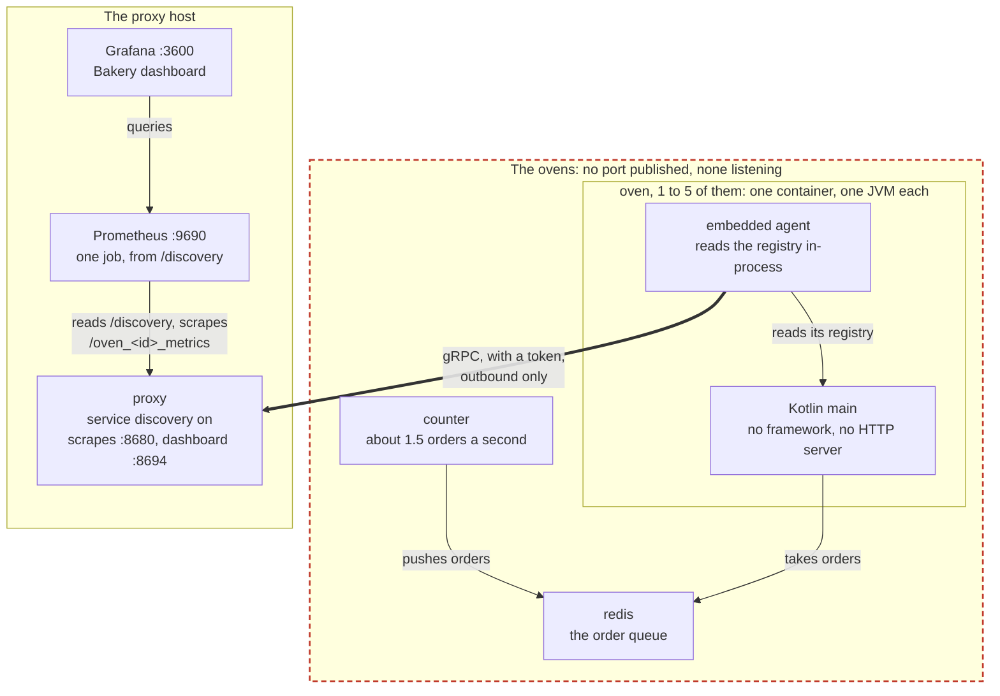

# Plain Kotlin demo

A self-contained demo of Prometheus Proxy's agent embedded in a plain Kotlin program, with no framework and no HTTP
server. A bakery's ovens are workers that take orders from a Redis queue, as a queue consumer, a scheduler, or a daemon
does. Such a worker often has no HTTP server at all, so reading its metrics in-process is the only way to get them to
Prometheus without opening a port. Each oven runs the agent inside its own JVM, wired in with a few lines of its `main`:
the agent reads the oven's metrics from the Prometheus Java client's registry and sends them out to a proxy, which
Prometheus scrapes.

The demo shows the oven listening on no port, its metrics in Grafana all the same, a rush that two more ovens clear,
each a Prometheus target of its own with no change to Prometheus's config, a scale-in that stops ovens cleanly, and
ovens that bake with no proxy, a certificate the agent rejects, or a token the proxy refuses.

The website's [Plain Kotlin Demo](https://prometheus-proxy.com/plain-kotlin-demo/) page walks through it. The agent in a
Ktor app, with its own dashboard, TLS, and secrets from the environment, is in the [Ktor demo](../ktor), and in a Spring
Boot app in the [Spring Boot demo](../spring-boot). A job that finishes before Prometheus's next scrape, such as a
nightly batch, needs the [Pushgateway](https://github.com/prometheus/pushgateway), not an agent: there's nothing left to
scrape when Prometheus comes.



## What you need

On macOS or Linux, the demo needs:

- [Docker](https://docs.docker.com/get-started/get-docker/) with Compose v2: Docker Desktop, or Docker Engine with the
  Compose plugin.
- `git`, to clone the repository, and GNU `make`. On macOS, the Xcode command-line tools (`xcode-select --install`)
  have both. Where GNU make is installed as `gmake`, type `gmake` wherever these instructions say `make`.
- `curl`, which the demo uses to wait for each service to answer, and to read the proxy and Prometheus.
- A web browser.

`make up` runs the latest release's proxy image, from Docker Hub, and builds the oven inside Docker against the latest
release's library, from Maven Central, so it needs no JDK. Until a release has everything the demo shows, it builds
from the checkout instead, which needs a JDK 17 or later, as `make up-local` always does.

## Quick start

Clone the repository at the latest release, then run the demo's commands from its own directory, where `make help` lists
its targets:

```bash
git clone -c advice.detachedHead=false --depth 1 --branch 4.7.0 https://github.com/pambrose/prometheus-proxy.git
cd prometheus-proxy/demos/plain-kotlin
make up      # builds the oven, starts everything, and prints the URLs
make tour    # walks through the guided tour below, pausing before each step
make down    # stops it and removes its containers and network
```

The first `make up` pulls the images and builds the oven, which takes a few minutes. After that it starts in under a
minute.

| What | URL |
|---|---|
| Proxy dashboard | <http://localhost:8694/dashboard> |
| Grafana (no sign-in needed; admin / admin to edit) | <http://localhost:3600> |
| Prometheus's targets | <http://localhost:9690/targets> |
| The proxy's service discovery | <http://localhost:8680/discovery> |

`make open` opens the proxy's dashboard, Grafana, and Prometheus's targets in your browser.

The ports are the basics demo's plus 600, so the demos can run side by side. If a port is already taken, move it, for
example with `PLAIN_KOTLIN_DEMO_GRAFANA_PORT=3601 make up`. The variables are `PLAIN_KOTLIN_DEMO_DASHBOARD_PORT`,
`PLAIN_KOTLIN_DEMO_GRAFANA_PORT`, `PLAIN_KOTLIN_DEMO_PROMETHEUS_PORT`, and `PLAIN_KOTLIN_DEMO_PROXY_PORT`. Every port
binds to `127.0.0.1` only, and the ovens and Redis publish none. The proxy's dashboard has no authentication, and
Grafana uses its default admin password, so this setup is for a laptop, not for anything shared.

## What's running

| Service | Role |
|---|---|
| `oven` | The worker (`app/`): a plain Kotlin program, with no framework or HTTP server, that takes orders from the Redis queue and bakes them one at a time, about two a second, counting them in the Prometheus Java client's default registry. The prometheus-proxy agent runs inside it, started in its `main`, and reads the registry in-process. `./demo.sh scale` runs 1 to 5 of them; each one's host name is its container's ID, which names its agent and its paths. |
| `oven-no-proxy`, `oven-bad-cert`, `oven-wrong-token` | Not started by default. `./demo.sh no-proxy`, `bad-cert`, and `wrong-token` each start one, the same image with the agent's settings wrong, show its log, and stop it. |
| `redis` | The order queue, a Redis list, which every oven takes from. Not published on the host; it keeps nothing on disk. |
| `counter` | Where the customers' orders come in (`counter/counter.sh`, in the Redis image): a steady trickle onto the queue, about one and a half a second, which one oven keeps up with. `./demo.sh rush` runs a rush beside it. |
| `proxy` | The stock proxy image, with a token the ovens' agents present, and its service discovery on. Its agent port is reachable only on the compose network; its dashboard is on. |
| `prometheus` | One job that reads the proxy's service discovery, so each oven is a target of its own, with its agent's metrics as a job of their own, and the proxy's own metrics. |
| `grafana` | Opens on the **Bakery** dashboard. The project's own **Prometheus Proxy** and **Prometheus Agents** dashboards (`grafana/*.json`) are linked from its top bar. |

The agent's token, `demo-bakery-token`, is in `docker/compose.yml`, a public file, so this suits a laptop and nothing
else; never reuse it.

## The worker's code

The oven's `main` (`app/src/main/kotlin/bakery/Main.kt`) builds the oven, adds a shutdown hook, and runs the oven with
the agent beside it:

```kotlin
fun main() {
  // The host name, the container's ID in Docker, so each oven's paths are its own
  val replica = replicaName()
  val oven = Oven(queue = OrderQueue(url = env("REDIS_URL")), registry = PrometheusRegistry.defaultRegistry)

  // On SIGTERM, the JVM runs its shutdown hooks, then exits without returning from main. This one has the oven finish
  // the order it's baking and take no more, then waits for main to return, by which time use { } has stopped the agent.
  // It waits 25 seconds at most, short of the 30 Kubernetes gives a pod to stop. Once it's added, don't call
  // exitProcess() in main: exitProcess() waits for the hooks, and this one would wait for main until its time is up.
  val mainThread = Thread.currentThread()
  Runtime.getRuntime().addShutdownHook(
    Thread {
      oven.stop()
      mainThread.join(25000)
    },
  )

  embeddedAgent {
    name = "oven-$replica"
    fromEnvironment()
    source(path = "oven_${replica}_metrics", registry = PrometheusRegistry.defaultRegistry)
    agentMetricsAt(path = "oven_${replica}_agent_metrics")
  }.startIfConfigured(logBanner = false).use {
    oven.runUntilStopped()
  }
}
```

- `replicaName()`, below `main`, is `HOSTNAME`, which Docker sets to the container's ID, or else the machine's host
  name, as on a developer's machine, whose shell doesn't usually export `HOSTNAME`. Any character but a letter, a digit,
  `.`, `_`, or `-` becomes `-`, since a proxy path can't hold whitespace, `?`, or `#`.
- `fromEnvironment()` reads the proxy and the token from `PROMETHEUS_PROXY` and `PROMETHEUS_AGENT_TOKEN`, which
  `docker/compose.yml` sets.
- `source(path, registry)` serves the default registry, where the oven's `Counter`, `Gauge`, and `Histogram` are, read
  in-process on each scrape, and `agentMetricsAt(path)` the agent's own metrics, at a path of their own.
- `startIfConfigured()` starts the agent where a proxy is set, and returns `null`, having logged why, where there isn't
  one or the agent can't start. `use { }` takes a `null` handle too, so the oven runs either way, and the agent stops
  when it returns.
- On a SIGTERM, the JVM runs its shutdown hooks and exits without returning from `main`. The hook tells the oven to
  stop, and waits for `main` to return: the oven finishes the order it's baking, takes no more, and returns, and then
  `use { }` stops the agent, which disconnects from the proxy. The hook waits 25 seconds at most, short of the 30
  Kubernetes gives a pod to stop. Once it's added, `main` mustn't call `exitProcess()`, which waits for the hooks while
  this one waits for `main`, so the JVM would hang until the hook gives up.

## Guided tour

`make tour` walks through these parts one step at a time, about 12 minutes in all. To follow them here instead, run the
scenario commands from `demos/plain-kotlin`; each prints what to watch. Leave about a minute between parts so the graphs
catch up.

1. A worker with no port at all (2 min)
2. The metrics in Grafana (2 min)
3. A rush, and two more ovens clear it (4 min)
4. Scaling in stops ovens cleanly (2 min)
5. No proxy, no outage (2 min)

### 1. A worker with no port at all

A worker often has no HTTP server at all, so there's nothing for Prometheus to scrape. Here the agent, inside the
oven's JVM, reads the oven's metrics in-process and sends them out to the proxy.

```bash
./demo.sh sockets
```

Compose publishes no port for the oven, and the oven's JVM, its container's process 1, listens on nothing: its only
connections are the two it opened, to Redis and to the proxy's agent port. Prometheus's targets page,
<http://localhost:9690/targets>, lists the oven's path through the proxy all the same, `oven_<id>_metrics`, under the
`oven` job, and its agent's own, `oven_<id>_agent_metrics`, under `oven-agent`. Prometheus's config names neither: its
one job reads the proxy's service discovery, which lists each path an agent registered. The code above does the rest.

### 2. The metrics in Grafana

Open Grafana, <http://localhost:3600>. It lands on the **Bakery** dashboard: ovens scraped, agents connected, waiting
orders, orders baked a minute, and the bake time, then each oven's orders, the backlog against the number of ovens, bake
times, and how much of its time each oven spends baking.

```bash
./demo.sh metrics
```

It reads both paths through the proxy. The oven's has its `bakery_` series and no `agent_` series, and the agent's has
its `agent_` series and no `bakery_` series: the agent keeps its own metrics in the default registry too, and a source
of the default registry leaves them out, so each series is served once. The **Prometheus Agents** link opens the
project's agents dashboard, which shows the ovens' embedded agents, the `oven-agent` job, like any other.

### 3. A rush, and two more ovens clear it

One oven bakes about two orders a second, which keeps up with the counter's one and a half.

```bash
./demo.sh rush       # 500 more orders, ten a second
./demo.sh scale 3    # once the backlog has passed 200
```

In Grafana's **Waiting orders, and ovens**, the backlog climbs by about nine orders a second while the rush lasts. Left
to one oven, it would reach nearly 500 and take about a quarter of an hour to clear. Each new oven's agent registers its
two paths, the proxy's service discovery lists them at once, and Prometheus, which reads it every 5 seconds, scrapes
each new oven as a target of its own, with no change to its config. **Orders baked / sec, by oven** gains a series for
each, and the three clear the backlog in about two minutes.

### 4. Scaling in stops ovens cleanly

```bash
./demo.sh scale 1    # once the backlog has cleared
```

It stops the other two ovens with SIGTERM, as a scale-in on Kubernetes or ECS does, and shows each one's log: the oven
finishing the order it was baking, so no order taken from the queue is lost, then its agent, which `use { }` stops,
disconnecting from the proxy. The proxy drops the agents' paths at once: the Paths view of its
dashboard, <http://localhost:8694/dashboard/paths>, lists only the remaining oven's, and its Activity view each stopped
oven's agent as disconnected. Prometheus drops their targets at its next discovery refresh, within 5 seconds, with no
restart and no config change. A scrape that comes between an agent's disconnect and that refresh finds no path and
records `up` 0, as a terminating pod's can on Kubernetes: **Scrape up, by oven** shows it, and the command says whether
one did.

### 5. No proxy, no outage

An oven's metrics aren't worth an outage. `startIfConfigured()` starts the agent only where a proxy is set, and logs a
start that fails rather than throwing, so the oven bakes either way. Each of these starts an oven with the agent's
settings wrong, shows its log, and stops it:

```bash
./demo.sh no-proxy      # no PROMETHEUS_PROXY
./demo.sh bad-cert      # a PROMETHEUS_PROXY_CERT that isn't a certificate
./demo.sh wrong-token   # a token the proxy refuses
```

- With no proxy, the agent stays off, with one INFO line: `No proxy is set, so the Prometheus agent stays off`.
- With a certificate the agent rejects as it starts, `startIfConfigured()` logs why at ERROR, naming the variable,
  without the PEM: `The Prometheus agent could not start, so it stays off: Invalid configuration: PROMETHEUS_PROXY_CERT,
  read by fromEnvironment() for agent.tls.trustCertCollectionPem: trustCertCollectionPem is neither PEM text nor the
  base64 of PEM text`.
- With a wrong token, nothing is wrong until the agent connects, so it starts, and the proxy refuses it. The agent logs
  that at ERROR once, naming where the token is set, and keeps retrying at DEBUG: in the 20 seconds the scenario
  watches, the proxy refuses it about seven times, and the oven logs one.

Each oven bakes all the same. That's the tour. Standalone agents behind a firewall are in the [basics demo](../basics),
proxy failover and tracing in the [network demo](../network), the proxy behind nginx in the [nginx demo](../nginx), the
Helm charts in the [Kubernetes demo](../kubernetes), the agent in a Ktor app in the [Ktor demo](../ktor), and in
a Spring Boot app, written in Java, in the [Spring Boot demo](../spring-boot). The demos use different ports, so they
can run side by side, but each takes memory and CPU: `make down` stops this one and frees its resources.

## Scenario reference

| Command | Effect | How it works |
|---|---|---|
| `demo.sh sockets` | Shows that the oven publishes no port and listens on none, and its targets in Prometheus | `docker port` of the oven, its JVM's sockets from `/proc/1/fd` and `/proc/net` in its container, and Prometheus's targets API |
| `demo.sh metrics` | Reads the oven's metrics, and its agent's, through the proxy, each at its own path | `curl` of the proxy's `/oven_<id>_metrics` and `/oven_<id>_agent_metrics` |
| `demo.sh rush` | 500 more orders, ten a second | `counter.sh rush 500`, run in the counter's container |
| `demo.sh scale <count>` | Runs this many ovens (1 to 5) | `docker compose up --scale oven=<count>` to add ovens; `docker stop`, a SIGTERM, to stop the extra ones, whose logs it shows |
| `demo.sh no-proxy` / `bad-cert` / `wrong-token` | Starts an oven with no proxy, a certificate that isn't one, or a token the proxy refuses, shows its log, and stops it | Starts the compose service `oven-no-proxy`, `oven-bad-cert`, or `oven-wrong-token` (profile `misconfigured`) |
| `make tour [PART=n]` | Walks through the guided tour above, from part 1 or the one given, pausing before each step |  |
| `make status` | The containers, the ovens and their paths, the queue, and the URLs |  |
| `make logs [SERVICE=name]` | Follows the logs, of every service or the one given |  |

## How it's put together

| File | What it sets up |
|---|---|
| `app/` | The oven: a Gradle project of its own, outside the repository's build, which reads the repository's version catalog (`settings.gradle.kts`). `Main.kt` is its `main`, with the agent, `Oven.kt` the oven and its menu and metrics, and `OrderQueue.kt` the Redis queue, through Jedis. With `-PlocalProxy` it builds against this checkout's library (a composite build), as `make up-local` and CI do. |
| `app/Dockerfile` | Builds the oven's image: compiled inside Docker against the latest release (`make up`), or from the build on the host (`make up-local`), on the Temurin JRE, whose shell `demo.sh sockets` reads `/proc` with |
| `counter/counter.sh` | The counter: the trickle of orders, and a rush |
| `docker/compose.yml` | The services, their ports, their images, the ovens' settings, and the misconfigured ovens' |
| `config/proxy.conf` | The proxy's dashboard, metrics, and service discovery; its token comes from the environment |
| `prometheus/prometheus.yml` | One job from the proxy's service discovery, with the agents' metrics as a job of their own, and the proxy's own metrics |
| `grafana/` | The provisioned datasource, dashboard folder, and Bakery dashboard |
| `Makefile` | The demo's targets: `make up`, `make up-local`, `down`, `status`, `open`, `tour`, and `logs`, which `make help` lists |
| `demo.sh` | Starting, stopping, and the scenarios. Its `NEEDS_RELEASE_AFTER` is the latest release that predates what the demo shows: until a later one is out, `make up` builds from this checkout, as `make up-local` does |

From the repository root, `make check-rules` validates the Prometheus config with promtool, `ConfigFileKeysTest` checks
every key in `config/proxy.conf` against `config/config.conf`, and CI builds the oven against the checkout
(`make plain-kotlin-demo-check`, which runs `./gradlew -p demos/plain-kotlin/app -PlocalProxy build`), so a change to
the library's API that breaks it fails the build.

## Troubleshooting

- **`port is already allocated`**: another service holds the port. Move it with the variables above.
- **The first `make up` is slow**: it downloads Gradle's dependencies to build the oven; Docker keeps them, so the next
  build takes seconds.
- **No oven in Prometheus's targets**: the oven's agent connects a few seconds after the proxy starts, and Prometheus
  reads the proxy's service discovery every 5 seconds. Give it ten seconds, or check `make logs SERVICE=oven`.
- **A scenario left things in an odd state**: `./demo.sh scale 1` puts the bakery back to one oven, and each
  misconfigured oven's scenario stops it. For a clean slate, `make down && make up`.
- The proxy logs a warning at startup that its dashboard has no authentication. That's expected here, and is why every
  port binds to `127.0.0.1`.
- Each oven logs a warning at startup that its agent's token is sent without TLS. That's expected here too: the ovens
  reach the proxy only on the compose network. The [Ktor demo](../ktor) shows the same agent over TLS.
