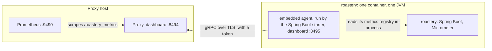

# Spring Boot demo

A self-contained demo of Prometheus Proxy's agent embedded in a Spring Boot app written in Java. The roastery, which
roasts the coffee shop's beans, runs the agent inside its own JVM, started by the project's
[Spring Boot starter](https://prometheus-proxy.com/spring-boot-starter/) from a few properties in `application.yml`.
The agent reads the app's metrics from its Micrometer registry, in-process, and sends them to a proxy, which Prometheus
scrapes. The demo shows the parts that are Spring Boot's own:
- the agent's lifecycle with the app's;
- the agent's connection in Actuator's health;
- the app's metrics served with no `/actuator/prometheus` endpoint;
- the versions of the agent's libraries that Spring Boot's dependency management picks;
- a graceful shutdown that takes the agent down first.

The agent's own [dashboard](https://prometheus-proxy.com/agent-dashboard/) is on too, turned on by the environment
with no change to the roastery. It shows the agent's side of its connection, from inside the roastery, and the
tour watches it while the proxy stops and starts again.

The coffee shop in the [embedded demo](../embedded) shows the rest with an app in Kotlin: a rush in Grafana, an alert
in Prometheus, a deploy that hands the agent's path to the new version, the proxy going away, and secrets from the
environment. The website's [Spring Boot Demo](https://prometheus-proxy.com/spring-boot-demo/) page walks through this
one.



## What you need

- [Docker](https://docs.docker.com/get-started/get-docker/) with Compose v2: Docker Desktop, or Docker Engine with the
  Compose plugin.
- `git`, to clone the repository, and `curl`, `make`, and `bash`.
- For `make up-local` only: a JDK 17 or later and [Maven](https://maven.apache.org/install.html) 3.9 or later, which
  build the library and the roastery from this checkout.

## Quick start

From a clone of the release, so the scripts match the images:

```bash
git clone -c advice.detachedHead=false --depth 1 --branch 4.7.0 https://github.com/pambrose/prometheus-proxy.git
cd prometheus-proxy/demos/spring-boot
make up      # builds the roastery, starts everything, prints the URLs
make tour    # the guided tour, about 11 minutes
make down    # stops it and removes its containers and network
```

`make up` runs the latest release's proxy image, from Docker Hub, and builds the roastery inside Docker against that
release's library, from Maven Central, so it needs only Docker. The first build downloads Maven's dependencies, which
takes a few minutes. `make up-local` builds the library, the proxy, and the roastery from this checkout instead.

| What | URL |
|---|---|
| The roastery's status page | <http://localhost:8490> |
| Proxy dashboard | <http://localhost:8494/dashboard> |
| The roastery agent's dashboard | <http://localhost:8495/dashboard> |
| Prometheus | <http://localhost:9490> |
| The roastery's metrics, through the proxy | <http://localhost:8480/roastery_metrics> |

The ports are the defaults; set `SPRING_BOOT_DEMO_APP_PORT`, `SPRING_BOOT_DEMO_DASHBOARD_PORT`,
`SPRING_BOOT_DEMO_AGENT_DASHBOARD_PORT`, `SPRING_BOOT_DEMO_PROXY_PORT`, or `SPRING_BOOT_DEMO_PROMETHEUS_PORT` to move
one. Every port is published on `127.0.0.1` only. The agent's dashboard has no password, so the agent warns at startup,
in the roastery's log, that it listens on all interfaces without a login: the container's, which only `127.0.0.1`
reaches.

The demo's TLS certificates are the repository's test ones (`testing/certs`), which are public, so it suits a laptop
and nothing shared. `make up` writes them, with a random token, to `docker/.env` the first time it runs.

## What's running

| Service | Role |
|---|---|
| `roastery` | The app, version 1.0 (`app/`): a Spring Boot app in Java that roasts a batch of beans every two seconds and ships some to the coffee shop every five, counting both in Micrometer meters. The prometheus-proxy agent runs inside it, started by the project's Spring Boot starter, and reads them, with the JVM's and Tomcat's, from the app's metrics registry, in-process; Actuator exposes only its health. Its dashboard is on, at port 8495, from the environment (`PROMETHEUSPROXY_AGENT_DASHBOARD_PORT`). |
| `proxy` | The stock proxy image, which takes its TLS certificate and key, and the agent's token, from environment variables, with none of them in a file. Its agent port is reachable only on the compose network; its dashboard is on. |
| `prometheus` | Scrapes the roastery's path through the proxy every 5s, and the proxy's own metrics. |

## Guided tour

`make tour`, or `./demo.sh tour`, walks through five parts, pausing before each step. `make tour PART=3`, or
`./demo.sh tour 3`, starts from part 3.

### 1. A Spring Boot app with the agent embedded

Open the roastery's status page, then run `./demo.sh settings`. It shows the settings the starter bound, with the
token and the certificate shown only as set, and the agent starting and registering
`/roastery_metrics`. The proxy dashboard's Agents view lists `roastery-1.0`, named after the version in the app's
Spring Boot build info. `./demo.sh health` shows the agent in Actuator's `/actuator/health`: UP, with the proxy's
address, while it's connected, and UNKNOWN, while the app's own health stays UP, when it isn't.

### 2. The app's metrics, read in-process, through the proxy

`./demo.sh peek` tries `/actuator/prometheus`, which answers 404, since the roastery exposes only Actuator's health,
then reads the roastery's metrics through the proxy. For each scrape, the agent reads the app's `PrometheusRegistry`
bean, where Micrometer keeps the meters, so there's no metrics endpoint, password, or Spring Security to set up.

### 3. What Spring Boot's dependency management picked

Spring Boot sets the version of every library it knows, some of the agent's among them, whatever version the agent
asks for: kotlinx-serialization, Jackson 2, Logback, and gRPC run older than the agent's own. `./demo.sh versions`
prints the versions the roastery runs beside the ones the agent is built with.

The agent runs with Spring Boot's versions, as the roastery shows. On every pull request,
`make spring-boot-demo-check` builds the roastery and runs its `RoasteryAgentTest`, which starts the agent against a
proxy and scrapes through it, so a Spring Boot release that breaks the agent fails there. Were one to break it, a
property in the pom sets that library back: `kotlin-serialization.version`, `jackson-2-bom.version`,
`logback.version`, or `grpc-java.version`.

### 4. The agent's own dashboard, with the proxy stopped and started

The agent serves a dashboard of its own, from inside the roastery, at <http://localhost:8495/dashboard>. Compose
turns it on with `PROMETHEUSPROXY_AGENT_DASHBOARD_PORT`, which Spring Boot binds to the starter's
`prometheus-proxy.agent.dashboard.port`, so `application.yml` needn't change. Its Paths view lists
`/roastery_metrics`, registered, with its recent scrapes. Select it to see each scrape the proxy asked for, and press
Scrape now to have the agent read the roastery's registry at once. The Activity view lists what has happened to the
agent, newest first, the Connection view its proxy endpoint, and the Settings view its settings.

`./demo.sh proxy-stop` stops the proxy, and its dashboard with it. The agent's still answers: its Connection view
turns failing, with the error the agent got connecting to the proxy, and its Activity view adds disconnected and
connect failed. The roastery keeps serving, and Actuator's health keeps it UP while the agent's component turns
UNKNOWN. Scrape now still reads the roastery's metrics, since it doesn't need the proxy. `./demo.sh proxy-start`
brings the proxy back: the agent connects within a few seconds and registers its path again, and the Activity view
adds connected and registered.

### 5. A graceful shutdown takes the agent down first

`./demo.sh stop-app` stops the roastery with SIGTERM, as a platform does on a deploy or a scale-down. Spring Boot stops
its lifecycle beans from the last phase down, so the agent stops first: it disconnects from the proxy, which drops
the roastery's path, and no scrape reaches the web server once it starts draining. The roastery's log shows the order.
`./demo.sh start-app` starts it again.

## Scenario reference

| Command | Effect | How it works |
|---|---|---|
| `demo.sh settings` | Shows the agent's settings as Spring Boot bound them, and the agent starting | The roastery's log lines from the starter's `PrometheusProxyAgent` and the agent |
| `demo.sh peek` | Tries `/actuator/prometheus`, which the roastery doesn't expose, then reads its metrics through the proxy | `curl` of the app's `/actuator/prometheus`, then of the proxy's `/roastery_metrics` |
| `demo.sh health` | Shows the agent's component of `/actuator/health` and the app's health | `curl` of the app's `/actuator/health`, whose `prometheusAgent` component the starter reports from `EmbeddedAgentInfo.isConnected` |
| `demo.sh versions` | Compares the agent's libraries' versions in the roastery with the agent's own | The jar names in the image's `/app/lib`, against `gradle/libs.versions.toml` |
| `demo.sh proxy-stop` / `proxy-start` | Stops the proxy, or starts it again, which the agent's dashboard shows | `docker compose stop` / `start proxy`: the agent retries every few seconds, its dashboard's Connection view shows the error, and its Activity view the disconnect and the reconnect |
| `demo.sh stop-app` / `start-app` | Stops the roastery with SIGTERM, or starts it again | `docker compose stop` / `start roastery` |

## Files

| Path | What it is |
|---|---|
| `app/` | The roastery: a Maven project of its own, outside the repository's Gradle build, whose parent is Spring Boot's `spring-boot-starter-parent`, and which depends on the project's Spring Boot starter, `com.pambrose:prometheus-proxy-spring-boot-starter`. Its `Dockerfile` builds it with Maven inside Docker (`make up`) or copies a jar built on the host (`make up-local`), and runs Spring Boot's extracted layout on a JRE. |
| `app/src/main/java/roastery/` | The roastery itself: its meters and schedule (`Roastery`), its status page, and its main class. It has no code for the agent, which the starter runs. |
| `app/src/main/resources/application.yml` | The starter's `prometheus-proxy.agent` properties, read from the environment, and the details Actuator's health shows. |
| `app/src/test/java/roastery/RoasteryAgentTest.java` | Starts the roastery and a proxy in one JVM, and scrapes through the proxy: the agent at the versions Spring Boot picks, which `make spring-boot-demo-check` runs on every pull request. |
| `config/proxy.conf` | The proxy's settings: its metrics and its dashboard. Its TLS material and token come from the environment. |
| `docker/compose.yml` | The services above, with the agent's dashboard turned on in the roastery's environment. |
| `prometheus/prometheus.yml` | Prometheus's scrape config. |
| `demo.sh` | Starts and stops the demo, runs its scenarios, and the tour. |
| `Makefile` | `make up`, `up-local`, `down`, `status`, `open`, `logs`, and `tour`, which run `demo.sh`. |
