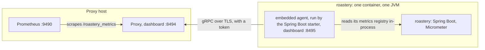

# Spring Boot Demo

A self-contained demo of Prometheus Proxy's agent embedded in a Spring Boot app written in Java. The roastery, which
roasts the coffee shop's beans, runs the agent inside its own JVM, started by the project's
[Spring Boot starter](https://prometheus-proxy.com/spring-boot-starter/) from a few properties in `application.yml`.
The agent reads the app's metrics from its Micrometer registry, in-process, and sends them to a proxy, which Prometheus
scrapes. The demo shows the parts that are Spring Boot's own:
- the agent's lifecycle with the app's;
- the agent's connection in Actuator's health;
- the app's metrics served with no `/actuator/prometheus` endpoint;
- the versions of the agent's libraries that Spring Boot's dependency management picks;
- a graceful shutdown that takes the agent down first.

The agent's own [dashboard](https://prometheus-proxy.com/agent-dashboard/) is on too, turned on by the environment
with no change to the roastery. It shows the agent's side of its connection, from inside the roastery, and the
tour watches it while the proxy stops and starts again.

The coffee shop in the [Ktor demo](../ktor) shows the rest with an app in Kotlin: a rush in Grafana, an alert
in Prometheus, a deploy that hands the agent's path to the new version, the proxy going away, and secrets from the
environment. The website's [Spring Boot Demo](https://prometheus-proxy.com/spring-boot-demo/) page walks through this
one.



## Quick Start

On macOS or Linux, the demo needs [Docker](https://docs.docker.com/get-started/get-docker/) with Compose v2, `git`, GNU
`make`, and `curl`. Where GNU make is installed as `gmake`, type `gmake` wherever these instructions say `make`.

`make up` runs the latest release's proxy image, from Docker Hub, and builds the roastery inside Docker with Maven,
against the latest release's library, from Maven Central, so it needs no JDK or Maven. `make up-local` builds the
library, the proxy, and the roastery from the checkout, which takes a JDK 17 or later and Maven 3.9 or later. Until a
release with everything the demo shows is on Docker Hub, `make up` builds from the checkout too, as `make up-local`
does.

From a clone of the release, so the scripts match the images:

```bash
git clone -c advice.detachedHead=false --depth 1 --branch 4.7.1 https://github.com/pambrose/prometheus-proxy.git
cd prometheus-proxy/demos/spring-boot
make up      # builds the roastery, starts everything, and prints the screens page's URL
make tour    # the guided tour, about 11 minutes
make down    # stops it and removes its containers and network
```

`make up` runs the latest release's proxy image, from Docker Hub, and builds the roastery inside Docker against that
release's library, from Maven Central, so it needs only Docker. The first build downloads Maven's dependencies, which
takes a few minutes. `make up-local` builds the library, the proxy, and the roastery from this checkout instead.

Then open the proxy's [screens page](https://prometheus-proxy.com/web-dashboard/#screens), one browser tab that holds
every screen in the demo, each in a tab of its own: the proxy's dashboard, the roastery's status page, its agent's
dashboard, and Prometheus. `make open` opens it, and the guided tour's links open in it: <http://localhost:8494/>

Each screen also has an address of its own, which the table gives with the variable that moves its port:

| What | URL | Port variable |
|---|---|---|
| The screens page, every screen in one tab | <http://localhost:8494/> | `SPRING_BOOT_DEMO_DASHBOARD_PORT` |
| The roastery's status page | <http://localhost:8490> | `SPRING_BOOT_DEMO_APP_PORT` |
| Proxy dashboard | <http://localhost:8494/dashboard> | `SPRING_BOOT_DEMO_DASHBOARD_PORT` |
| The roastery agent's dashboard | <http://localhost:8495/dashboard> | `SPRING_BOOT_DEMO_AGENT_DASHBOARD_PORT` |
| Prometheus | <http://localhost:9490> | `SPRING_BOOT_DEMO_PROMETHEUS_PORT` |
| The roastery's metrics, through the proxy | <http://localhost:8480/roastery_metrics> | `SPRING_BOOT_DEMO_PROXY_PORT` |

Each port is the basics demo's plus 400, so the demos can run side by side. If a port is already taken, set its variable
from the table for `make up`, for example `SPRING_BOOT_DEMO_APP_PORT=8491 make up`. `make up` saves it in `docker/.env`,
which every later command and docker compose read, so you set it once; delete its line there to go back to the default.

Every port binds to `127.0.0.1` only. The agent's dashboard has no password, so the agent warns at startup, in the
roastery's log, that it listens on all interfaces without a login: the container's, which only `127.0.0.1` reaches.

The demo's TLS certificates are the repository's test ones (`testing/certs`), which are public, so it suits a laptop
and nothing shared. `make up` writes them, with a random token, to `docker/.env` the first time it runs, in the same
file as any ports it saved. Delete the file, and the next `make up` writes a new one, with a new token, and forgets
the saved ports.

## What's Running

| Service | Role |
|---|---|
| `roastery` | The app, version 1.0 (`app/`): a Spring Boot app in Java that roasts a batch of beans every two seconds and ships some to the coffee shop every five, counting both in Micrometer meters. The prometheus-proxy agent runs inside it, started by the project's Spring Boot starter, and reads them, with the JVM's and Tomcat's, from the app's metrics registry, in-process; Actuator exposes only its health. Its dashboard is on, at port 8495, from the environment (`PROMETHEUSPROXY_AGENT_DASHBOARD_PORT`). |
| `proxy` | The stock proxy image, which takes its TLS certificate and key, and the agent's token, from environment variables, with none of them in a file. Its agent port is reachable only on the compose network; its dashboard is on. |
| `prometheus` | Scrapes the roastery's path through the proxy every 5s, and the proxy's own metrics. |

## What This Demo Shows

Each part of the guided tour, `make tour`, makes one point. A part's name links to its section under [Guided
Tour](#guided-tour).

| Part | What it shows | Why it matters |
|---|---|---|
| 1. [A Spring Boot app with the agent embedded](#1-a-spring-boot-app-with-the-agent-embedded) | The starter runs the agent from properties in `application.yml`, and logs its secrets only as set | Embedding the agent takes configuration, not code |
| 2. [The app's metrics, read in-process, through the proxy](#2-the-apps-metrics-read-in-process-through-the-proxy) | No `/actuator/prometheus`: the agent reads the app's registry, and Prometheus scrapes it through the proxy | There's no metrics endpoint to secure |
| 3. [What Spring Boot's dependency management picked](#3-what-spring-boots-dependency-management-picked) | The versions of the agent's libraries Spring Boot picked, against the agent's own, and how to pin one | You can see what the agent runs with in your app, and fix a conflict |
| 4. [The proxy goes away, and the roastery stays healthy](#4-the-proxy-goes-away-and-the-roastery-stays-healthy) | With the proxy gone, Actuator reports the agent UNKNOWN and the app UP, and the agent's dashboard says why | A proxy outage never takes the app out of service |
| 5. [A graceful shutdown takes the agent down first](#5-a-graceful-shutdown-takes-the-agent-down-first) | On SIGTERM, the agent stops before Tomcat's graceful shutdown begins | No scrape lands on a half-stopped app during a deploy |

## Guided Tour

`make tour`, or `./demo.sh tour`, walks through five parts, pausing before each step. `make tour PART=3`, or
`./demo.sh tour 3`, starts from part 3.

### 1. A Spring Boot App with the Agent Embedded

Open the roastery's status page in the screens page, <http://localhost:8494/screens#roastery>, then run
`./demo.sh settings`. It shows the settings the starter bound, with the token and the certificate shown only as set, and
the agent starting and registering `/roastery_metrics`. The proxy dashboard's Agents view,
<http://localhost:8494/screens#proxy>, lists `roastery-1.0`, named after the version in the app's Spring Boot build
info. `./demo.sh health` shows the agent in Actuator's `/actuator/health`: UP, with the proxy's address, while it's
connected, and UNKNOWN, while the app's own health stays UP, when it isn't.

### 2. The App's Metrics, Read In-Process, through the Proxy

`./demo.sh peek` tries `/actuator/prometheus`, which answers 404, since the roastery exposes only Actuator's health,
then reads the roastery's metrics through the proxy. For each scrape, the agent reads the app's `PrometheusRegistry`
bean, where Micrometer keeps the meters, so there's no metrics endpoint, password, or Spring Security to set up.
Prometheus scrapes them through the proxy, and graphs the batches roasted in the last minute, by origin:
<http://localhost:8494/screens#prometheus>

### 3. What Spring Boot's Dependency Management Picked

Spring Boot sets the version of every library it knows, some of the agent's among them, whatever version the agent
asks for, so some run older than the agent's own. `./demo.sh versions` prints the versions the roastery runs beside
the ones the agent is built with, and marks each one older, the same, or newer.

The agent runs with Spring Boot's versions, as the roastery shows. On every pull request,
`make spring-boot-demo-check` builds the roastery and runs its `RoasteryAgentTest`, which starts the agent against a
proxy and scrapes through it, so a Spring Boot release that breaks the agent fails there. Were one to break it, the pom
sets that library to the agent's version with the property Spring Boot names it by, such as
`prometheus-client.version`, `grpc-java.version`, or `netty.version`, which Spring Boot's
[Version Properties](https://docs.spring.io/spring-boot/appendix/dependency-versions/properties.html) lists for every
library it manages. An app on Spring Boot 4.0 or 4.1 sets two of them, as the
[Spring Boot Starter](https://prometheus-proxy.com/spring-boot-starter/#adding-the-dependency) page says. netty-tcnative
has none, since Netty's BOM sets it: the pom would pin `netty-tcnative-classes` and `netty-tcnative-boringssl-static`,
with each native's classifier, in its own `dependencyManagement`.

### 4. The Proxy Goes Away, and the Roastery Stays Healthy

A platform takes an app out of service, or restarts it, when its health check fails. The starter's health indicator
reports the agent UNKNOWN, not DOWN, when it loses the proxy, so a proxy outage never fails the roastery's health.

The agent serves a dashboard of its own, from inside the roastery: <http://localhost:8494/screens#agent>

Compose turns it on with `PROMETHEUSPROXY_AGENT_DASHBOARD_PORT`, which Spring Boot binds to the starter's
`prometheus-proxy.agent.dashboard.port`, so `application.yml` needn't change. Its Paths view lists `/roastery_metrics`,
registered, with its recent scrapes. Select it, and press Scrape now, the circular arrow after the path's name, to have
the agent read the roastery's registry at once. The Connection view shows its proxy endpoint, the Activity view what has
happened to the agent, newest first, and the Settings view its settings.

`./demo.sh proxy-stop` stops the proxy, and its dashboard and screens page with it. The agent's dashboard still answers,
in a screens page you have open or at its own address, <http://localhost:8495/dashboard/connection>: its Connection view
turns failing, with the error the agent got connecting to the proxy, and its Activity view adds disconnected and connect
failed. Scrape now still reads the roastery's metrics, since it doesn't need the proxy. `./demo.sh health` then shows
the agent's component UNKNOWN and the roastery's own health UP, so a platform that checks it keeps the roastery in
service. `./demo.sh proxy-start` brings the proxy back: the agent connects within a few seconds and registers its path
again, and its component is UP again.

### 5. A Graceful Shutdown Takes the Agent Down First

`./demo.sh stop-app` stops the roastery with SIGTERM, as a platform does on a deploy or a scale-down. Spring Boot stops
its lifecycle beans from the last phase down, so the agent stops first: it disconnects from the proxy, which drops
the roastery's path and stops sending scrapes before Spring Boot starts shutting down the rest of the app. The
roastery's log shows the order. With the proxy dashboard beside the agent's, the agent leaves the Agents view as its
own dashboard stops: <http://localhost:8494/screens#proxy+agent>
`./demo.sh start-app` starts it again.

## Scenario Reference

| Command | Effect | How it works |
|---|---|---|
| `demo.sh settings` | Shows the agent's settings as Spring Boot bound them, and the agent starting | The roastery's log lines from the starter's `PrometheusProxyAgent` and the agent |
| `demo.sh peek` | Tries `/actuator/prometheus`, which the roastery doesn't expose, then reads its metrics through the proxy | `curl` of the app's `/actuator/prometheus`, then of the proxy's `/roastery_metrics` |
| `demo.sh health` | Shows the agent's component of `/actuator/health` and the app's health | `curl` of the app's `/actuator/health`, whose `prometheusAgent` component the starter reports from `EmbeddedAgentInfo.isConnected` |
| `demo.sh versions` | Compares the agent's libraries' versions in the roastery with the agent's own | The jar names in the image's `/app/lib`, against `gradle/libs.versions.toml` |
| `demo.sh proxy-stop` / `proxy-start` | Stops the proxy, or starts it again, which the agent's dashboard shows | `docker compose stop` / `start proxy`: the agent retries every few seconds, its dashboard's Connection view shows the error, and its Activity view the disconnect and the reconnect |
| `demo.sh stop-app` / `start-app` | Stops the roastery with SIGTERM, or starts it again | `docker compose stop` / `start roastery`: Spring Boot stops the agent first, then shuts down the web server |
| `make tour [PART=n]` | Walks through the guided tour above, from part 1 or the one given, pausing before each step |  |
| `make status` | The containers, the roastery's state, and the URLs |  |
| `make logs [SERVICE=name]` | Follows the logs, of every service or the one given |  |
| `make open` | Opens the proxy's screens page, which holds the roastery, the proxy's and the agent's dashboards, and Prometheus's graph of the batches roasted, in the browser |  |

## Files

| Path | What it is |
|---|---|
| `app/` | The roastery: a Maven project of its own, outside the repository's Gradle build, whose parent is Spring Boot's `spring-boot-starter-parent`, and which depends on the project's Spring Boot starter, `com.pambrose:prometheus-proxy-spring-boot-starter`. Its `Dockerfile` builds it with Maven inside Docker (`make up`) or copies a jar built on the host (`make up-local`), and runs Spring Boot's extracted layout on a JRE. |
| `app/src/main/java/roastery/` | The roastery itself: its meters and schedule (`Roastery`), its status page, and its main class. It has no code for the agent, which the starter runs. |
| `app/src/main/resources/application.yml` | The starter's `prometheus-proxy.agent` properties, read from the environment, and the details Actuator's health shows. |
| `app/src/test/java/roastery/RoasteryAgentTest.java` | Starts the roastery and a proxy in one JVM, and scrapes through the proxy: the agent at the versions Spring Boot picks, which `make spring-boot-demo-check` runs on every pull request. |
| `config/proxy.conf` | The proxy's settings: its metrics, its dashboard, and the screens its screens page holds. Its TLS material and token come from the environment. |
| `docker/compose.yml` | The services above, with the agent's dashboard turned on in the roastery's environment, and each screen's address in the proxy's. |
| `prometheus/prometheus.yml` | Prometheus's scrape config. |
| `demo.sh` | Starts and stops the demo, runs its scenarios, and the tour. |
| `Makefile` | `make up`, `up-local`, `down`, `status`, `open`, `logs`, and `tour`, which run `demo.sh`. |

## The Other Demos

- [Basics demo](../basics): the whole system on one machine, the proxy and its dashboard, three agents behind a
  simulated firewall, Prometheus, and Grafana
- [Network demo](../network): a simulated WAN between the agents and the proxies, and what a far, thin, dead, flaky, or
  missing link does
- [nginx demo](../nginx): nginx between the agents and the proxy, its stream timeouts, its reloads, and TLS ended on one
  port
- [Kubernetes demo](../kubernetes): the Helm charts on two kind clusters, with Kubernetes doing the operating and the
  target cluster exposing nothing
- [Ktor demo](../ktor): a coffee shop, a Ktor app that runs the agent in its own JVM through the Ktor plugin
- [Plain Kotlin demo](../plain-kotlin): a bakery's ovens, workers with no framework or HTTP server, each reading its own
  metrics in-process
