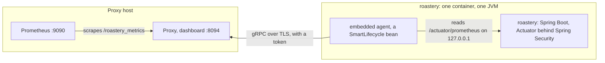

# Spring Boot demo

A self-contained demo of Prometheus Proxy's agent embedded in a Spring Boot app written in Java. The roastery, which
roasts the coffee shop's beans, runs the agent inside its own JVM, started by a Spring bean from settings Spring Boot
binds. The agent reads the metrics Spring Boot's Actuator serves behind Spring Security, and sends them to a proxy,
which Prometheus scrapes. The demo shows the parts that are Spring Boot's own:
- the agent's lifecycle with the app's;
- Actuator's metrics behind a password;
- the versions of the agent's libraries that Spring Boot's dependency management picks;
- a graceful shutdown that takes the agent down first.

The coffee shop in the [embedded demo](../embedded) shows the rest with an app in Kotlin: a rush, an alert in Grafana,
a deploy that hands the agent's path to the new version, the proxy going away, and secrets from the environment. The
website's [Spring Boot Demo](https://pambrose.github.io/prometheus-proxy/spring-boot-demo/) page walks through this
one.



## What you need

- [Docker](https://docs.docker.com/get-started/get-docker/) with Compose v2: Docker Desktop, or Docker Engine with the
  Compose plugin.
- `curl`, `make`, and `bash`.
- For `make up-local` only: a JDK 17 or later and [Maven](https://maven.apache.org/install.html) 3.9 or later, which
  build the library and the roastery from this checkout.

## Quick start

From a clone of the release, so the scripts match the images:

```bash
git clone -c advice.detachedHead=false --depth 1 --branch 4.6.0 https://github.com/pambrose/prometheus-proxy.git
cd prometheus-proxy/demos/spring-boot
make up      # builds the roastery, starts everything, prints the URLs
make tour    # the guided tour, about 8 minutes
make down    # stops it and removes its containers and network
```

`make up` runs the latest release's proxy image, from Docker Hub, and builds the roastery inside Docker against that
release's library, from Maven Central, so it needs only Docker. The first build downloads Maven's dependencies, which
takes a few minutes. `make up-local` builds the library, the proxy, and the roastery from this checkout instead.

| What | URL |
|---|---|
| The roastery's status page | <http://localhost:8490> |
| Proxy dashboard | <http://localhost:8494/dashboard> |
| Prometheus | <http://localhost:9490> |
| The roastery's metrics, through the proxy | <http://localhost:8480/roastery_metrics> |

The ports are the defaults; set `SPRING_BOOT_DEMO_APP_PORT`, `SPRING_BOOT_DEMO_DASHBOARD_PORT`,
`SPRING_BOOT_DEMO_PROXY_PORT`, or `SPRING_BOOT_DEMO_PROMETHEUS_PORT` to move one. Every port is published on
`127.0.0.1` only.

The demo's TLS certificates are the repository's test ones (`testing/certs`), which are public, so it suits a laptop
and nothing shared. `make up` writes them, with a random token and password, to `docker/.env` the first time it runs.

## What's running

| Service | Role |
|---|---|
| `roastery` | The app, version 1.0 (`app/`): a Spring Boot app in Java that roasts a batch of beans every two seconds and ships some to the coffee shop every five, counting both in Micrometer meters. Actuator serves them, with the JVM's and Tomcat's, at `/actuator/prometheus`, which Spring Security guards with Basic Auth. The prometheus-proxy agent runs inside it, and reads `/actuator/prometheus` on `127.0.0.1`. |
| `proxy` | The stock proxy image, which takes its TLS certificate and key, and the agent's token, from environment variables, with no file mounted. Its agent port is reachable only on the compose network; its dashboard is on. |
| `prometheus` | Scrapes the roastery's path through the proxy every 5s, and the proxy's own metrics. |

### Where the agent is set up

- **`AgentSettings`** is a `@ConfigurationProperties` record. It binds `roastery.monitoring` from `application.yml`,
  whose values read the environment the coffee shop's agent reads: `PROMETHEUS_PROXY`, `PROMETHEUS_AGENT_TOKEN`,
  `PROMETHEUS_PROXY_CERT`, `PROMETHEUS_PROXY_AUTHORITY`, `METRICS_USER`, and `METRICS_PASSWORD`.
- **`PrometheusAgentLifecycle`** is a `SmartLifecycle` bean in the last phase, so it starts once the web server is
  serving and stops first. It builds the agent's settings with `EmbeddedAgentConfig.builder()`, the Java form of
  `embeddedAgent { }`, pointing `scrapeSelf` at `actuator/prometheus` with the credentials.
- **`SecurityConfig`** lets only that user read `/actuator/prometheus`; the status page and `/actuator/health` are
  open.

## Guided tour

`make tour`, or `./demo.sh tour`, walks through four parts, pausing before each step. `make tour PART=3`, or
`./demo.sh tour 3`, starts from part 3.

### 1. A Spring Boot app with the agent embedded

Open the roastery's status page, then run `./demo.sh settings`. It shows the settings Spring Boot bound, with the
token, the certificate, and the password shown only as set, and the agent starting and registering
`/roastery_metrics`. The proxy dashboard's Agents view lists `roastery-1.0`, named after the version in the app's
Spring Boot build info.

### 2. Actuator's metrics, behind Spring Security, through the proxy

`./demo.sh peek` tries `/actuator/prometheus` without its password, which answers 401, then reads the same metrics
through the proxy. The agent read them with the credentials, which `scrapeSelf` percent-encoded into the scrape URL,
so Prometheus never needs them.

### 3. What Spring Boot's dependency management picked

Spring Boot sets the version of every library it knows, some of the agent's among them, whatever version the agent
asks for. `./demo.sh versions` compares the versions the roastery runs with the ones the agent is built with:

| Library | The agent's | Spring Boot 4.2.0's |
|---|---|---|
| kotlinx-serialization | 1.13.0 | 1.11.0 |
| Jackson 2 | 2.23.0 | 2.21.8 |
| Logback | 1.6.8 | 1.6.6 |
| gRPC | 1.85.1 | 1.84.1 |

The agent runs with Spring Boot's versions, as the roastery shows, and `make consumer-check` builds the roastery on
every pull request, so a Spring Boot release that breaks it is caught there. Were one to break it, a property in the
pom sets that library back: `kotlin-serialization.version`, `jackson-2-bom.version`, `logback.version`, or
`grpc-java.version`.

### 4. A graceful shutdown takes the agent down first

`./demo.sh stop-app` stops the roastery with SIGTERM, as a platform does on a deploy or a scale-down. Spring Boot stops
its lifecycle beans from the last phase down, so the agent stops first: it disconnects from the proxy, which drops
the roastery's path, and no scrape reaches the web server once it starts draining. The roastery's log shows the order.
`./demo.sh start-app` starts it again.

## Scenario reference

| Command | Effect | How it works |
|---|---|---|
| `demo.sh settings` | Shows the agent's settings as Spring Boot bound them, and the agent starting | The roastery's log lines from `PrometheusAgentLifecycle` and the agent |
| `demo.sh peek` | Tries `/actuator/prometheus` without the password, then reads it through the proxy | `curl` of the app's `/actuator/prometheus`, then of the proxy's `/roastery_metrics` |
| `demo.sh versions` | Compares the agent's libraries' versions in the roastery with the agent's own | The jar names in the image's `/app/lib`, against `gradle/libs.versions.toml` |
| `demo.sh stop-app` / `start-app` | Stops the roastery with SIGTERM, or starts it again | `docker compose stop` / `start roastery` |

## Files

| Path | What it is |
|---|---|
| `app/` | The roastery: a Maven project of its own, outside the repository's Gradle build, whose parent is Spring Boot's `spring-boot-starter-parent`. `src/main/java/roastery/` holds the app, and `src/main/resources/application.yml` its settings. Its `Dockerfile` builds it with Maven inside Docker (`make up`) or copies a jar built on the host (`make up-local`), and runs Spring Boot's extracted layout on a JRE. |
| `config/proxy.conf` | The proxy's settings: its metrics and its dashboard. Its TLS material and token come from the environment. |
| `docker/compose.yml` | The services above. |
| `prometheus/prometheus.yml` | Prometheus's scrape config. |
| `demo.sh` | Starts and stops the demo, runs its scenarios, and the tour. |
| `Makefile` | `make up`, `up-local`, `down`, `status`, `open`, `logs`, and `tour`, which run `demo.sh`. |
