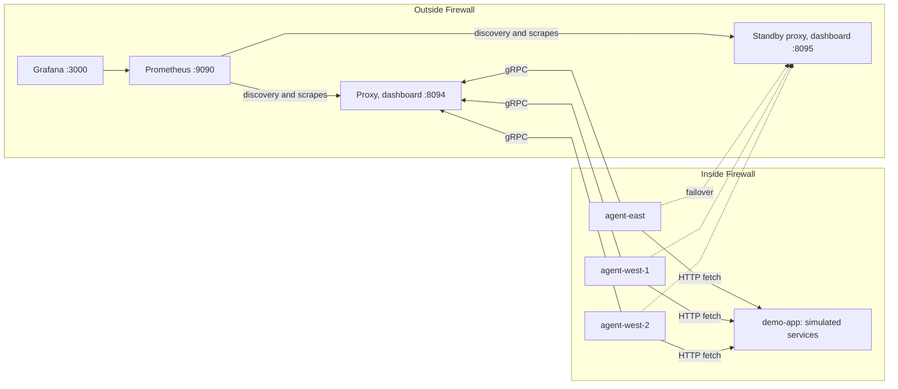

# Live Demo

The repository ships a demo that runs the whole system on one machine: a proxy and its standby, each with its
[dashboard](web-dashboard.md), three agents behind a simulated firewall, a set of simulated services, and Prometheus
and Grafana in front. It is the quickest way to watch the proxy work, and every screenshot on this page comes from it.

The proxy and agent images are built from your clone, so the demo shows the dashboard as it is in the code.



## Running it

You need Docker with Compose v2, a JDK 17 or later to run Gradle, and a clone of the repository. From its root:

```bash
make demo-up      # builds the jars and images, starts everything, prints the URLs
make demo-down    # stops it and removes its containers, network, and volume
```

The first `make demo-up` pulls the Prometheus, Grafana, and Python images and builds the jars, which takes a few
minutes. After that it starts in under a minute, and runs without a network connection.

| What | URL |
|---|---|
| Proxy dashboard | <http://localhost:8094/dashboard> |
| Standby proxy's dashboard | <http://localhost:8095/dashboard> |
| Grafana (no sign-in needed; admin / admin to edit) | <http://localhost:3000> |
| Prometheus | <http://localhost:9090> (alerts at `/alerts`) |
| The proxy's service discovery | <http://localhost:8080/discovery> |

Every port binds to `127.0.0.1` only: the dashboard has no authentication and Grafana keeps its default admin
password, which suits a laptop and nothing shared. To move a port that is already taken, set `DEMO_DASHBOARD_PORT`,
`DEMO_STANDBY_DASHBOARD_PORT`, `DEMO_GRAFANA_PORT`, `DEMO_PROMETHEUS_PORT`, or `DEMO_PROXY_PORT`, for example
`DEMO_GRAFANA_PORT=3001 make demo-up`.

## What's running

| Service | Role |
|---|---|
| `proxy` | The proxy, outside the firewall. Its dashboard is on, and its service discovery tells Prometheus about every path the agents register. |
| `proxy-standby` | The standby: the same config, with its own dashboard. Every agent lists it second, so it serves nothing until the primary goes. |
| `agent-east` | Scrapes the orders, payments, inventory, and catalog services, the proxy's own metrics, its own, and whatever its discovery file lists. |
| `agent-west-1`, `agent-west-2` | A redundant pair. Both run [consolidated](glossary.md#consolidated-mode) and serve `/shipping_metrics`, and the proxy merges their two replicas. |
| `agent-rogue` | Started only by `demo.sh rogue-agent`: a contractor's agent whose identity may register only `contractor_*` paths. |
| `demo-app` | The simulated services. Their traffic follows a 5-minute "day", so the graphs move. It also writes agent-east's discovery file. |
| `prometheus` | Scrapes every path through whichever proxy advertises it, every 5 seconds, with no targets in its config, and loads the project's alerting rules and a few fast demo ones. |
| `grafana` | Opens on the demo's dashboard, which links to the two dashboards the project ships. |

## The dashboard

The dashboard has two views of the same state: one organized by agent, one by path. Select any screenshot on this
page to see it full size.

<figure markdown="span">
  [{ loading=lazy }](images/demo/agents.webp)
  [{ loading=lazy }](images/demo/agents-light.webp)
  <figcaption>The Agents view, with agent-east selected</figcaption>
</figure>

Selecting an agent shows its address, host, uptime, idle time, and eviction countdown; the paths it registered, with
their labels; and its scrapes as they happen, with status, time, and size. The catalog payload is about 480,000
characters, large enough that the agent sends it to the proxy in chunks.

`/proxy_metrics` is the proxy's own metrics. They leave the proxy, pass through agent-east, and come back through the
proxy to Prometheus, so the proxy monitors itself the same way it serves everything else.

<figure markdown="span">
  [{ loading=lazy }](images/demo/paths.webp)
  [{ loading=lazy }](images/demo/paths-light.webp)
  <figcaption>The Paths view</figcaption>
</figure>

The Paths view lists every path with the agent serving it, its target, and how its last scrape went. `/shipping_metrics`
shows `agent-west-2 +1`, since two agents serve it. The button after a path copies its URL on the proxy, the one
to curl, and the one after a target copies the target's URL.

## Scenarios

`demos/dashboard/demo.sh` drives the scenarios below. Run it from the repository root; each command prints what to
watch, and a minute between them lets the graphs catch up.

### A service fails

```bash
./demos/dashboard/demo.sh outage      # payments answers 500
./demos/dashboard/demo.sh slow        # inventory hangs past the agent's timeout
```

<figure markdown="span">
  [{ loading=lazy }](images/demo/outage.webp)
  [{ loading=lazy }](images/demo/outage-light.webp)
  <figcaption>payments failing with 500, and inventory timing out</figcaption>
</figure>

Payments' scrapes fail with a 500. Inventory's hang until the agent gives up after its 3-second scrape timeout and
reports a 408 (`upstream_timed_out`), so Prometheus gets a clear answer instead of waiting. Every other path keeps
working: one failing target never affects the rest.

<figure markdown="span">
  [{ loading=lazy }](images/demo/grafana.webp)
  [{ loading=lazy }](images/demo/grafana-light.webp)
  <figcaption>The same outage in Grafana</figcaption>
</figure>

In Grafana, both targets turn red on **Target health**, **Scrape latency** spikes for inventory alone, and
**Scrape outcomes** shows the errors and timeouts at the proxy. After 15 seconds, **DemoTargetDown** fires for each:
the **Alerts** stat counts them, and so does Prometheus's `/alerts` page.

`./demos/dashboard/demo.sh recover` returns every service to normal, and the red rows turn green within a scrape or
two.

### New services appear without a restart

```bash
./demos/dashboard/demo.sh discover
```

<figure markdown="span">
  [{ loading=lazy }](images/demo/discovered.webp)
  [{ loading=lazy }](images/demo/discovered-light.webp)
  <figcaption>Three services added through dynamic discovery</figcaption>
</figure>

Within about 5 seconds, `/search_metrics`, `/recommendations_metrics`, and `/notifications_metrics` appear with the
source `disc` ([discovered](configuration/agent.md#dynamic-target-discovery)), beside the `cfg` (configured) paths.
Prometheus finds them through the proxy's [service discovery](service-discovery.md), with no restart and no change to
its config, and Grafana's **Discovered services** panel fills. `./demos/dashboard/demo.sh undiscover` removes them
just as quietly.

### An agent goes silent

```bash
./demos/dashboard/demo.sh agent-freeze    # agent-west-2: connected, but silent
```

<figure markdown="span">
  [{ loading=lazy }](images/demo/evicting.webp)
  [{ loading=lazy }](images/demo/evicting-light.webp)
  <figcaption>A frozen agent, counting down to its eviction</figcaption>
</figure>

The frozen agent's idle time climbs and its eviction countdown runs; the demo evicts an agent after 30 seconds of
silence. A consolidated path waits for every agent that serves it, so `/shipping_metrics` stalls too, and Prometheus's
scrapes of both paths give up at its 4-second timeout, recorded as 499 (`client_cancelled`).

<figure markdown="span">
  [{ loading=lazy }](images/demo/evicted.webp)
  [{ loading=lazy }](images/demo/evicted-light.webp)
  <figcaption>After the eviction: a departed path, marked gone</figcaption>
</figure>

Once the proxy evicts it, agent-west-2's own `/agent_west_2_metrics` stays in the Paths view marked `gone`, the status
bar counts it as departed, and agent-west-1 carries `/shipping_metrics` alone, which now shows agent-west-1's own
target.
`./demos/dashboard/demo.sh agent-thaw` unfreezes the agent, and it reconnects and registers again.

### Redundancy

```bash
./demos/dashboard/demo.sh agent-stop      # stops agent-west-2
./demos/dashboard/demo.sh agent-start     # it reconnects and rejoins in seconds
```

A stopped agent leaves the dashboard at once, and `/shipping_metrics` drops from `+1` to agent-west-1 alone. In
Grafana, **Shipping by replica** keeps west-1 flowing, and shipping stays green on **Target health**.

### The proxy fails over

Every agent lists two [proxy endpoints](production.md#high-availability), the primary and a standby, in order.

```bash
./demos/dashboard/demo.sh proxy-down      # stops the primary proxy
```

<figure markdown="span">
  [{ loading=lazy }](images/demo/failover.webp)
  [{ loading=lazy }](images/demo/failover-light.webp)
  <figcaption>The standby's dashboard, seconds after the primary stopped</figcaption>
</figure>

Within seconds every agent is on the standby, with no manual step: its dashboard shows each one
**via proxy-standby:50051 (2 of 2)**, marked **failed over**. Prometheus discovers through both proxies, so every
service stays up in Grafana, scraped through the standby; only `prometheus-proxy`, the primary's own metrics, goes
down, and **DemoTargetDown** fires for it alone.

`./demos/dashboard/demo.sh proxy-up` brings the primary back, but the agents stay on the standby: an agent returns to
the head of its list only when its connection drops. Once `prometheus-proxy` is green again,
`./demos/dashboard/demo.sh proxy-down proxy-standby` sends them back within seconds, and
`./demos/dashboard/demo.sh proxy-up proxy-standby` restores the standby.

### Filtering before the WAN

```bash
./demos/dashboard/demo.sh filter          # restarts agent-east with a metric filter for the catalog
```

<figure markdown="span">
  [{ loading=lazy }](images/demo/filtered.webp)
  [{ loading=lazy }](images/demo/filtered-light.webp)
  <figcaption>The catalog after the filter: about 190,000 characters, down from 480,000</figcaption>
</figure>

Most of the catalog's payload is a per-item price list no dashboard uses. The [filter](configuration/agent.md#metric-filtering)
drops that family at the agent, before the payload is compressed and sent to the proxy, so the catalog falls from
about 480,000 characters to about 190,000, and Grafana's **Payload size** drops with it. What never crosses the
firewall costs nothing to send, store, or query. `./demos/dashboard/demo.sh unfilter` restores the full payload.

### One proxy, several teams

The proxy has [per-agent identities](security/index.md#per-agent-identities-and-path-authorization): each data
center's agents connect with their own token, and an identity may register only the paths its patterns allow.

```bash
./demos/dashboard/demo.sh rogue-agent     # a contractor's agent tries to register payments_metrics
```

The contractor's agent appears on the dashboard with the one path its identity allows, `/contractor_metrics`. Its
`/payments_metrics` is refused, and the command prints the proxy's log line:

```
WARN  [ProxyServiceImpl.kt:322] - Agent identity 'contractor' denied registration of path /payments_metrics
```

Payments keeps coming from agent-east, untouched. With a shared token, the newer agent would have taken the path
over. `./demos/dashboard/demo.sh rogue-agent-stop` removes it.

## Scenario reference

| Command | Effect |
|---|---|
| `demo.sh outage [service]` | The service answers 500 (default `payments`) |
| `demo.sh slow [service]` | The service hangs past the agent's scrape timeout (default `inventory`) |
| `demo.sh recover` | Every service returns to normal |
| `demo.sh discover` / `undiscover` | Adds or removes the search, recommendations, and notifications services through agent-east's discovery file |
| `demo.sh agent-stop` / `agent-start [agent]` | Stops or starts an agent (default `agent-west-2`) |
| `demo.sh agent-freeze` / `agent-thaw [agent]` | Pauses or resumes an agent's container (default `agent-west-2`) |
| `demo.sh proxy-down` / `proxy-up [proxy]` | Stops or starts a proxy (default `proxy`, the primary; or `proxy-standby`) |
| `demo.sh filter` / `unfilter` | Restarts agent-east with or without the catalog filter |
| `demo.sh rogue-agent` / `rogue-agent-stop` | Starts or removes the contractor's agent |
| `demo.sh status` | The containers, the services' modes, and the URLs |
| `demo.sh logs [service]` | Follows the logs |
| `demo.sh open` | Opens the dashboard, Grafana, and Prometheus's alerts in the browser |

`recover`, `undiscover`, `agent-thaw`, `agent-start`, `proxy-up` (for each proxy), `unfilter`, and
`rogue-agent-stop` undo every scenario. For a clean slate, `make demo-down && make demo-up`.

## Going further

- The demo's [README](https://github.com/pambrose/prometheus-proxy/tree/master/demos/dashboard) lays these scenarios
  out as a presenter's script, with what each one means for the audience, and lists the files that set the demo up.
- [Dashboard](web-dashboard.md) covers every part of the dashboard, and how to turn it on for your own proxy.
- [Grafana & Alerting](grafana.md) covers the dashboards and alerting rules the project ships.
