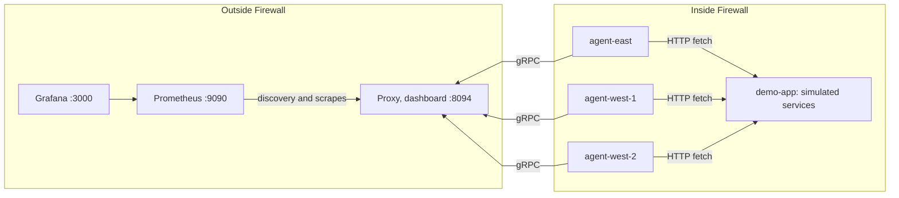

# Basics Demo

The repository ships a demo that runs the whole system on one machine: the proxy with its
[dashboard](web-dashboard.md), three agents behind a simulated firewall, a set of simulated services, and Prometheus
and Grafana in front. It is the quickest way to watch the proxy work, and every screenshot on this page comes from it.

The proxy and agent images are built from your clone, so the demo shows the dashboard as it is in the code.



## Running it

You need Docker with Compose v2, a JDK 17 or later to run Gradle, and a clone of the repository. The demo's commands
run from its own directory, where `make help` lists its targets. From the clone's root:

```bash
cd demos/basics
make up      # builds the jars and images, starts everything, prints the URLs
make tour    # walks through every scenario below, pausing before each step
make down    # stops it and removes its containers, network, and volume
```

The first `make up` pulls the Prometheus, Grafana, and Python images and builds the jars, which takes a few minutes.
After that it starts in under a minute, and runs without a network connection.

| What | URL |
|---|---|
| Proxy dashboard | <http://localhost:8094/dashboard> |
| Grafana (no sign-in needed; admin / admin to edit) | <http://localhost:3000> |
| Prometheus | <http://localhost:9090> (alerts at `/alerts`) |
| The proxy's service discovery | <http://localhost:8080/discovery> |

Every port binds to `127.0.0.1` only: the dashboard has no authentication and Grafana keeps its default admin
password, which suits a laptop and nothing shared. To move a port that is already taken, set `DEMO_DASHBOARD_PORT`,
`DEMO_GRAFANA_PORT`, `DEMO_PROMETHEUS_PORT`, or `DEMO_PROXY_PORT`, for example `DEMO_GRAFANA_PORT=3001 make up`.

## What's running

| Service | Role |
|---|---|
| `proxy` | The proxy, outside the firewall. Its dashboard is on, and its service discovery tells Prometheus about every path the agents register. |
| `agent-east` | Scrapes the orders, payments, inventory, and catalog services, the proxy's own metrics, its own, and whatever its discovery file lists. |
| `agent-west-1`, `agent-west-2` | A redundant pair. Both run [consolidated](glossary.md#consolidated-mode) and serve `/shipping_metrics`, and the proxy merges their two replicas. |
| `agent-rogue` | Started only by `demo.sh rogue-agent`: a contractor's agent whose identity may register only `contractor_*` paths. |
| `agent-east-copy` | Started only by `demo.sh duplicate-agent`: agent-east's config, deployed a second time. |
| `demo-app` | The simulated services. Their traffic follows a 5-minute "day", so the graphs move. It also writes agent-east's discovery file. |
| `prometheus` | Scrapes every path through the proxy every 5 seconds, with no targets in its config, and loads the project's alerting rules and a few fast demo ones. |
| `grafana` | Opens on the demo's dashboard, which links to the two dashboards the project ships. |

## The dashboard

The dashboard has three views: one organized by agent, one by path, and one of what has happened, newest first. Select
any screenshot on this page to see it full size.

<figure markdown="span">
  [{ loading=lazy }](images/demo/agents.webp)
  [{ loading=lazy }](images/demo/agents-light.webp)
  <figcaption>The Agents view, with agent-east selected</figcaption>
</figure>

Selecting an agent shows its address, host, uptime, idle time, and eviction countdown; the paths it registered, with
their labels; and its scrapes as they happen, with status, time, and size. The catalog payload is about 480,000
characters, large enough that the agent sends it to the proxy in chunks.

`/proxy_metrics` is the proxy's own metrics. They leave the proxy, pass through agent-east, and come back through the
proxy to Prometheus, so the proxy monitors itself the same way it serves everything else.

<figure markdown="span">
  [{ loading=lazy }](images/demo/paths.webp)
  [{ loading=lazy }](images/demo/paths-light.webp)
  <figcaption>The Paths view</figcaption>
</figure>

The Paths view lists every path with the agent serving it, its target, and how its last scrape went. `/shipping_metrics`
shows `agent-west-2 +1`, since two agents serve it. The button after a path copies its URL on the proxy, the one
to curl, and the one after a target copies the target's URL.

## Scenarios

`demo.sh`, in `demos/basics`, drives the scenarios below. Run it from that directory, where `make up` started
the demo; each command prints what to watch, and a minute between them lets the graphs catch up.

### One service fails, another hangs, and the rest keep working

```bash
./demo.sh outage      # payments answers 500
./demo.sh slow        # inventory hangs past the agent's timeout
```

<figure markdown="span">
  [{ loading=lazy }](images/demo/outage.webp)
  [{ loading=lazy }](images/demo/outage-light.webp)
  <figcaption>payments failing with 500, and inventory timing out</figcaption>
</figure>

Payments' scrapes fail with a 500. Inventory's hang until the agent gives up after its 3-second scrape timeout and
reports a 408 (`upstream_timed_out`), so Prometheus gets a clear answer instead of waiting. Every other path keeps
working: one failing target never affects the rest.

<figure markdown="span">
  [{ loading=lazy }](images/demo/grafana.webp)
  [{ loading=lazy }](images/demo/grafana-light.webp)
  <figcaption>The same outage in Grafana</figcaption>
</figure>

In Grafana, both targets turn red on **Target health**, **Scrape latency** spikes for inventory alone, and
**Scrape outcomes** shows the errors and timeouts at the proxy. After 15 seconds, **DemoTargetDown** fires for each:
the **Alerts** stat counts them, and so does Prometheus's `/alerts` page.

`./demo.sh recover` returns every service to normal, and the red rows turn green within a scrape or two.

### New services appear without a restart

```bash
./demo.sh discover
```

<figure markdown="span">
  [{ loading=lazy }](images/demo/discovered.webp)
  [{ loading=lazy }](images/demo/discovered-light.webp)
  <figcaption>Three services added through dynamic discovery</figcaption>
</figure>

Within about 5 seconds, `/search_metrics`, `/recommendations_metrics`, and `/notifications_metrics` appear with the
source `disc` ([discovered](configuration/agent.md#dynamic-target-discovery)), beside the `cfg` (configured) paths.
Prometheus finds them through the proxy's [service discovery](service-discovery.md), with no restart and no change to
its config, and Grafana's **Discovered services** panel fills. `./demo.sh undiscover` removes them just as quietly.

### The proxy evicts an agent that goes silent

```bash
./demo.sh agent-freeze    # agent-west-2: connected, but silent
```

<figure markdown="span">
  [{ loading=lazy }](images/demo/evicting.webp)
  [{ loading=lazy }](images/demo/evicting-light.webp)
  <figcaption>A frozen agent, counting down to its eviction</figcaption>
</figure>

The frozen agent's idle time climbs and its eviction countdown runs; the demo evicts an agent after 30 seconds of
silence. A consolidated path waits for every agent that serves it, so `/shipping_metrics` stalls too, and Prometheus's
scrapes of both paths give up at its 4-second timeout, recorded as 499 (`client_cancelled`).

<figure markdown="span">
  [{ loading=lazy }](images/demo/evicted.webp)
  [{ loading=lazy }](images/demo/evicted-light.webp)
  <figcaption>After the eviction: a departed path, marked gone</figcaption>
</figure>

Once the proxy evicts it, agent-west-2's own `/agent_west_2_metrics` stays in the Paths view marked `gone`, the status
bar counts it as departed, and agent-west-1 carries `/shipping_metrics` alone, which now shows agent-west-1's own
target. The Activity view lists the eviction as a problem, with how long the proxy waited and the paths the agent
served. `./demo.sh agent-thaw` unfreezes the agent, and it reconnects and registers again.

### A second agent keeps a path up when one stops

```bash
./demo.sh agent-stop      # stops agent-west-2
./demo.sh agent-start     # it reconnects and rejoins in seconds
```

A stopped agent leaves the dashboard at once, and `/shipping_metrics` drops from `+1` to agent-west-1 alone. In
Grafana, **Shipping by replica** keeps west-1 flowing, and shipping stays green on **Target health**.

### Per-team tokens restrict which paths an agent can register

The proxy has [per-agent identities](security/index.md#per-agent-identities-and-path-authorization): each data
center's agents connect with their own token, and an identity may register only the paths its patterns allow.

```bash
./demo.sh rogue-agent     # a contractor's agent tries to register payments_metrics
```

The contractor's agent appears on the dashboard with the one path its identity allows, `/contractor_metrics`. Its
`/payments_metrics` is refused, which no list of agents or paths can show, since nothing was added. The Activity view
shows it, searched here for the contractor's agent:

<figure markdown="span">
  [{ loading=lazy }](images/demo/activity.webp)
  [{ loading=lazy }](images/demo/activity-light.webp)
  <figcaption>The Activity view, searched for agent-rogue</figcaption>
</figure>

The command also prints the proxy's log line:

```
WARN  [ProxyServiceImpl.kt:333] - Agent identity 'contractor' denied registration of path /payments_metrics
```

Payments keeps coming from agent-east, untouched. With a shared token, the newer agent would have taken the path
over. `./demo.sh rogue-agent-stop` removes it.

### A duplicate agent takes over the paths, and the proxy logs the fix

```bash
./demo.sh duplicate-agent    # a second copy of agent-east, without consolidated mode
```

<figure markdown="span">
  [{ loading=lazy }](images/demo/duplicate.webp)
  [{ loading=lazy }](images/demo/duplicate-light.webp)
  <figcaption>agent-east, left with no paths by its copy</figcaption>
</figure>

Someone deployed agent-east's config twice. The copy registers the same paths with the same identity, and the newer
registration takes each one: agent-east-copy serves all six, and agent-east stays connected with none. The two
settle; agent-east doesn't reconnect and take the paths back, which used to make two such agents swap them every few
seconds. The command prints the proxy's log line, which names both agents and gives the fix: `agent.consolidated =
true` on each, if both should serve the paths. `./demo.sh duplicate-agent-stop` removes the copy and restarts
agent-east, which registers its paths again.

## Scenario reference

| Command | Effect | How it works |
|---|---|---|
| `demo.sh outage [service]` | The service answers 500 (default `payments`) | demo-app's control API: `POST /control/<service>/error` |
| `demo.sh slow [service]` | The service hangs past the agent's scrape timeout (default `inventory`) | `POST /control/<service>/slow`: demo-app holds each request 10 seconds, past the agent's 3-second `scrapeTimeoutSecs` |
| `demo.sh recover` | Every service returns to normal | `POST /control/all/ok` |
| `demo.sh discover` / `undiscover` | Adds or removes the search, recommendations, and notifications services through agent-east's discovery file | demo-app rewrites `/discovery/targets.json`, which agent-east re-reads every 5 seconds |
| `demo.sh agent-stop` / `agent-start [agent]` | Stops or starts an agent (default `agent-west-2`) | `docker compose stop` / `start`: the agent's connection closes as it exits |
| `demo.sh agent-freeze` / `agent-thaw [agent]` | Pauses or resumes an agent's container (default `agent-west-2`) | `docker compose pause` / `unpause`: the connection stays open but silent, so the proxy evicts the agent after 30 seconds |
| `demo.sh rogue-agent` / `rogue-agent-stop` | Starts or removes the contractor's agent | Starts or removes `agent-rogue` (compose profile `rogue`), which presents the contractor identity's token, allowed only `contractor_*` paths |
| `demo.sh duplicate-agent` / `duplicate-agent-stop` | Starts a second copy of agent-east, or removes it and restarts agent-east | Starts or removes `agent-east-copy` (profile `duplicate`): agent-east's config under another name, not consolidated |
| `make tour [PART=n]` | Walks through every scenario, from part 1 or the one given, pausing before each step |  |
| `make status` | The containers, the services' modes, and the URLs |  |
| `make logs [SERVICE=name]` | Follows the logs, of every service or the one given |  |
| `make open` | Opens the dashboard, Grafana, and Prometheus's alerts in the browser |  |

`recover`, `undiscover`, `agent-thaw`, `agent-start`, `rogue-agent-stop`, and `duplicate-agent-stop` undo every
scenario. For a clean slate, `make down && make up`.

## Going further

- The demo's [README](https://github.com/pambrose/prometheus-proxy/tree/master/demos/basics) lays these scenarios
  out as a presenter's script, with what each one means for the audience, and lists the files that set the demo up.
- The [Network Demo](network-demo.md) puts a simulated WAN between the agents and the proxies, and shows what a far,
  thin, dead, flaky, or missing link does. It also covers what this demo leaves out: the agents failing over to a
  standby proxy, a filter at the agent that keeps a payload from crossing the firewall, and a call followed through
  the firewall in Zipkin.
- [Dashboard](web-dashboard.md) covers every part of the dashboard, and how to turn it on for your own proxy.
- [Grafana & Alerting](grafana.md) covers the dashboards and alerting rules the project ships.
