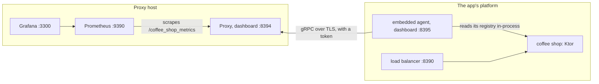

# Embedded Demo

The repository ships a demo of the agent [embedded](embedded-agent.md) in an app: a coffee shop, a small Ktor app with
built-in customers, runs the agent inside its own JVM. The agent connects to a proxy, and Prometheus and Grafana sit
beside the proxy. It's the setup [Cloud Platforms](cloud-platforms.md) describes, with the app on ECS, Cloud Run, or
Azure Container Apps and the proxy on another host, run on one machine.



## What you need

On macOS or Linux, the demo needs:

- [Docker](https://docs.docker.com/get-started/get-docker/) with Compose v2: Docker Desktop, or Docker Engine with the
  Compose plugin.
- `git`, to clone the repository, and GNU `make`. On macOS, the Xcode command-line tools (`xcode-select --install`)
  have both. Where GNU make is installed as `gmake`, type `gmake` wherever these instructions say `make`.
- `curl`, which the demo uses to wait for each service to answer, and to turn the coffee shop's knobs.
- A web browser.

`make up` runs the latest release's proxy image, from Docker Hub, and builds the coffee shop inside Docker against the
latest release's library, from Maven Central, so it needs no JDK.

## Running it

Clone the repository at the latest release, then run the demo's commands from its own directory, where `make help` lists
its targets:

```bash
git clone -c advice.detachedHead=false --depth 1 --branch 4.7.0 https://github.com/pambrose/prometheus-proxy.git
cd prometheus-proxy/demos/embedded
make up      # builds the coffee shop, starts everything, prints the URLs
make tour    # walks through every scenario below, pausing before each step
make down    # stops it and removes its containers and network
```

The first `make up` pulls the images and builds the coffee shop, which takes a few minutes. After that it starts in
under a minute.

| What | URL |
|---|---|
| The coffee shop, through its load balancer | <http://localhost:8390> |
| Proxy dashboard | <http://localhost:8394/dashboard> |
| Grafana (no sign-in needed; admin / admin to edit) | <http://localhost:3300> |
| Prometheus | <http://localhost:9390> (alerts at `/alerts`) |
| The coffee shop's metrics, through the proxy | <http://localhost:8380/coffee_shop_metrics> |
| The coffee shop agent's dashboard | <http://localhost:8395/dashboard> |
| Version 1.1's agent's dashboard, after `./demo.sh deploy` | <http://localhost:8396/dashboard> |
| The agent's `/debug` page, on its admin port | <http://localhost:8393/debug> |

The ports are the [Basics Demo](basics-demo.md)'s plus 300, so the two can run side by side. Every port binds to
`127.0.0.1` only. To move one that is already taken, set `EMBEDDED_DEMO_APP_PORT`, `EMBEDDED_DEMO_DASHBOARD_PORT`,
`EMBEDDED_DEMO_GRAFANA_PORT`, `EMBEDDED_DEMO_PROMETHEUS_PORT`, `EMBEDDED_DEMO_PROXY_PORT`,
`EMBEDDED_DEMO_AGENT_ADMIN_PORT`, `EMBEDDED_DEMO_AGENT_DASHBOARD_PORT`, or
`EMBEDDED_DEMO_NEXT_AGENT_DASHBOARD_PORT`, for example `EMBEDDED_DEMO_GRAFANA_PORT=3301 make up`.

## What's running

| Service | Role |
|---|---|
| `coffee-shop` | The app, version 1.0: a Ktor server whose built-in customers order over HTTP, and whose baristas brew from a queue. Its metrics, with Ktor's HTTP and the JVM's, are in a Micrometer registry, and it serves no `/metrics`. The agent runs inside it, installed with the [Ktor plugin](ktor-plugin.md) from settings the app builds in code, and reads the registry in-process. Its admin endpoints, `/debug` among them, are on port 8393, for debugging it, and its [dashboard](agent-dashboard.md) on port 8395. |
| `coffee-shop-next` | Started only by `demo.sh deploy`: version 1.1 of the same image, beside 1.0, as a rolling deploy does. Its agent's dashboard is on port 8396. |
| `load-balancer` | The coffee shop's one address, on port 8390, as a platform's load balancer is: it sends every request to 1.0, or to 1.1 once a deploy has stopped 1.0. |
| `proxy` | The stock proxy image. It takes its TLS certificate and key as [PEM in environment variables](security/tls.md#certificates-as-environment-variables), and the agent's token from one too, with none of them in a file. |
| `prometheus` | Scrapes the coffee shop's paths through the proxy every 5 seconds, and the proxy's own metrics, and loads the project's alerting rules and the coffee shop's. |
| `grafana` | Opens on the Coffee Shop dashboard, which links to the two dashboards the project ships. |

The secrets are the repository's test certificates and a token, which `make up` writes to the demo's `docker/.env`
the first time it runs. The certificates are public, so this suits a laptop and nothing shared;
[Cloud Platforms](cloud-platforms.md#securing-the-link) shows how to make your own.

## The app and its agent

Select any screenshot on this page to see it full size.

<figure markdown="span">
  { loading=lazy }
  { loading=lazy }
  <figcaption>The coffee shop's status page</figcaption>
</figure>

The coffee shop's status page shows the queue, the baristas on shift, and the drinks served. It has no `/metrics`:
`./demo.sh peek` shows it answering 404, then reads the shop's metrics through the proxy, where Prometheus finds them.
The agent reads the app's registry in-process, so Prometheus needs no password, port, or way into the app.

<figure markdown="span">
  { loading=lazy }
  { loading=lazy }
  <figcaption>The coffee shop's embedded agent on the proxy dashboard</figcaption>
</figure>

On the proxy dashboard, the embedded agent is an agent like any other: `coffee-shop-1.0`, named after the app's version,
with two paths, the coffee shop's metrics and its own, and its scrapes as they happen.

The agent has a [dashboard](agent-dashboard.md) of its own, served from inside the app at
<http://localhost:8395/dashboard>, with its side of the same two paths: each one's registration with the proxy, and its
recent scrapes as the agent saw them. Select `coffee_shop_metrics`, whose target is `in-process`, and **Scrape now**
reads the app's registry at once, from inside the app, and shows what came back, whether or not the proxy has the path. Its Connection view shows the agent's connection to the proxy, and its Activity view what the agent did, in
order. The coffee shop's environment turns it on, with nothing in the app's code: `DASHBOARD_ENABLED=true`, and a
`DASHBOARD_PORT` for each version, 8395 for 1.0 and 8396 for 1.1, which the agent reads itself, over anything the app's
code sets.

## Where the agent is configured

The coffee shop configures its agent in code, with no config file. `installPrometheusAgent`, in
[`PrometheusAgent.kt`](https://github.com/pambrose/prometheus-proxy/blob/master/demos/embedded/app/src/main/kotlin/coffeeshop/PrometheusAgent.kt),
builds the agent's settings from the app's environment in the [Ktor plugin](ktor-plugin.md)'s `agent { }` block, with
[`fromEnvironment()`](embedded-agent.md#settings-from-the-environment), serves the agent's own metrics beside the app's
with [`agentMetricsAt`](embedded-agent.md#the-agents-own-metrics), and installs the plugin with the app's registry:

```kotlin
--8<-- "demos/embedded/app/src/main/kotlin/coffeeshop/PrometheusAgent.kt:agent-config"
```

The app's Ktor module, `coffeeShop` in
[`Main.kt`](https://github.com/pambrose/prometheus-proxy/blob/master/demos/embedded/app/src/main/kotlin/coffeeshop/Main.kt),
calls it with the registry that Ktor's metrics and the shop's share; the plugin starts the agent once the module has
loaded, and stops it as the server stops:

```kotlin
--8<-- "demos/embedded/app/src/main/kotlin/coffeeshop/Main.kt:app-module"
```

- The app depends on `com.pambrose:prometheus-proxy-ktor`, which brings the agent, as
  [Adding the Dependency](ktor-plugin.md#adding-the-dependency) shows; the demo's build uses the latest release
  (`make up`) or this checkout (`make up-local`).
- Its image is built from
  [`app/Dockerfile`](https://github.com/pambrose/prometheus-proxy/blob/master/demos/embedded/app/Dockerfile), as
  [Packaging the App](cloud-platforms.md#packaging-the-app) describes, with a second way in that copies in a build
  made on the host, for `make up-local`.
- The environment comes from the demo's
  [`docker/compose.yml`](https://github.com/pambrose/prometheus-proxy/blob/master/demos/embedded/docker/compose.yml),
  whose `x-coffee-shop-env` block gives the proxy's address and the name its certificate was issued to, and reads the
  token and the CA certificate from `docker/.env`, which `make up` writes the first time
  it runs. It also turns on the agent's admin endpoints, `/debug`, and its dashboard, with `ADMIN_ENABLED`,
  `DEBUG_ENABLED`, and `DASHBOARD_ENABLED`, which the agent reads itself, and each version's service gives the
  dashboard its port, in `DASHBOARD_PORT`.

## The coffee shop in Grafana

<figure markdown="span">
  { loading=lazy }
  { loading=lazy }
  <figcaption>The Coffee Shop dashboard during a rush, with the espresso machine broken</figcaption>
</figure>

Grafana opens on the Coffee Shop dashboard: the shop right now, whether its agent is connected to the proxy, drinks
served by type, orders by outcome, the queue against the baristas, brew time, the order counter's HTTP statuses, and,
below them, Ktor's HTTP latency, the JVM's heap, and how long each scrape through the proxy took. Here a rush has filled
the queue, and with the espresso machine broken, about three orders in four fail, and `CoffeeShopErrors` fires.

```bash
./demo.sh rush            # customers order three times as often
./demo.sh baristas 8      # more baristas drain the queue
./demo.sh calm            # ends the rush
./demo.sh break-machine   # every espresso drink fails
./demo.sh fix-machine
```

## A deploy

<figure markdown="span">
  { loading=lazy }
  { loading=lazy }
  <figcaption>After a deploy, version 1.1's agent serves both paths</figcaption>
</figure>

`./demo.sh deploy` starts version 1.1 beside 1.0, then stops 1.0, as a rolling deploy does. 1.1's agent registers the
same paths with the same token, and the proxy gives each one to the newer registration, so Prometheus scrapes 1.0
through 1.0's agent, then 1.1 through 1.1's, with no gap in the graphs. The coffee shop keeps one address throughout:
its load balancer sends requests to 1.0 while it runs, and to 1.1 once it has stopped, so the status page at
<http://localhost:8390> now reads Version 1.1. Each version's agent has its own dashboard, inside its own app: 1.1's,
at <http://localhost:8396/dashboard>, lists the two paths registered. The proxy tells 1.0's agent it gave the paths
away, so until 1.0 stops, its own dashboard shows them as `retrying`, taken over by `coffee-shop-1.1`, and had 1.1
stopped first, as a failed deploy's new version does, 1.0's agent would have taken them back within seconds.
`./demo.sh rollback` puts 1.0 back.

## Debugging the agent

When an embedded agent doesn't connect, or a path doesn't scrape, its admin endpoints show what it's doing. The coffee
shop's environment turns them on with `ADMIN_ENABLED`, and its `/debug` page with `DEBUG_ENABLED`, with nothing in its
code, and the demo publishes the port on `127.0.0.1:8393`. The agent reads them itself, from the `x-coffee-shop-env`
block of the demo's `docker/compose.yml`:

```yaml
ADMIN_ENABLED: "true"     # its admin endpoints, on port 8093, published on 127.0.0.1:8393
DEBUG_ENABLED: "true"     # adds /debug
```

`./demo.sh debug` calls each endpoint and shows what it answered:

| Endpoint | What it answers |
|---|---|
| `/ping` | `pong`, while the agent is running, for a liveness probe |
| `/version` | The agent's version, release date, and build time, as JSON |
| `/healthcheck` | The agent's health checks, as JSON: its own health, not its connection, so it stays healthy while the proxy is down |
| `/threaddump` | Every thread in the coffee shop's JVM, the app's as well as the agent's |
| `/debug` | Only with `DEBUG_ENABLED`: the agent's name, the ID the proxy gave it when it connected, which is empty while it isn't connected, the proxy it's connected to or trying, and each path with the URL it scrapes, or `in-process` for the app's registry |

Turn them off once the agent works, since the admin port has no authentication and `/threaddump` shows the app's
threads: take `ADMIN_ENABLED` and `DEBUG_ENABLED` out of the app's environment and restart it, with no new build, and
set them again when you need to look. `ADMIN_PORT` moves the port. In code, `setting("admin.enabled", true)` and
`setting("admin.debugEnabled", true)` do the same, though the environment overrides them.
[Debugging](embedded-agent.md#debugging) on the Embedded Agent page has more.

The agent's [dashboard](agent-dashboard.md) answers the same questions in a browser, and some the admin endpoints
can't. Its Connection view shows the last error from each proxy endpoint while the agent can't connect, its Paths view
why the proxy refused a path, and its Activity view the order things happened in. The coffee shop logs a warning at
startup that the dashboard has no authentication and listens on all interfaces; inside the container it has to, for
Docker to publish its port, which the demo binds to `127.0.0.1`.

## The proxy goes away

`./demo.sh proxy-stop` stops the proxy. The coffee shop keeps serving, and an order still goes through
(`./demo.sh order`), since its agent retries in the background and the app never waits on it. Prometheus can't reach
the proxy, so the graphs stop, Grafana's **Agent** reads Disconnected, and `CoffeeShopDown` fires. The agent's `/debug` page, <http://localhost:8393/debug>,
shows an empty AgentId, since the agent has lost its connection, and the proxy it keeps trying, while its
`/healthcheck` still reads healthy. On the agent's dashboard, the Connection view,
<http://localhost:8395/dashboard/connection>, reads `failing`, with the error the agent's last try to reach
`proxy:50051` got, and its paths read `pending`. `./demo.sh proxy-start` brings the proxy back, and the agent
reconnects within a few seconds and registers its paths again. The dashboard's Activity view,
<http://localhost:8395/dashboard/activity>, then tells the outage in order, newest first: the paths `registered`,
`connected`, `connect failed`, and `disconnected`.

## Secrets from the environment

`./demo.sh secrets` lists the coffee shop's and the proxy's secrets by name, and shows that the app's container holds
no config file. The app builds its agent's settings in code from its environment, with `fromEnvironment()`, and the
stock proxy image, which has
no shell to write a variable to a file, takes its certificate and key as base64 PEM in `CERT_CHAIN_PEM` and
`PRIVATE_KEY_PEM`, and logs only whether each is set. On a cloud platform, they're the service's variables.

## Scenario reference

| Command | Effect |
|---|---|
| `demo.sh peek` | Looks for the coffee shop's `/metrics`, which it doesn't have, then reads its metrics through the proxy |
| `demo.sh order [drink]` | Orders a drink at the counter (default `latte`) |
| `demo.sh rush` / `calm` | Starts a rush, or ends it and keeps three baristas |
| `demo.sh baristas <count>` | Puts this many baristas on shift, from 1 to 12 |
| `demo.sh break-machine` / `fix-machine` | Every espresso drink fails, or is served again |
| `demo.sh deploy` / `rollback` | Deploys version 1.1 beside 1.0 and stops 1.0, or puts 1.0 back |
| `demo.sh proxy-stop` / `proxy-start` | Stops or starts the proxy |
| `demo.sh debug` | Calls each of the agent's admin endpoints, and shows its `/debug` page |
| `demo.sh secrets` | Shows where the secrets come from |
| `make tour [PART=n]` | Walks through every scenario, from part 1 or the one given, pausing before each step |
| `make status` | The containers, the coffee shop's state, and the URLs |
| `make logs [SERVICE=name]` | Follows the logs, of every service or the one given |
| `make open` | Opens the coffee shop, the proxy's and the agent's dashboards, Grafana, and Prometheus's alerts in the browser |

`calm`, `fix-machine`, `rollback`, and `proxy-start` undo every scenario. For a clean slate, `make down && make up`.

## Going further

- The demo's [README](https://github.com/pambrose/prometheus-proxy/tree/master/demos/embedded) has these scenarios as a
  guided tour, explaining how each one works, and lists the files that set the demo up. The coffee shop's code is in
  `demos/embedded/app`.
- [Cloud Platforms](cloud-platforms.md) sets the same thing up for real: the app on ECS, Cloud Run, or Azure Container
  Apps, and the proxy on AWS, GCP, Azure, DigitalOcean, or Railway, with your own certificate and token.
- [Embedded Agent](embedded-agent.md) covers the API the coffee shop uses, and the agent's logging and metrics inside
  a host app.
- The [Spring Boot Demo](spring-boot-demo.md) embeds the agent in a Spring Boot app written in Java with the Spring
  Boot starter, and shows the agent's lifecycle with the app's, the app's metrics read in-process, and the versions
  Spring Boot picks.
- The [Basics Demo](basics-demo.md) runs standalone agents behind a simulated firewall, with the proxy's dashboard.
- The [nginx Demo](nginx-demo.md) puts the proxy behind nginx, a reverse proxy that ends the agents' TLS.
