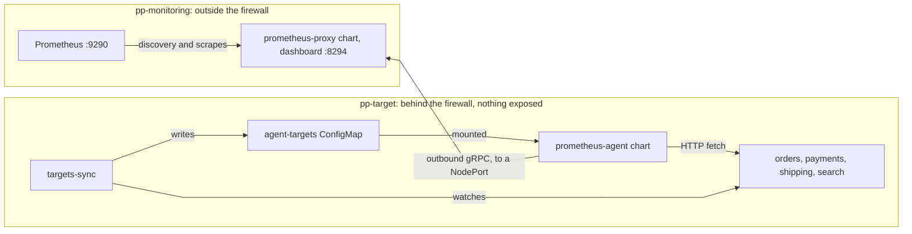

# Kubernetes Demo

The [Basics Demo](demo.md) and the [Network Demo](network-demo.md) show the proxy, its dashboard, and the link through
the firewall. This third demo deploys the same proxy and agent the way a platform team would run them: on two
[kind](https://kind.sigs.k8s.io/) clusters, with the project's own Helm charts, and Kubernetes doing the operating. It
shows that the target cluster exposes nothing, that annotating a Service is all it takes for Prometheus to scrape it,
that Kubernetes replaces a lost agent by itself, and what a change to the agent's config costs next to a change to its
targets. Every screenshot on this page comes from it.



## What you need

The proxy and agent are the latest release's images, which each cluster pulls from Docker Hub, so there's nothing to
build. On macOS or Linux, the demo needs only:

- [Docker](https://docs.docker.com/get-started/get-docker/): Docker Desktop, or Docker Engine. kind runs each cluster's
  node as a container.
- [kind](https://kind.sigs.k8s.io/docs/user/quick-start/#installation) 0.33.0 or later,
  [`kubectl`](https://kubernetes.io/docs/tasks/tools/), and [Helm](https://helm.sh/docs/intro/install/) 3 or 4.
  `demo.sh` checks for each.
- `git`, to clone the repository, and `make`. On macOS, the Xcode command-line tools (`xcode-select --install`) have
  both.
- `curl`, which the demo uses to wait for each service to answer.
- A web browser.

## Running it

Clone the repository, then run the demo's commands from its own directory, where `make help` lists its targets:

```bash
git clone https://github.com/pambrose/prometheus-proxy.git
cd prometheus-proxy/demos/kubernetes
make up      # creates both clusters, installs everything, prints the URLs
make tour    # walks through every scenario below, pausing before each step
make down    # deletes both clusters
```

The first `make up` pulls the kind node image, and each new cluster pulls its images, the proxy's and Prometheus's or
the agent's and Python's, which takes a few minutes. After that, `make up` on running clusters takes under a minute.

| What | URL |
|---|---|
| Proxy dashboard | <http://localhost:8294/dashboard> |
| Prometheus | <http://localhost:9290> (targets at `/targets`) |
| The proxy's service discovery | <http://localhost:8280/discovery> |
| `kubectl` | `kubectl --context kind-pp-monitoring …` and `kubectl --context kind-pp-target …` |

Each port is the Basics Demo's plus 200, so all three demos can run side by side. kind publishes them on `127.0.0.1`
only, through NodePort Services in the monitoring cluster: the dashboard has no authentication, which suits a laptop
and nothing shared. To move a port that is already taken, set `KUBERNETES_DEMO_DASHBOARD_PORT`,
`KUBERNETES_DEMO_PROMETHEUS_PORT`, or `KUBERNETES_DEMO_PROXY_PORT` when the cluster is created, for example
`KUBERNETES_DEMO_PROMETHEUS_PORT=9291 make up`.

## What's running

| Cluster | Workload | Role |
|---|---|---|
| `pp-monitoring` | `prometheus-proxy` | The proxy, from the `prometheus-proxy` chart, with its dashboard and [service discovery](service-discovery.md) on, and its gRPC port a NodePort (the chart's `agentService`) for the agent in the other cluster. |
| `pp-monitoring` | `prometheus` | Prometheus. Its one job finds every target through the proxy's `/discovery`, and scrapes each through the proxy, every 5 seconds. |
| `pp-target` | `prometheus-agent` | The agent, from the `prometheus-agent` chart, named for its pod. It dials the proxy's NodePort, with a token from a Secret, and takes its targets from a ConfigMap it re-reads every 5 seconds ([dynamic target discovery](configuration/agent.md#dynamic-target-discovery)). |
| `pp-target` | `targets-sync` | Lists and watches the Services in the `apps` namespace, and writes each one annotated `prometheus-proxy/path` into the agent's targets ConfigMap. Part of the demo, not the product. |
| `pp-target` | `orders`, `payments`, `shipping` | Simulated services, each behind a ClusterIP Service annotated `prometheus-proxy/path`. |

The proxy and agent images are built from the checkout and loaded into the clusters, so the demo always runs the code
as it is. The charts get nothing but a values file each, a config file, and the proxy's address.

## Scenarios

`demo.sh`, in `demos/kubernetes`, drives the scenarios below. Run it from that directory, where `make up` started the
demo; each command prints what to watch, and how long it took. The times on this page were measured on an
Apple-silicon laptop.

### The Helm charts on two clusters, with no inbound access

```bash
./demo.sh clusters    # pp-target's Services, each cluster's Helm release, and Prometheus's one job
```

```text
$ kubectl --context kind-pp-target get services --all-namespaces
NAMESPACE     NAME               TYPE        CLUSTER-IP      EXTERNAL-IP   PORT(S)                  AGE
apps          orders             ClusterIP   10.96.135.38    <none>        8000/TCP                 2m27s
apps          payments           ClusterIP   10.96.151.15    <none>        8000/TCP                 2m27s
apps          shipping           ClusterIP   10.96.20.183    <none>        8000/TCP                 2m27s
default       kubernetes         ClusterIP   10.96.0.1       <none>        443/TCP                  3m8s
kube-system   kube-dns           ClusterIP   10.96.0.10      <none>        53/UDP,53/TCP,9153/TCP   3m7s
monitoring    prometheus-agent   ClusterIP   10.96.100.246   <none>        8083/TCP                 2m27s
```

Every Service in the target cluster is ClusterIP: nothing in it can be reached from outside, and kind maps none of its
ports to the host but the API server's, for `kubectl`. The agent dialed out to the proxy; nothing dialed in. `helm list`
shows the proxy chart in one cluster and the agent chart in the other, and Prometheus's config names no target in the
target cluster: its one job asks the proxy's `/discovery` what to scrape.

<figure markdown="span">
  { loading=lazy }
  { loading=lazy }
  <figcaption>The agent on the dashboard, under its pod's name, connected from the target cluster</figcaption>
</figure>

The dashboard lists one agent, under its pod's name, the one `kubectl` shows: the agent chart sets `AGENT_NAME` from the
pod with the downward API. It has four paths: its own metrics, from its config, and the three services, from
discovery.

<figure markdown="span">
  { loading=lazy }
  { loading=lazy }
  <figcaption>Prometheus's targets: every one found through the proxy's /discovery, and scraped through the proxy</figcaption>
</figure>

### Annotate a Service, and Prometheus scrapes it

```bash
./demo.sh add-service     # deploys search, then its Service, annotated prometheus-proxy/path: search_metrics
```

targets-sync sees the new Service and writes it into the agent's targets ConfigMap. The kubelet copies the ConfigMap
into the agent's pod, the agent re-reads it and registers the path, and Prometheus picks it up from the proxy's
`/discovery`. The path was in `/discovery` 1 to 7 seconds after the Service was created, and in Prometheus within its
5-second discovery refresh after that. Nothing restarted: the agent's pod is the same one, and no other path missed a
scrape.

<figure markdown="span">
  { loading=lazy }
  { loading=lazy }
  <figcaption>search_metrics on the Paths view, its source disc: from discovery, not the agent's config</figcaption>
</figure>

The delay is mostly the kubelet's. It copies a changed ConfigMap into the pods that mount it on its periodic sync, every
`syncFrequency`, which is a minute on a production kubelet; the demo's target cluster lowers it to 5 seconds. With the
default, which the demo's monitoring cluster keeps, the same change took 63 to 74 seconds to reach a pod; with 5
seconds, 1 to 7. The agent's own re-read, `agent.discovery.reconcileIntervalSecs`, comes on top.
`./demo.sh remove-service` removes the annotation, and the path leaves `/discovery` within about 10 seconds, again
without a restart.

The [Basics Demo](demo.md) shows dynamic discovery itself, from a file; here Kubernetes drives it. targets-sync is the
demo's: a discovery source in the agent that read Services itself would replace it.

### Kubernetes replaces a deleted agent pod in about a second

```bash
./demo.sh delete-agent-pod   # deletes the agent's pod; its Deployment starts another
```

```text
$ kubectl --context kind-pp-target -n monitoring delete pod prometheus-agent-8588c987c9-dqns8 --wait=false
pod "prometheus-agent-8588c987c9-dqns8" deleted from monitoring namespace
prometheus-agent-8588c987c9-llglr is on the dashboard with its paths, 2s after
  Scrapes of orders_metrics through the proxy failed for about 1s.
```

The Deployment starts a new pod at once. Its agent connects out to the proxy and registers every path again, under its
own pod's name, about 1.3 seconds after the delete, and scrapes through the proxy fail for about a second meanwhile: a
Prometheus scrape that lands in it fails, and the next succeeds. Nobody touched the agent. In Prometheus, each target's
`agent` label is the pod's name, so the new pod's scrapes start new series, as a `pod` label's would.

<figure markdown="span">
  { loading=lazy }
  { loading=lazy }
  <figcaption>The Activity view, newest first: the new pod's agent arriving with every path, the old one leaving, and below, the search service's path coming and going</figcaption>
</figure>

### A config change restarts the agent; a targets change doesn't

```bash
./demo.sh change-config      # helm upgrade with a change to the agent's main config
```

```text
Upgrading the prometheus-agent chart with config/agent-change.conf added to its main config
$ helm --kube-context kind-pp-target --namespace monitoring upgrade prometheus-agent ../../charts/prometheus-agent \
    --reuse-values --set-file config=<(cat config/agent.conf config/agent-change.conf)
prometheus-agent-85db4c79cb-s6d98 is on the dashboard with its paths, 2s after
  Scrapes of orders_metrics through the proxy failed for about 2s.
```

The change turns on the agent's JVM metrics. The chart renders the agent's config into a ConfigMap and stamps the pod
with its checksum, so the upgrade replaces the pod, and the chart's `strategy: Recreate` stops the old one before
starting the new, since both would register the same paths. That's a gap: scrapes through the proxy fail for about
1.3 seconds. Compare the annotated Service above, where the targets changed and nothing restarted. That's why the agent
chart keeps the targets in a ConfigMap of their own, which the agent re-reads in place, apart from its main config,
which only a restart applies. `./demo.sh restore-config` puts the original config back, with another replacement.

## Scenario reference

| Command | Effect | How it works |
|---|---|---|
| `demo.sh clusters` | Shows the target cluster's Services, each cluster's Helm release, and Prometheus's scrape config | `kubectl get services`, `helm list`, and Prometheus's ConfigMap |
| `demo.sh add-service` / `remove-service` | Deploys the search service and then its annotated Service; or removes the annotation and then deletes both | `kubectl apply` / `kubectl annotate ... prometheus-proxy/path-`; targets-sync rewrites the `agent-targets` ConfigMap, which the kubelet copies into the agent's pod |
| `demo.sh delete-agent-pod` | Deletes the agent's pod, and reports when its replacement registered and how long scrapes failed | `kubectl delete pod`; the agent's Deployment starts a replacement |
| `demo.sh change-config` / `restore-config` | Upgrades the agent chart with or without the config change, and reports the replacement the same way | `helm upgrade --set-file config=...`; the config's checksum on the pod template makes the Deployment replace the pod |
| `make tour [PART=n]` | Walks through every scenario, from part 1 or the one given, pausing before each step |  |
| `make status` | Both clusters' pods and Services, the Helm releases, and the URLs |  |
| `make logs [SERVICE=name]` | Follows a workload's logs: `agent`, the default, `proxy`, `prometheus`, `targets-sync`, or a service |  |
| `make open` | Opens the dashboard and Prometheus's targets in the browser |  |

`remove-service` and `restore-config` undo every scenario. For a clean slate, `make down && make up`.

## Going further

- The demo's [README](https://github.com/pambrose/prometheus-proxy/tree/master/demos/kubernetes) lays these scenarios
  out as a presenter's script, with what each one means for the audience, and lists the files that set the demo up,
  including how `make up` connects the two clusters. It also says why the demo runs one agent, not two consolidated
  replicas.
- [Kubernetes](kubernetes.md) is the guide to the deployment itself: the charts, exposing the proxy's gRPC port to
  other clusters, and updating targets without restarting the agent.
- [Agent Configuration](configuration/agent.md#dynamic-target-discovery) covers dynamic target discovery, which the
  agent's targets ConfigMap feeds.
