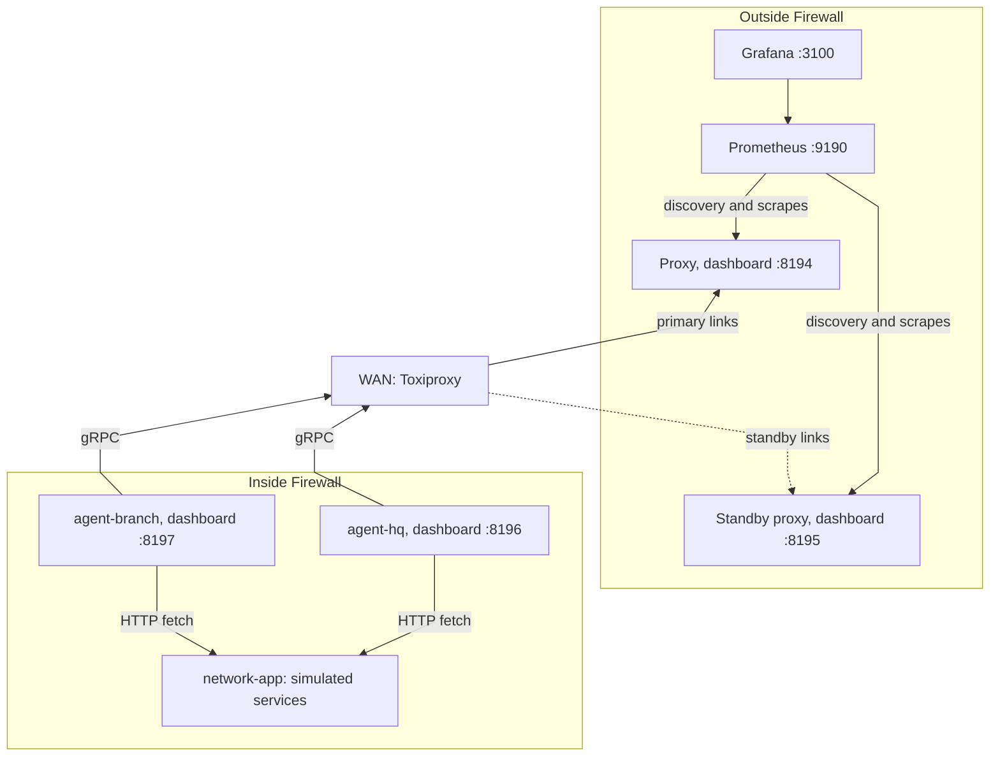
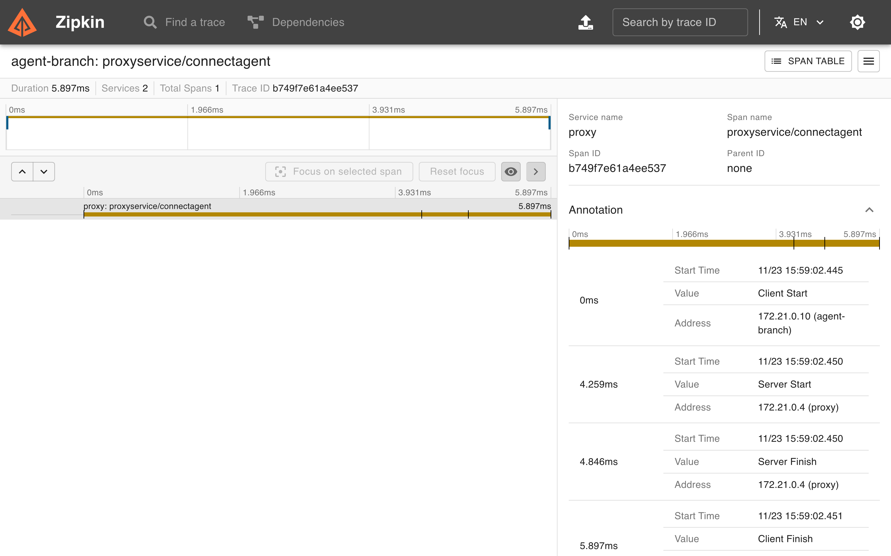

# Network Demo

The [Basics Demo](basics-demo.md) shows the proxy, its dashboard, and Grafana with a perfect network between the agents
and the proxy. This second demo puts a simulated WAN there, the link through the firewall that the product exists to
cross, and shows what a far, thin, dead, flaky, or missing link does, and how the proxy and agents cope. Every
screenshot on this page comes from it.

The WAN is [Toxiproxy](https://github.com/Shopify/toxiproxy), with four links: one from each agent to each proxy. Each
agent lists its link to the primary proxy first and its link to the standby second, so the dashboards name the link
an agent connected through. Each agent serves its own [dashboard](agent-dashboard.md) too, which shows the agent's side
of each failure: the endpoint it's trying, the error it got from each, and what happened, in order.



## What you need

The proxy and agent are the latest release's images, from Docker Hub, the same ones the Basics Demo runs, so there's
nothing to build. On macOS or Linux, the demo needs only:

- [Docker](https://docs.docker.com/get-started/get-docker/) with Compose v2: Docker Desktop, or Docker Engine with the
  Compose plugin.
- `git`, to clone the repository, and GNU `make`. On macOS, the Xcode command-line tools (`xcode-select --install`)
  have both. Where GNU make is installed as `gmake`, type `gmake` wherever these instructions say `make`.
- `curl`, which the demo uses to wait for each service to answer.
- A web browser.

## Running it

Clone the repository at the latest release, then run the demo's commands from its own directory, where `make help` lists
its targets:

```bash
git clone -c advice.detachedHead=false --depth 1 --branch 4.7.0 https://github.com/pambrose/prometheus-proxy.git
cd prometheus-proxy/demos/network
make up      # pulls the images, starts everything, prints the URLs
make tour    # walks through every scenario below, pausing before each step
make down    # stops it and removes its containers and network
```

The first `make up` pulls the proxy, agent, Prometheus, Grafana, Zipkin, Toxiproxy, and Python images, which takes a few
minutes. After that it starts in under a minute, and runs without a network connection.

| What | URL |
|---|---|
| Proxy dashboard | <http://localhost:8194/dashboard> |
| Standby proxy's dashboard | <http://localhost:8195/dashboard> |
| agent-hq's dashboard | <http://localhost:8196/dashboard> |
| agent-branch's dashboard | <http://localhost:8197/dashboard> (its connection at `/connection`, its history at `/activity`) |
| Grafana (no sign-in needed; admin / admin to edit) | <http://localhost:3100> |
| Prometheus | <http://localhost:9190> (alerts at `/alerts`) |
| The proxy's service discovery | <http://localhost:8180/discovery> |
| Zipkin | <http://localhost:9511/zipkin/> |

Each port is the Basics Demo's plus 100, so the two demos can run side by side. Every port binds to `127.0.0.1` only:
the dashboards run without their login and Grafana keeps its default admin password, which suits a laptop and nothing
shared. To move a port that is already taken, set `NETWORK_DEMO_DASHBOARD_PORT`, `NETWORK_DEMO_STANDBY_DASHBOARD_PORT`,
`NETWORK_DEMO_HQ_DASHBOARD_PORT`, `NETWORK_DEMO_BRANCH_DASHBOARD_PORT`, `NETWORK_DEMO_GRAFANA_PORT`,
`NETWORK_DEMO_PROMETHEUS_PORT`, `NETWORK_DEMO_PROXY_PORT`, or `NETWORK_DEMO_ZIPKIN_PORT`, for example
`NETWORK_DEMO_GRAFANA_PORT=3101 make up`.

## What's running

| Service | Role |
|---|---|
| `proxy` | The proxy, outside the firewall, with its dashboard and [service discovery](service-discovery.md) on. |
| `proxy-standby` | The standby: the same config, with its own dashboard. It serves nothing until an agent can't connect to the primary. |
| `wan` | Toxiproxy: the four links, `hq-to-proxy`, `hq-to-standby`, `branch-to-proxy`, and `branch-to-standby`. The proxies see every agent at the WAN's address, as they would behind a NAT. |
| `agent-hq` | The agent at headquarters: two small services and its own metrics. The scenarios that degrade one agent's links leave its links alone, so it is the steady reference. Its [dashboard](agent-dashboard.md) is on, on port 8196. |
| `agent-branch` | The agent at a branch office: a small shipping service, its own metrics, and an inventory service whose payload is about 496,000 characters, about 56 KB gzipped, so the agent sends it in chunks. Its [dashboard](agent-dashboard.md) is on, on port 8197, and shows the agent's side of each scenario. |
| `network-app` | The simulated services. Their traffic follows a 5-minute "day", so the graphs move. |
| `prometheus` | Scrapes every agent's paths through whichever proxy advertises them, every 5 seconds with a 4-second timeout, and both proxies' own metrics directly, from its own side of the WAN. It loads a few fast demo alerts. |
| `grafana` | Opens on the demo's dashboard: scrape time per agent, target health, payload size, connects, connected agents per proxy, evictions, bytes a filter saved, and firing alerts. |
| `zipkin` | Receives a span from every proxy and agent for each gRPC call between them but heartbeats and the stream of path notices, and each scrape's spans. |

## Scenarios

`demo.sh`, in `demos/network`, drives the scenarios below. Run it from that directory, where `make up` started the
demo; each command prints what to watch. The scenarios that change one agent's links change agent-branch's unless
they're given `agent-hq`, and `./demo.sh heal` ends each scenario: it removes every change to the WAN, brings back
every link and proxy, and returns any agent on the standby to the primary. The proxies' dashboards show each scenario
as the proxies see it; agent-branch's own dashboard, at <http://localhost:8197/dashboard>, shows the agent's side.

### A high-latency link slows scrapes, but nothing fails

```bash
./demo.sh far         # agent-branch's links add 250 ms, give or take 50 ms, each way
```

<figure markdown="span">
  { loading=lazy }
  { loading=lazy }
  <figcaption>agent-branch's scrape time steps up by a round trip; agent-hq's stays flat</figcaption>
</figure>

agent-branch's scrapes take about half a second, one round trip more, while agent-hq's stay well under a tenth of a
second. Nothing fails: the agent's connection is already open, so a scrape needs no new handshake through the firewall,
and costs the round trip and nothing more.

### A low-bandwidth link fails scrapes; filtering at the agent fixes it

```bash
./demo.sh thin        # agent-branch's links carry 8 KB/s toward the proxies
```

The inventory payload, about 56 KB gzipped, takes 7 seconds on this link, and Prometheus gives up at 4. Every path
shares the link, so it backs up behind the inventory, and within about 15 seconds the shipping service and the agent's
own metrics fail too. agent-hq, on its own links, is untouched.

<figure markdown="span">
  { loading=lazy }
  { loading=lazy }
  <figcaption>Most of a minute on the thin link: every scrape too late for Prometheus, and agent-branch still connected</figcaption>
</figure>

agent-branch stays connected all the while. Its answers keep arriving, too late for Prometheus, and each one tells the
proxy the agent is alive, so its idle time stays near zero and the proxy never evicts it: a saturated link is slow, not
dead. [A link that goes silent](#a-link-goes-silent-the-agent-detects-it-and-fails-over) shows one that is.
agent-branch's own dashboard shows the other side: every path's last scrape is a success, fetched from its target in a
fraction of a second. The targets are fine; the time goes on the link.

```bash
./demo.sh filter      # restarts agent-branch with a metric filter for the inventory
```

<figure markdown="span">
  { loading=lazy }
  { loading=lazy }
  <figcaption>The filtered inventory, about 199,000 characters, crossing the thin link in about 3 seconds</figcaption>
</figure>

Most of the inventory's payload is a per-item price list no dashboard uses. The
[filter](configuration/agent.md#metric-filtering) drops that family at the agent, before the payload is compressed and
chunked, so the inventory falls from about 496,000 characters to about 199,000, 21 KB gzipped. Each scrape takes about
3 seconds on the thin link, inside Prometheus's 4, and every path is green again within about 5 seconds. Grafana's
**Filter bytes saved at the agent**, from `agent_filter_bytes_saved_total`, climbs to about 60 KB a second: what never
crosses the WAN costs nothing to send, store, or query. The restarted agent connects at once; its old connection stays
on the agent list, with no paths, for about 20 seconds more, until what it had queued drains through the thin link.
On agent-branch's own dashboard, which reconnects to the restarted agent by itself, the inventory path's page shows the
filter's rules and how many lines and bytes it has dropped, and its recent scrapes give each body's size before and
after the filter. `./demo.sh heal` and then `./demo.sh unfilter` restore the link and the full payload. `heal` alone,
without the filter, brings every path back within a second or two, since what the thin link had queued drains at full
speed.

### The primary proxy stops, and the agents fail over to the standby

```bash
./demo.sh proxy-down  # stops the primary proxy
```

<figure markdown="span">
  { loading=lazy }
  { loading=lazy }
  <figcaption>The standby's dashboard: agent-branch via its link to the standby, marked failed over</figcaption>
</figure>

The primary's connections close, so both agents know at once, and within about 4 seconds they're on the standby, with
no manual step: its dashboard shows each one via its link to the standby, **(2 of 2)**, marked **failed over**, from
the agent's [ordered endpoints](configuration/agent.md#proxy-failover). Prometheus discovers through both proxies, so
within about 15 seconds every service is up again in Grafana, scraped through the standby; only `prometheus-proxy`, the
primary's own metrics, stays down, and **NetworkTargetDown** fires for it alone. Grafana's **Agents off their primary**
shows each agent at 1, the second endpoint in its list, from `agent_proxy_endpoint_index`, which each agent reports,
and about 20 seconds later **NetworkAgentNotOnPrimary** fires for both.

agent-branch's own dashboard shows the failover from the agent's side, which no proxy can. Its
[Connection view](agent-dashboard.md#the-connection-view), <http://localhost:8197/dashboard/connection>, reads
**connecting**, then **failing**, as its connect through `branch-to-proxy:50053` fails, then **connected** through
`branch-to-standby:50054`, marked **failed over**. Under **Proxy endpoints**, `branch-to-proxy:50053` keeps the error
its connect got, so a proxy that's down shows there, not only in the agent's log. Its
[Activity view](agent-dashboard.md#the-activity-view), <http://localhost:8197/dashboard/activity>, lists what the
agent went through, newest first: **disconnected**, **connect failed** on `branch-to-proxy:50053`, **failed over** to
`branch-to-standby:50054`, **connected**, and **registered**, one line for its three paths.

`./demo.sh proxy-up` brings the primary back, but the agents stay on the standby: an agent returns to the head of its
list only when its connection drops. **NetworkAgentNotOnPrimary** keeps firing, agent-branch's Connection view
doesn't change, and `branch-to-proxy:50053` keeps its error until a connect through it succeeds. `./demo.sh heal`
closes each agent's connection through its standby link once, and they return to the primary within seconds, which
resolves the alert: agent-branch's Activity view adds **disconnected**, **back to primary**, and **connected**, and
its Connection view drops the **failed over** tag.

### A link goes silent; the agent detects it and fails over

```bash
./demo.sh cut         # agent-branch's link to the primary goes silent, both ways
```

Here the connection doesn't close. The link stops passing anything, the agent's own goodbye included, which is what a
stateful firewall or NAT that drops a connection does, and nothing tells either end.

<figure markdown="span">
  { loading=lazy }
  { loading=lazy }
  <figcaption>The primary hears nothing from agent-branch: its idle time climbs toward the eviction</figcaption>
</figure>

Within about 10 seconds agent-branch's scrapes time out, and **NetworkTargetDown** goes pending for inventory,
shipping, and agent-branch, which Prometheus can't scrape through either proxy; it fires at about 25 seconds. The
agent's heartbeat fails three times, with a 5-second deadline each, so at about 20 seconds the agent gives up on the
connection and dials the head of its list again: the same dead link, where the connect waits out its 30-second
deadline (`agent.grpc.unaryDeadlineSecs`). Meanwhile the primary, which has heard nothing, evicts the agent after 30
seconds of silence (`proxy.internal.maxAgentInactivitySecs`, which the demo sets to 30), and **NetworkAgentEvicted**
fires. At about 50 seconds agent-branch connects through its link to the standby, failed over, while the primary is
still up, and about then **NetworkTargetDown** clears. Grafana's **Agents off their primary** shows it at 1. About 20
seconds later **NetworkAgentNotOnPrimary** fires for agent-branch alone, until `./demo.sh heal` brings it back.
agent-hq is untouched throughout.

agent-branch's Connection view, <http://localhost:8197/dashboard/connection>, shows the agent's side of the wait: from
about 20 seconds it reads **connecting**, with `branch-to-proxy:50053` tagged **trying**, until the connect's deadline
passes, and then that endpoint gets its error, `DEADLINE_EXCEEDED`, and the agent fails over. Its Activity view keeps
the whole sequence, **disconnected**, **connect failed**, **failed over**, **connected**, and **registered**, where the
proxies saw only an eviction and a new connection.

### A link that keeps dropping: the agent reconnects, traced in Zipkin

```bash
./demo.sh flaky       # agent-branch's link to the primary drops its connection about every 15 seconds
```

The link closes each connection once it has carried 170 KB toward the proxy, about 15 seconds of agent-branch's
traffic. Each time, the agent reconnects within milliseconds and stays on the primary, since a connection that
registered and then dropped retries from the head of the list. Grafana's **Agent connects, by agent**, from
`agent_connect_count_total`, climbs, and most scrapes succeed; the one in flight as a connection drops fails as
`agent_disconnected`. On agent-branch's Connection view, the count of connects climbs by one with each drop, and the
agent stays on `branch-to-proxy:50053`, with no **failed over** tag; its Activity view shows each drop as
**disconnected**, then **connected** and **registered**.

Every proxy and agent reports a [Zipkin](advanced.md#zipkin-tracing) span for each gRPC call between them but
heartbeats and the stream of path notices, under its own service name. In Zipkin, the search is `serviceName` =
`agent-branch` and `spanName` = `proxyservice/connectagent`.
Open <http://localhost:9511/zipkin/?serviceName=agent-branch&spanName=proxyservice%2Fconnectagent>, which fills that search in, and click **Run Query**.

<figure markdown="span">
  { loading=lazy }
  <figcaption>One reconnect's connectagent call, from agent-branch to the proxy</figcaption>
</figure>

Each reconnect is a `connectagent` trace, then `registeragent` and a `registerpath` for each path. Zipkin joins the
agent's client side and the proxy's server side of each call into one span, so a trace names both services, and its
annotations mark when the agent sent the call and the proxy answered it. A connection's scrape streams are traced too,
and appear as the connection closes, each about 15 seconds long: as long as the connection lasted.

Each scrape is a trace of its own: the proxy's `scrape` span, a `forward` span for the agent it went to, and under that
agent-branch's `fetch` of the target, which joins the trace the proxy sent with the request. Open
<http://localhost:9511/zipkin/?serviceName=agent-branch&spanName=fetch> and click **Run Query**. A failed scrape's spans are red: the one in flight as a connection drops ends its
`forward` span as `agent_disconnected`.

### The whole WAN goes down: an alert fires, and the agents reconnect

```bash
./demo.sh wan-down    # every link goes down
```

<figure markdown="span">
  { loading=lazy }
  { loading=lazy }
  <figcaption>Every link down: no agents connected, and NetworkNoAgentsConnected firing</figcaption>
</figure>

Both agents leave both proxies' dashboards at once, and retry every 3 seconds, alternating between their two links. A
proxy's `/discovery` lists only the paths of the agents connected to it, so within about 15 seconds their targets vanish
from Prometheus rather than staying red: on **Target health** their rows go red for a scrape or two, then stop.
Prometheus scrapes the proxies directly, on its own side of the WAN, so it still sees them: at about 20 seconds
**NetworkNoAgentsConnected**, built on `proxy_agent_map_size`, fires.

The proxies can't show an agent that can't reach them, but its own dashboard can. agent-branch's Connection view reads
**failing**, and the endpoint it's trying alternates between its two links, each with the error from its last connect.
Its Activity view records **connect failed** once for each link, since a repeat of the same failure isn't listed again,
and **failed over**, counted on one line as it repeats with each pass back through the link to the primary.

`./demo.sh wan-up` brings the links back. Within a few seconds each agent reconnects, through whichever of its links it
tries next, so one may land on the standby, and the alert resolves, leaving a gap in the graphs where nothing could be
scraped. An agent that lands on the standby shows at 1 on **Agents off their primary**, and about 20 seconds later
**NetworkAgentNotOnPrimary** fires for it. On agent-branch's Connection view, only the endpoint it connected through
loses its error; the other keeps its error until a connect through it succeeds. `./demo.sh heal` returns any agent on
the standby to the primary.

## Scenario reference

| Command | Effect | How it works |
|---|---|---|
| `demo.sh far [agent]` | Adds 250 ms of latency, give or take 50 ms, each way on both of the agent's links | A Toxiproxy `latency` toxic each way on both links |
| `demo.sh thin [agent]` | Caps both of the agent's links at 8 KB/s toward the proxies | A Toxiproxy `bandwidth` toxic toward the proxies on both links |
| `demo.sh filter` / `unfilter` | Restarts agent-branch with or without the inventory filter | Recreates agent-branch's container with `config/agent-branch-filtered.conf`, whose `agent.filters` drops `inventory_item_price_dollars`, or with `config/agent-branch.conf` |
| `demo.sh proxy-down` / `proxy-up [proxy]` | Stops or starts a proxy (default `proxy`, the primary; or `proxy-standby`) | `docker compose stop` / `start`; an agent whose connection closes dials its next endpoint |
| `demo.sh cut [agent]` | Silences the agent's link to the primary, both ways, closes included | Two `timeout` toxics with a timeout of 0, which drop all data, and two `slow_close` toxics, which hold the closes |
| `demo.sh flaky [agent]` | Closes each connection through the agent's link to the primary after about 15 seconds of its traffic | A `limit_data` toxic, which closes each connection after a set number of bytes |
| `demo.sh wan-down` / `wan-up` | Takes every link down, or brings every link back | Disables or enables all four Toxiproxy links; a disabled link closes its connections and refuses new ones |
| `demo.sh heal` | Removes every change to the WAN, brings back every link and proxy, and returns any agent on the standby to the primary | Removes the toxics, enables the links, starts the proxies, and disables an agent's link to the standby for a second, so it reconnects to the primary |
| `make tour [PART=n]` | Walks through every scenario, from part 1 or the one given, pausing before each step |  |
| `make status` | The containers, each link's state and changes, and the URLs |  |
| `make logs [SERVICE=name]` | Follows the logs, of every service or the one given |  |
| `make open` | Opens both proxy dashboards, agent-branch's dashboard, Grafana, and Prometheus's alerts in the browser |  |

The optional `[agent]` is `agent-branch`, the default, or `agent-hq`. `heal` and `unfilter` undo every scenario. For a
clean slate, `make down && make up`.

## Going further

- The demo's [README](https://github.com/pambrose/prometheus-proxy/tree/master/demos/network) has these scenarios as
  a guided tour, explaining how each one works, and lists the files that set the demo up,
  including which Toxiproxy toxic each scenario uses.
- The [nginx Demo](nginx-demo.md) puts nginx, a reverse proxy that ends the agents' TLS, between the agents and the
  proxy, and shows what its stream timeouts and its reloads do to an agent's connection, and what the dashboard needs
  behind it.
- The [Kubernetes Demo](kubernetes-demo.md) deploys the same proxy and agent with their Helm charts on two kind
  clusters, and shows Kubernetes driving the agent's targets and replacing its pod. It needs kind, `kubectl`, and Helm
  as well as Docker.
- [Agent Dashboard](agent-dashboard.md) covers the agent's own dashboard: its Paths, Connection, Activity, and Settings
  views, and Scrape now.
- [Running in Production](production.md#high-availability) covers a standby proxy and the agent's ordered endpoints.
- [Advanced Topics](advanced.md#stale-agent-cleanup) covers how the proxy evicts a silent agent.
