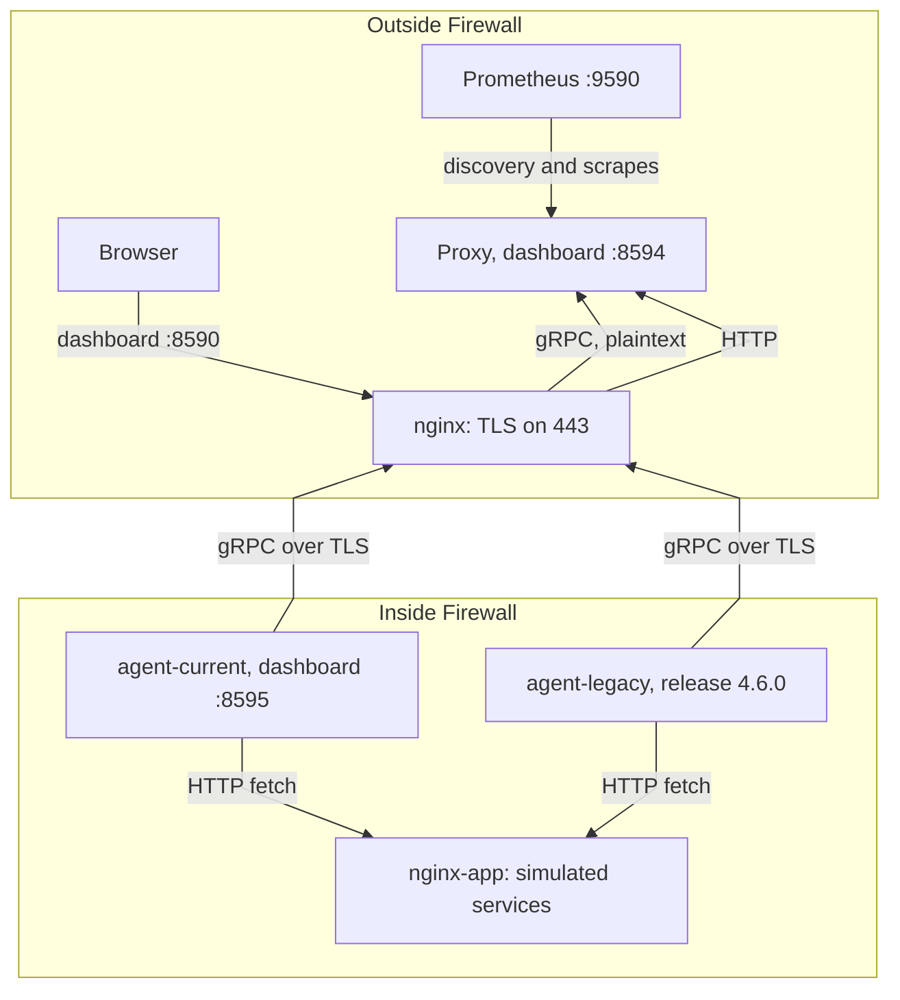

# nginx Demo

The [Basics Demo](basics-demo.md) and the [Network Demo](network-demo.md) connect the agents straight to the proxy.
This third demo puts [nginx](https://nginx.org/) between them, as the reverse proxy many sites put in front of a
service to end its TLS on one port, and in front of the proxy's dashboard. It shows what nginx's stream timeouts do to
an agent from before the proxy's stream keepalives, a stream timeout shorter than the keepalive, why a reload of nginx
doesn't reach an agent that's connected, and what nginx has to pass on for the dashboard's live updates. Every
screenshot on this page comes from it. [Nginx Reverse Proxy](advanced.md#nginx-reverse-proxy) is the guide to the
same setup.



## What You Need

The proxy and agent are the latest release's images, from Docker Hub, the same ones the other demos run, so there's
nothing to build, and agent-legacy is release 4.6.0's image. On macOS or Linux, the demo needs only:

- [Docker](https://docs.docker.com/get-started/get-docker/) with Compose v2: Docker Desktop, or Docker Engine with the
  Compose plugin.
- `git`, to clone the repository, and GNU `make`. On macOS, the Xcode command-line tools (`xcode-select --install`)
  have both. Where GNU make is installed as `gmake`, type `gmake` wherever these instructions say `make`.
- `curl`, which the demo uses to wait for each service to answer.
- A web browser.

## Running It

Clone the repository at the latest release, then run the demo's commands from its own directory, where `make help` lists
its targets:

```bash
git clone -c advice.detachedHead=false --depth 1 --branch 4.7.0 https://github.com/pambrose/prometheus-proxy.git
cd prometheus-proxy/demos/nginx
make up      # pulls the images, starts everything, prints the URLs
make tour    # walks through every scenario below, pausing before each step
make down    # stops it and removes its containers and network
```

The first `make up` pulls the proxy, agent, nginx, Prometheus, and Python images, which takes a few minutes. After that
it starts in under a minute, and runs without a network connection.

| What | URL | Port variable |
|---|---|---|
| Proxy dashboard | <http://localhost:8594/dashboard> (its history at `/activity`) | `NGINX_DEMO_DASHBOARD_PORT` |
| The proxy dashboard, through nginx | <http://localhost:8590/dashboard> | `NGINX_DEMO_NGINX_PORT` |
| agent-current's dashboard | <http://localhost:8595/dashboard> (its connection at `/connection`, its history at `/activity`) | `NGINX_DEMO_AGENT_DASHBOARD_PORT` |
| Prometheus | <http://localhost:9590> | `NGINX_DEMO_PROMETHEUS_PORT` |
| The proxy's service discovery | <http://localhost:8580/discovery> | `NGINX_DEMO_PROXY_PORT` |

Each port is the [Basics Demo](basics-demo.md)'s plus 500, so the demos can run side by side. If a port is already
taken, set its variable from the table for `make up`, for example `NGINX_DEMO_PROMETHEUS_PORT=9591 make up`. `make up`
saves it in `docker/.env`, which every later command and docker compose read, so you set it once; delete its line there
to go back to the default. The proxy dashboard's link into Prometheus keeps the default port (`config/proxy.conf`).

Every port binds to `127.0.0.1` only. The dashboards run without their login, so this setup is for a laptop, not for
anything shared.

## What's Running

| Service | Role |
|---|---|
| `proxy` | The proxy, outside the firewall, with its [transport filter](configuration/proxy.md#transport-filter) off, as it must be behind a reverse proxy, its dashboard and [service discovery](service-discovery.md) on, and an identity for each agent. |
| `nginx` | The agents' entrance, TLS on port 443 with the repository's test certificate, which passes their gRPC calls to the proxy's agent port, and the dashboard's entrance, on port 8590. The scenarios swap each entrance's config and reload nginx. |
| `agent-current` | An agent of this release, beside a web storefront. It and the proxy send a keepalive on each stream between them after 30 seconds of quiet. Its [dashboard](agent-dashboard.md) is on, on port 8595. |
| `agent-legacy` | An agent of release 4.6.0, beside a warehouse, from before the stream keepalives, to show what an agent without them goes through behind nginx. It has no dashboard, which came later. |
| `nginx-app` | The simulated services, with small metrics. |
| `prometheus` | Scrapes both agents' paths through the proxy every 5 seconds, and the proxy's own metrics directly. |

## Scenarios

`demo.sh`, in `demos/nginx`, drives the scenarios below. Run it from that directory, where `make up` started the demo;
each command prints what to watch. `./demo.sh reset` puts nginx and the proxy back as `make up` starts them.

### Two Agents Reach the Proxy through nginx, over TLS

Each agent dials nginx at `nginx.test.google.fr:443` over TLS, and checks nginx's certificate against that name: the
certificate names `*.test.google.fr`, and the agent trusts the CA that signed it,
`agent.tls.trustCertCollectionFilePath`. nginx ends the TLS and passes each gRPC call to the proxy's agent port,
which only nginx can reach.

<figure markdown="span">
  { loading=lazy }
  { loading=lazy }
  <figcaption>Behind nginx, the proxy lists each agent at the address Unknown, and by the identity its token names</figcaption>
</figure>

nginx relays each agent's calls over connections of its own, so the proxy can't watch an agent's connection, as its
transport filter does, and both the proxy and the agents turn the filter off. The proxy then learns an agent has gone
when the agent's stream of scrape requests ends, and ties each agent's calls to the identity its token names, so each
agent has a token of its own.

```bash
./demo.sh nginx-log      # the last gRPC calls nginx passed to the proxy, by agent
```

An agent connects with three calls, `connectAgentWithTransportFilterDisabled`, `registerAgent`, and `registerPath` for
each path, and then keeps its streams open, four for an agent of this release and three for one of 4.6.0, which nginx
logs only when they end.

nginx counts all an agent sends on a stream as one request body, and stops a body at `client_max_body_size`, 1 MB by
default. A stream of results stays open while the agent is connected, so behind nginx's default, every agent is cut off
with 413 each time its results add up to a megabyte. Every entrance in the demo turns the limit off with
`client_max_body_size 0`, as any nginx in front of the proxy needs; see
[Nginx Reverse Proxy](advanced.md#nginx-reverse-proxy).

### nginx's Stream Timeouts Cut Off an Agent from 4.6.0 Every Minute

This part is for you if the proxy or any agent you run behind nginx, or another reverse proxy, is on 4.6.0 or earlier,
as happens while you upgrade one before the other: keepalives flow only when both ends are newer, so such a pair goes
without them. What you'd see is an agent that drops about once a minute, even while it's scraped, and scrapes that fail
now and then while it reconnects. agent-legacy shows that, and agent-current, behind the same nginx, shows the
keepalives preventing it.

nginx closes a stream that carries nothing for 60 seconds: its `grpc_read_timeout` covers the streams the proxy sends
on, scrape requests and path notices, and `client_body_timeout` the streams the agent sends results on. An agent's
stream for results sent in chunks carries something only when a result is over 32 KB gzipped, so it's quiet even while
Prometheus scrapes the agent every 5 seconds.

<figure markdown="span">
  { loading=lazy }
  { loading=lazy }
  <figcaption>agent-legacy disconnects about once a minute, its stream ended by nginx; agent-current doesn't</figcaption>
</figure>

agent-current and the proxy send a keepalive on each stream after 30 seconds of quiet. agent-legacy predates them, and
the proxy, seeing it doesn't take them, sends it none, so nginx cuts it off every minute, and a scrape that lands while
it reconnects fails: `up{job="warehouse"}` dips to 0 now and then, and
`increase(proxy_agent_disconnects_total{reason="stream_terminated"}[1m])` climbs to about 1.

```bash
./demo.sh nginx-long-timeouts   # raises both timeouts to a day, and reloads nginx
```

agent-legacy is cut off once more, by the worker it's on, which keeps the old timeouts, then reconnects to a new worker
under the day-long ones and stays connected. For an agent or a proxy from 4.6.0 or earlier, raising both timeouts is
the fix short of upgrading both.

### A Shorter Stream Timeout, and a Reload That Doesn't Reach Connected Agents

Some load balancers close a quiet connection sooner than nginx's 60 seconds.

```bash
./demo.sh nginx-short-timeouts     # both timeouts cut to 20 seconds, and a reload: agent-current isn't cut off
./demo.sh nginx-workers            # the old workers, shutting down, that hold the agents' connections
./demo.sh nginx-shutdown-timeout   # worker_shutdown_timeout 10s, and a restart of nginx
```

A reload is how nginx takes a new config without dropping a connection: it starts new workers under the new config,
and tells the old ones to take no new connections and to exit once the ones they have end. An old worker keeps those
connections under the config they opened with, and an agent's connection, whose streams the keepalives keep open,
doesn't end. So the 20-second timeouts don't reach agent-current, and each reload leaves more old workers.
`worker_shutdown_timeout` has an old worker close the connections it still has after 10 seconds. A worker takes it
from the config it started with, so it covers the reloads after it's in place, and a restart brings it in. Then a
reload reaches every agent within 10 seconds, at the cost of one reconnect each.

<figure markdown="span">
  { loading=lazy }
  { loading=lazy }
  <figcaption>Under 20-second timeouts, agent-current is cut off about every 20 seconds, before its keepalive comes</figcaption>
</figure>

Under the 20-second timeouts, agent-current is cut off about every 20 seconds. Two of its streams go quiet for 20
seconds before their keepalives come, at 30: its stream for results in chunks, which nginx ends with 408, from
`client_body_timeout`, and the proxy's stream of path notices to it, which nginx ends with 504, from
`grpc_read_timeout`, the reason its Activity view shows.

```bash
./demo.sh keepalive 10   # the proxy recreated with a keepalive interval of 10 seconds
./demo.sh reset
```

The proxy sets the interval for both directions, `proxy.internal.streamKeepAliveSecs`: it uses it on the streams it
sends on, and gives it to each agent as it registers. At 10 seconds, agent-current logs `Sending stream keepalives to
proxy nginx.test.google.fr after 10s without a result`, and stays connected. Keep the interval under the shortest idle
timeout between the agents and the proxy.

### The Dashboard behind nginx

The proxy's dashboard updates live over a WebSocket, which a reverse proxy has to pass on.

<figure markdown="span">
  { loading=lazy }
  { loading=lazy }
  <figcaption>Through a plain proxy_pass, the page loads, but its live indicator stays on reconnecting</figcaption>
</figure>

A plain `proxy_pass` passes each request as HTTP/1.0 and drops the `Upgrade` and `Connection` headers, so the
dashboard can't take the WebSocket handshake, and answers 400.

```bash
./demo.sh dashboard-upgrade   # passes the WebSocket handshake's headers, over HTTP/1.1
./demo.sh dashboard-host      # passes the browser's Host header too
```

With the headers, the dashboard still refuses the WebSocket, now with 403: the `Host` nginx passes is the upstream's
name, `proxy:8094`, while the browser's `Origin` names `localhost:8590`, and the dashboard takes a WebSocket, and any
POST, only from a page of its own. The proxy logs `Refused a dashboard request from origin http://localhost:8590; add
it to proxy.dashboard.allowedOrigins if expected`. Passing the browser's `Host` with
`proxy_set_header Host $http_host` (`$host` drops the port), or listing the address in
`proxy.dashboard.allowedOrigins`, puts the page live.

<figure markdown="span">
  { loading=lazy }
  { loading=lazy }
  <figcaption>With the WebSocket's headers and the browser's Host passed on, the dashboard updates through nginx</figcaption>
</figure>

## Scenario Reference

| Command | Effect | How it works |
|---|---|---|
| `demo.sh nginx-log [n]` | Shows the last n gRPC calls nginx passed to the proxy (default 12), by agent | Reads nginx's access log, a line per call as it ends, and names each agent by its address |
| `demo.sh nginx-stock` | The agents' entrance with nginx's default stream timeouts, 60 seconds | Copies `nginx/agents-stock.conf` in as `conf.d/agents.conf` and reloads nginx |
| `demo.sh nginx-long-timeouts` | Both stream timeouts raised to a day | `nginx/agents-long-timeouts.conf`: `client_body_timeout` and `grpc_read_timeout` of `1d` |
| `demo.sh nginx-short-timeouts` | Both stream timeouts cut to 20 seconds | `nginx/agents-short-timeouts.conf`: both at `20s` |
| `demo.sh nginx-workers` | Lists nginx's processes, the old workers a reload left among them | `ps` in the nginx container |
| `demo.sh nginx-shutdown-timeout` | nginx's old workers close their connections 10 seconds after a reload | Copies `nginx/main-shutdown-timeout.conf` (`worker_shutdown_timeout 10s`) into `main.d` and restarts nginx |
| `demo.sh keepalive <secs>` | The proxy's stream keepalive interval, for both directions | Stops nginx, recreates the proxy with `-Dproxy.internal.streamKeepAliveSecs=<secs>`, and starts nginx again, which looks up the new proxy's address |
| `demo.sh dashboard-stock` | The dashboard's entrance as a plain `proxy_pass` | `nginx/dashboard-stock.conf` in as `conf.d/dashboard.conf`, and a reload |
| `demo.sh dashboard-upgrade` | The same, passing the WebSocket handshake's headers | `nginx/dashboard-upgrade.conf`: HTTP/1.1, `Upgrade`, and `Connection` |
| `demo.sh dashboard-host` | The same, passing the browser's `Host` too | `nginx/dashboard-host.conf`: `proxy_set_header Host $http_host` |
| `demo.sh reset` | nginx and the proxy as `make up` starts them | The stock configs, no `worker_shutdown_timeout`, a restart of nginx if anything differed, and the default keepalive |
| `make tour [PART=n]` | Walks through every scenario, from part 1 or the one given, pausing before each step |  |
| `make status` | The containers, nginx's configs in use, its old workers, the proxy's keepalive, and the URLs |  |
| `make logs [SERVICE=name]` | Follows the logs, of every service or the one given |  |
| `make open` | Opens the proxy dashboard, directly and through nginx, agent-current's dashboard, and a Prometheus graph of whether each agent's path answered |  |

`reset` undoes every scenario. For a clean slate, `make down && make up`.

## Going Further

- The demo's [README](https://github.com/pambrose/prometheus-proxy/tree/master/demos/nginx) has these scenarios as
  a guided tour, explaining how each one works, and lists the files that set the demo up, nginx's configs among them.
- [Nginx Reverse Proxy](advanced.md#nginx-reverse-proxy) covers the settings this demo uses, for your own nginx.
- [Web Dashboard](web-dashboard.md#behind-a-reverse-proxy) covers putting the dashboard behind a reverse proxy.
- The other demos, in the order the [Demos](demos/index.md) page gives them:
    - [Basics Demo](basics-demo.md): the whole system on one machine, the proxy and its dashboard, three agents behind
      a simulated firewall, Prometheus, and Grafana
    - [Network Demo](network-demo.md): a simulated WAN between the agents and the proxies, and what a far, thin, dead,
      flaky, or missing link does
    - [Kubernetes Demo](kubernetes-demo.md): the Helm charts on two kind clusters, with Kubernetes doing the operating
      and the target cluster exposing nothing
    - [Ktor Demo](ktor-demo.md): a coffee shop, a Ktor app that runs the agent in its own JVM through the Ktor plugin
    - [Spring Boot Demo](spring-boot-demo.md): a roastery, a Spring Boot app in Java whose agent the starter starts
      from properties
    - [Plain Kotlin Demo](plain-kotlin-demo.md): a bakery's ovens, workers with no framework or HTTP server, each
      reading its own metrics in-process
