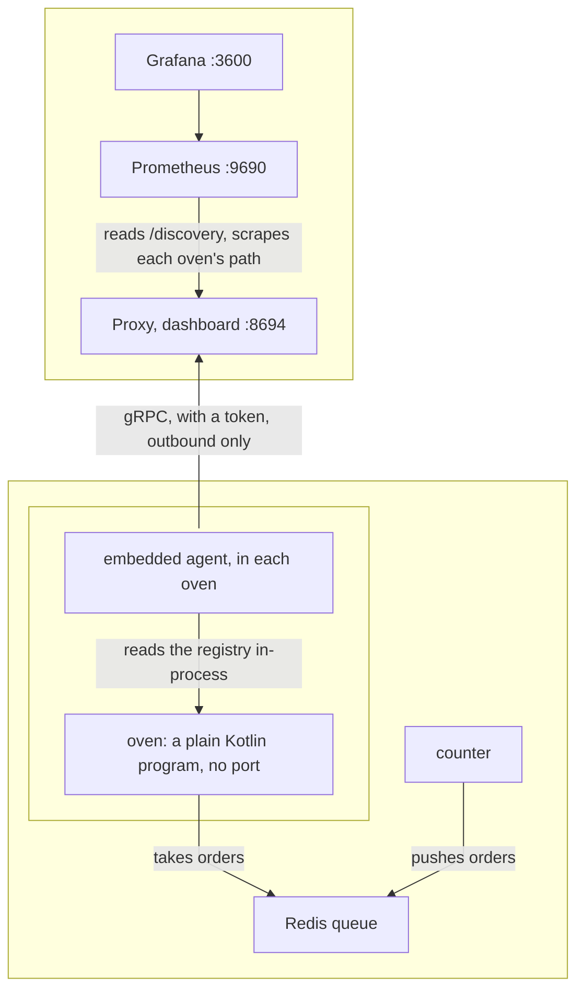

# Plain Kotlin Demo

The repository ships a demo of the agent [embedded](embedded-agent.md) in a plain Kotlin program, with no framework
and no HTTP server: a bakery's ovens, workers that take orders from a Redis queue. A worker, such as a queue consumer,
a scheduler, or a daemon, often has no HTTP server at all, so reading its metrics in-process is the only way to get them
to Prometheus without opening a port. Each oven's agent reads the oven's metrics from the Prometheus Java client's
registry and sends them out to a proxy, which Prometheus scrapes.

It shows:

- the agent wired into a plain program, in a few lines of its `main`;
- a worker that listens on no port, scraped through the proxy all the same;
- one Prometheus target for each oven, found through the proxy's service discovery as ovens are added and stopped;
- an oven that starts with no proxy, or with a setting the agent rejects, and bakes all the same.

The [Ktor Demo](ktor-demo.md) runs the agent in a Ktor app, with its own dashboard, TLS, and secrets from the
environment, and the [Spring Boot Demo](spring-boot-demo.md) in a Spring Boot app.



## Running It

On macOS or Linux, the demo needs [Docker](https://docs.docker.com/get-started/get-docker/) with Compose v2, `git`, GNU
`make`, and `curl`, as the [Demos](demos/index.md) page says.

`make up` runs the latest release's proxy image, from Docker Hub, and builds the oven inside Docker against the latest
release's library, from Maven Central, so it needs no JDK. Until a release with everything the demo shows is on Docker
Hub, it builds from the checkout instead, which needs a JDK 17 or later, as `make up-local` always does.

Clone the repository at the latest release, then run the demo's commands from its own directory, where `make help` lists
its targets:

```bash
git clone -c advice.detachedHead=false --depth 1 --branch 4.7.1 https://github.com/pambrose/prometheus-proxy.git
cd prometheus-proxy/demos/plain-kotlin
make up      # builds the oven, starts everything, prints the screens page's URL
make tour    # walks through the scenarios below, pausing before each step
make down    # stops it and removes its containers and network
```

The first `make up` pulls the images and builds the oven, which takes a few minutes. After that it starts in under a
minute.

Then open the proxy's [screens page](web-dashboard.md#screens), <http://localhost:8694/>, one browser tab that holds
every screen in the demo, each in a tab of its own: the proxy's dashboard, Grafana, and Prometheus. The ovens have none:
they serve nothing. `make open` opens it, and the tour's links open in it.

Each screen also has an address of its own, which the table gives with the variable that moves its port:

| What | URL | Port variable |
|---|---|---|
| The screens page, every screen in one tab | <http://localhost:8694/> | `PLAIN_KOTLIN_DEMO_DASHBOARD_PORT` |
| Proxy dashboard | <http://localhost:8694/dashboard> | `PLAIN_KOTLIN_DEMO_DASHBOARD_PORT` |
| Grafana (no sign-in needed; admin / admin to edit) | <http://localhost:3600> | `PLAIN_KOTLIN_DEMO_GRAFANA_PORT` |
| Prometheus's targets | <http://localhost:9690/targets> | `PLAIN_KOTLIN_DEMO_PROMETHEUS_PORT` |
| The proxy's service discovery | <http://localhost:8680/discovery> | `PLAIN_KOTLIN_DEMO_PROXY_PORT` |

Each port is the [Basics Demo](basics-demo.md)'s plus 600, so the demos can run side by side. If a port is already
taken, set its variable from the table for `make up`, for example `PLAIN_KOTLIN_DEMO_GRAFANA_PORT=3601 make up`. `make
up` saves it in `docker/.env`, which every later command and docker compose read, so you set it once; delete its line
there to go back to the default.

Every port binds to `127.0.0.1` only, and the ovens and Redis publish none. The proxy's dashboard has no authentication,
and Grafana uses its default admin password, so this setup is for a laptop, not for anything shared.

## What's Running

| Service | Role |
|---|---|
| `oven` | The worker: a plain Kotlin program, with no framework or HTTP server, that takes orders from the Redis queue and bakes them one at a time, about two a second, counting them in the Prometheus Java client's default registry. The agent runs inside it, and reads the registry in-process. `./demo.sh scale` runs 1 to 5 of them. |
| `redis` | The order queue, a Redis list, which every oven takes from. Not published on the host. |
| `counter` | Where the customers' orders come in: a steady trickle onto the queue, about one and a half a second, which one oven keeps up with. `./demo.sh rush` adds 500 more. |
| `proxy` | The stock proxy image, with a token the ovens' agents present, and its service discovery on. Its agent port is reachable only on the compose network; its dashboard is on. |
| `prometheus` | One job that reads the proxy's service discovery, so each oven is a target of its own, and the proxy's own metrics. |
| `grafana` | Opens on the Bakery dashboard, which links to the two dashboards the project ships. |

## The Worker's Code

The oven's `main`, in
[`Main.kt`](https://github.com/pambrose/prometheus-proxy/blob/master/demos/plain-kotlin/app/src/main/kotlin/bakery/Main.kt),
builds the oven, adds a shutdown hook, and runs the oven with the agent beside it:

=== "Kotlin"

    ```kotlin
    --8<-- "demos/plain-kotlin/app/src/main/kotlin/bakery/Main.kt:main"
    ```

=== "Java"

    ```java
    --8<-- "PlainKotlinDemoJavaExample.java:plain-kotlin-java"
    ```

- **[`fromEnvironment()`](embedded-agent.md#settings-from-the-environment)** reads the proxy and the token from
  `PROMETHEUS_PROXY` and `PROMETHEUS_AGENT_TOKEN`, which the demo's compose file sets.
- **[`source(path, registry)`](embedded-agent.md#metrics-served-in-process)** serves the Prometheus Java client's
  default registry, where the oven's `Counter`, `Gauge`, and `Histogram` are, read in-process on each scrape, and
  **[`agentMetricsAt(path)`](embedded-agent.md#the-agents-own-metrics)** the agent's own metrics, at a path of their own.
  Both paths are named after the oven's host name, so each oven's are its own: `replicaName()`, below `main`, reads
  `HOSTNAME`, which Docker sets to the container's ID, or else, as on a developer's machine, whose shell doesn't
  usually export it, takes the machine's host name, with any character but a letter, a digit, `.`, `_`, or `-` made a
  `-`, since a path can't hold whitespace, `?`, or `#`.
- **[`startIfConfigured()`](embedded-agent.md#starting-where-theres-a-proxy)** starts the agent where a proxy is set,
  and returns `null`, having logged why, where there isn't one or the agent can't start. `use { }` takes a `null` handle
  too, so the oven runs either way, and the agent stops when it returns.
- **The shutdown hook** is there because on a SIGTERM the JVM runs its shutdown hooks and exits without returning from
  `main`. It tells the oven to stop, and waits for `main` to return: the oven finishes the order it's baking, takes no
  more, and returns, and then `use { }` stops the agent, which disconnects from the proxy. The agent registers no
  shutdown hook of its own, so it stops after the oven, not alongside it. The hook waits 25 seconds at most, short of
  the 30 Kubernetes gives a pod to stop. Once it's added, `main` mustn't call `exitProcess()` (`System.exit()` in
  Java), which waits for the hooks while this one waits for `main`, so the JVM would hang until the hook gives up.

The oven's build depends on `com.pambrose:prometheus-proxy`, which brings the registry's model, and the Prometheus Java
client's `prometheus-metrics-core` for its metrics. On every pull request, the project builds it against the checkout
(`make plain-kotlin-demo-check`), so a change to the API it uses that breaks it fails there.

The oven's build adds Logback, since the library brings neither an SLF4J provider nor a configuration, and its
`logback.xml` sets the agent's logging along with the oven's: INFO to the console, with gRPC's internals and Netty at
WARN. A plain program has no
framework to set logging up, and with no configuration Logback logs everything at DEBUG, gRPC and Netty included, which
would bury the lines `startIfConfigured()` logs. [Logging](embedded-debugging.md#logging) covers the agent's loggers.

## What This Demo Shows

Each part of the guided tour, `make tour`, makes one point. A part's name links to where this page covers it.

| Part | What it shows | Why it matters |
|---|---|---|
| 1. [A worker with no port at all](#a-worker-with-no-port) | A worker with no HTTP server and nothing listening is scraped anyway, through the agent its `main` starts | Queue consumers, schedulers, and daemons can be monitored with no port |
| 2. [The metrics in Grafana](#its-metrics-and-its-agents) | The worker's metrics and its agent's at paths of their own, each series served once | No duplicate series, and no metrics port for the agent |
| 3. [A rush, and two more ovens clear it](#scaling-out-and-in) | A backlog builds, and two more workers register paths of their own and clear it | Scaling out needs no change to Prometheus |
| 4. [Scaling in stops ovens cleanly](#scaling-out-and-in) | On SIGTERM, each worker finishes its order, then its agent disconnects and its paths leave discovery | Scaling in loses no work, and Prometheus stops scraping the stopped workers by itself |
| 5. [No proxy, no outage](#no-proxy-no-outage) | Workers with no proxy set, a bad certificate, or a refused token keep working, and log why | Trouble with metrics never stops the work |

## A Worker with No Port

`./demo.sh sockets` shows that compose publishes no port for the oven, and reads what the oven's JVM has open from
`/proc` in its container, the JVM being its process 1:

``` { .text .pp-output title="./demo.sh sockets" }
What the oven's JVM has open, from /proc in its container
  Listening:   nothing: no TCP port, UDP socket, or Unix socket
  Connected:   out to Redis, on port 6379
               out to the proxy's agent port, 50051
```

Prometheus scrapes the oven all the same. Its agent registered two paths with the proxy, `/oven_<id>_metrics` and
`/oven_<id>_agent_metrics`, and Prometheus's one job reads the proxy's service discovery, so its targets page lists both,
with the proxy's address, and its config names no oven:

```yaml
--8<-- "demos/plain-kotlin/prometheus/prometheus.yml:discovery"
```

## Its Metrics, and Its Agent's

`./demo.sh metrics` reads both paths through the proxy. The oven's has its `bakery_` series and no `agent_` series, and
the agent's has its `agent_` series and no `bakery_` series: the agent keeps its own metrics in the default registry
too, and a source of the default registry leaves them out, so each series is served once. Prometheus scrapes them as
two jobs, `oven` and `oven-agent`. Grafana's Bakery dashboard reads the first: the orders each oven bakes, the backlog
against the number of ovens, bake times, and how much of its time each oven spends baking. The project's Prometheus
Agents dashboard, linked from its top bar, reads the second.

## Scaling Out and In

One oven bakes about two orders a second, which keeps up with the counter's one and a half.

```bash
./demo.sh rush       # 500 more orders, ten a second
./demo.sh scale 3    # once the backlog has passed 200
./demo.sh scale 1    # once it has cleared
```

The backlog climbs by about nine orders a second while the rush lasts. Left to one oven, two a second against one and a
half coming in, it would reach nearly 500 and take about a quarter of an hour to clear. `./demo.sh scale 3` runs
`docker compose up --scale oven=3`: each new oven's agent registers its two paths, the proxy's service discovery lists
them at once, and Prometheus, which reads it every 5 seconds, scrapes each new oven as a target of its own, with no
change to its config. The three clear the backlog in about two minutes. The screens page shows the new ovens' paths
join the proxy dashboard's Paths view beside Grafana: <http://localhost:8694/screens#proxy/paths+grafana>

<figure markdown="span">
  { loading=lazy }
  { loading=lazy }
  <figcaption>The proxy's screens page: three ovens' paths beside the Bakery dashboard, as they clear the backlog</figcaption>
</figure>

`./demo.sh scale 1` stops the other two with SIGTERM, as a scale-in on Kubernetes or ECS does, and shows each one's
log:

``` { .text .pp-output title="A stopped oven's log" }
Stopping: the oven finishes the order it's baking, and takes no more
The oven is off, after baking 20 orders
Disconnected from proxy at proxy:50051
Terminated Agent{...}
```

The oven finishes the order it was baking, so no order taken from the queue is lost, and returns, and then `use { }`
stops its agent, which disconnects from the proxy. The proxy drops its paths at once: its `/discovery`, which
Prometheus follows, lists only the remaining oven's two, while the Paths view of its dashboard marks the stopped ovens'
paths `gone` and keeps them for an hour, so it's clear what left. Prometheus drops the stopped ovens' targets at its
next discovery refresh, within 5 seconds. A scrape that comes between the agent's disconnect and that refresh finds no
path and records `up` 0, as a terminating pod's can on Kubernetes; the Bakery dashboard's **Scrape up, by oven** shows
it, and the command says whether one did.

## No Proxy, No Outage

An oven's metrics aren't worth an outage. Three scenarios each start an oven with the agent's settings wrong, show its
log, and stop it, and each oven bakes:

- `./demo.sh no-proxy` starts one without `PROMETHEUS_PROXY`, as on a developer's machine. `startIfConfigured()` doesn't
  start the agent, and logs one line:

    ``` { .text .pp-output title="The oven's log" }
    INFO  i.p.a.EmbeddedAgentConfig - No proxy is set, so the Prometheus agent stays off
    ```

- `./demo.sh bad-cert` starts one whose `PROMETHEUS_PROXY_CERT` isn't a certificate. The agent rejects it as it starts,
  and `startIfConfigured()` logs why, naming the variable, without the PEM, and returns `null`:

    ``` { .text .pp-output title="The oven's log" }
    ERROR i.p.a.EmbeddedAgentConfig - The Prometheus agent could not start, so it stays off: Invalid configuration:
      PROMETHEUS_PROXY_CERT, read by fromEnvironment() for agent.tls.trustCertCollectionPem: trustCertCollectionPem
      is neither PEM text nor the base64 of PEM text
    ```

- `./demo.sh wrong-token` starts one with a token the proxy refuses. Nothing is wrong until the agent connects, so it
  starts, and the proxy refuses it with `UNAUTHENTICATED`. The agent logs that at ERROR once, naming where the token is
  set, and keeps retrying, at DEBUG. In the 20 seconds the scenario watches, the proxy refuses it about seven times,
  which `proxy_agent_auth_failures_total` counts, and the oven logs one:

    ``` { .text .pp-output title="The oven's log" }
    ERROR i.p.a.AgentGrpcService - The proxy at proxy:50051 refused the agent's token (StatusException:
      UNAUTHENTICATED: Missing or invalid agent token). Check that the agent has a token the proxy accepts: it's given
      with --agent_token, AGENT_TOKEN, or agent.agentToken, in that order of precedence, which an embedded agent's
      token() sets, and fromEnvironment() reads from PROMETHEUS_AGENT_TOKEN. The agent keeps retrying
    ```

## Scenario Reference

| Command | Effect | How it works |
|---|---|---|
| `demo.sh sockets` | Shows that the oven publishes no port and its JVM listens on none, and its targets in Prometheus | `docker port` of the oven, its JVM's sockets from `/proc/1/fd` and `/proc/net` in its container, and Prometheus's targets API |
| `demo.sh metrics` | Reads the oven's metrics, and its agent's, through the proxy, each at its own path | `curl` of the proxy's `/oven_<id>_metrics` and `/oven_<id>_agent_metrics` |
| `demo.sh rush` | 500 more orders, ten a second | `counter.sh rush 500`, run in the counter's container |
| `demo.sh scale <count>` | Runs 1 to 5 ovens; a scale-in stops the extra ovens with SIGTERM and shows their logs | `docker compose up --scale oven=<count>` to add ovens; `docker stop`, a SIGTERM, to stop the extra ones |
| `demo.sh no-proxy` | Starts an oven with no proxy set, shows its log, and stops it | Starts the compose service `oven-no-proxy` (profile `misconfigured`), with `PROMETHEUS_PROXY` unset |
| `demo.sh bad-cert` | Starts an oven whose `PROMETHEUS_PROXY_CERT` isn't a certificate, shows its log, and stops it | Starts the compose service `oven-bad-cert` (profile `misconfigured`) |
| `demo.sh wrong-token` | Starts an oven whose token the proxy refuses, shows its log, and stops it | Starts the compose service `oven-wrong-token` (profile `misconfigured`), whose `PROMETHEUS_AGENT_TOKEN` the proxy doesn't accept |
| `make tour [PART=n]` | Walks through every scenario, from part 1 or the one given, pausing before each step |  |
| `make status` | The containers, the ovens and their paths, the queue, and the URLs |  |
| `make logs [SERVICE=name]` | Follows the logs, of every service or the one given |  |
| `make open` | Opens the proxy's screens page, which holds its dashboard, Grafana, and Prometheus, in the browser |  |

## Going Further

- The demo's [README](https://github.com/pambrose/prometheus-proxy/tree/master/demos/plain-kotlin) has its guided tour
  and lists the files that set it up. The oven's code is in `demos/plain-kotlin/app`.
- [Embedded Agent](embedded-agent.md) covers the API the oven uses: the builder, the in-process sources, and
  `startIfConfigured()`.
- A job that finishes before Prometheus's next scrape, such as a nightly batch, needs the
  [Pushgateway](https://github.com/prometheus/pushgateway), not an agent: there's nothing left to scrape when Prometheus
  comes.
- The other demos, in the order the [Demos](demos/index.md) page gives them:
    - [Basics Demo](basics-demo.md): the whole system on one machine, the proxy and its dashboard, three agents behind
      a simulated firewall, Prometheus, and Grafana
    - [Network Demo](network-demo.md): a simulated WAN between the agents and the proxies, and what a far, thin, dead,
      flaky, or missing link does
    - [nginx Demo](nginx-demo.md): nginx between the agents and the proxy, its stream timeouts, its reloads, and TLS
      ended on one port
    - [Kubernetes Demo](kubernetes-demo.md): the Helm charts on two kind clusters, with Kubernetes doing the operating
      and the target cluster exposing nothing
    - [Ktor Demo](ktor-demo.md): a coffee shop, a Ktor app that runs the agent in its own JVM through the Ktor plugin
    - [Spring Boot Demo](spring-boot-demo.md): a roastery, a Spring Boot app in Java whose agent the starter starts
      from properties
